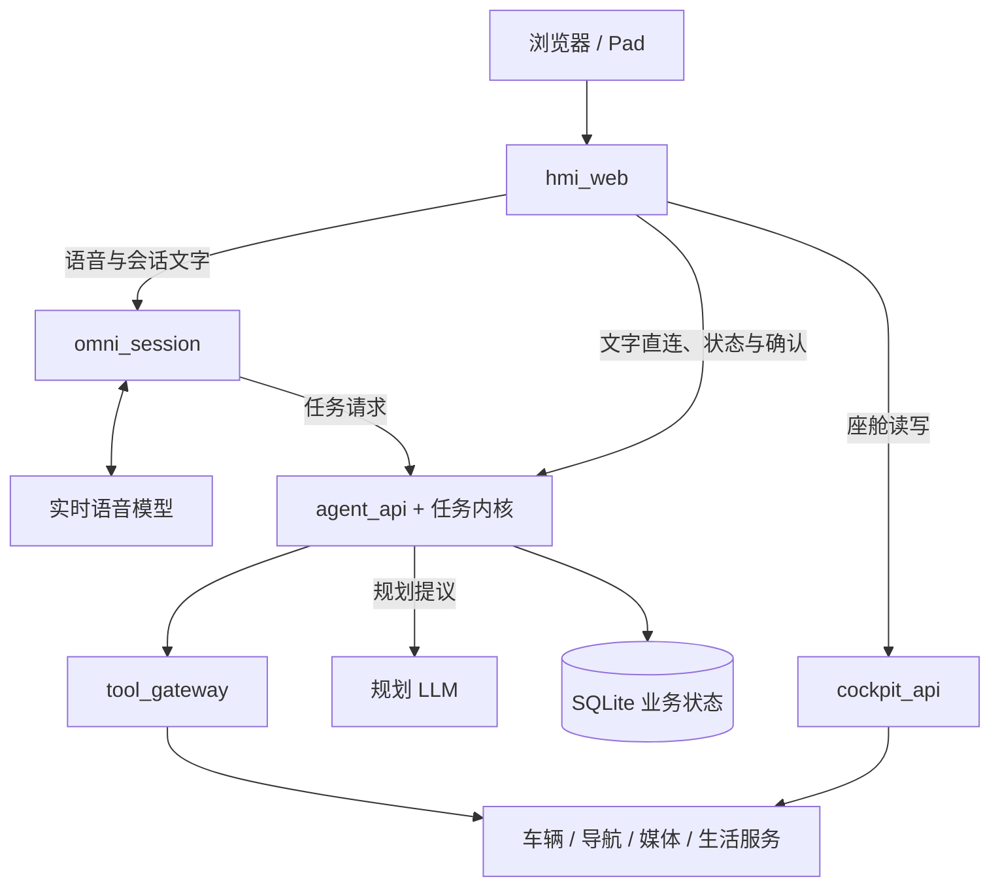

# 系统架构

AIDV Agent 将自然语言交互与任务执行分开：**模型理解需求、提议计划；本地确定性内核决定计划能否执行，以及状态如何推进。** 本页只描述总体关系，接口、配置与代码细节见[模块级架构说明](modules/system-architecture.md)及各专题页。

## 核心分工

| 部分 | 职责 |
| --- | --- |
| 交互与会话 | HMI 展示状态、接收触摸与文字；语音会话连接实时模型，处理对话、音频与任务分发。 |
| 任务内核 | 统一处理仲裁、规划校验、工具调度、用户确认与计划修改，并保存业务状态。 |
| 资源与工具 | 通过工具网关和领域服务接入车辆、导航、媒体与生活服务能力。 |

## 运行拓扑

`hmi_web` 是浏览器的同源入口，TLS 在此终结；`agent_api` 是任务内核的统一入口。语音不可用时，文字仍可经 HTTP 直连任务 API。图中的组件名表示源码职责，不代表实际部署主机。

## 任务如何推进

1. **接收与仲裁**：语音任务和文字任务汇入同一任务入口；符合快速路径的高频控制命令可直接执行，无需创建工作流。
2. **提议与校验**：规划模型提出计划，本地内核完成编译、参数校验与依赖检查，再决定是否接纳。
3. **执行与等待**：内核按依赖调度工具；遇到选择或确认边界时持久化 Gate，等待用户下一次请求后继续。
4. **返回与修改**：状态快照驱动 HMI 展示和语音播报；用户改主意时，通过 Patch 保留未受影响的状态、重算受影响的任务。

Gate 是持久化的用户交互边界，不依赖保持一个图调用挂起；任务可以推进到等待、完成或失败边界后返回。

## 关键边界

- **模型不掌握执行权**：Plan / Patch 只是提议，控制流、状态变更和确认规则由确定性代码裁定。
- **会话不装配内核**：`omni_session` 通过 `agent_api` 执行任务；对话状态、图执行临时状态与持久化业务状态分开管理。
- **领域知识集中声明**：领域适配器描述工具、Gate 与交接规则，内核消费统一契约；模型后端差异留在 Provider 适配层。
- **分层与验证约束扩展**：包依赖保持单向无环，纯决策与 I/O 编排分离；核心流程可通过离线替身验证，真实模型与外部服务另行验收。

## 深入阅读

- **服务与依赖**：[系统架构总览](modules/system-architecture.md)、[内核包 DAG 与分层契约](modules/kernel-dag.md)。
- **任务与状态**：[工作流生命周期与 Gate](modules/workflow-lifecycle.md)、[多域工具编排与 Patch](modules/tool-orchestration.md)、[状态存储与数据流](modules/state-storage.md)。
- **交互与模型**：[HMI 前端与调试台](modules/hmi-frontend.md)、[agent_api 后端服务](modules/agent-api.md)、[语音会话服务](modules/omni-session.md)、[LLM 规划与模型集成](modules/llm-integration.md)。
- **运行与扩展**：[部署、基础设施与验收](modules/deployment.md)、[扩展与定制](modules/extensibility.md)。
