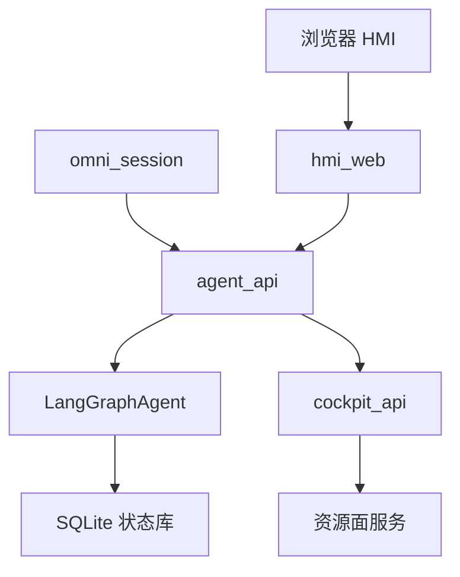
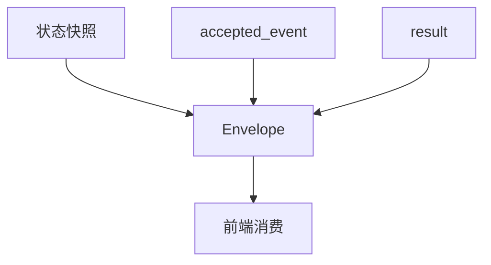
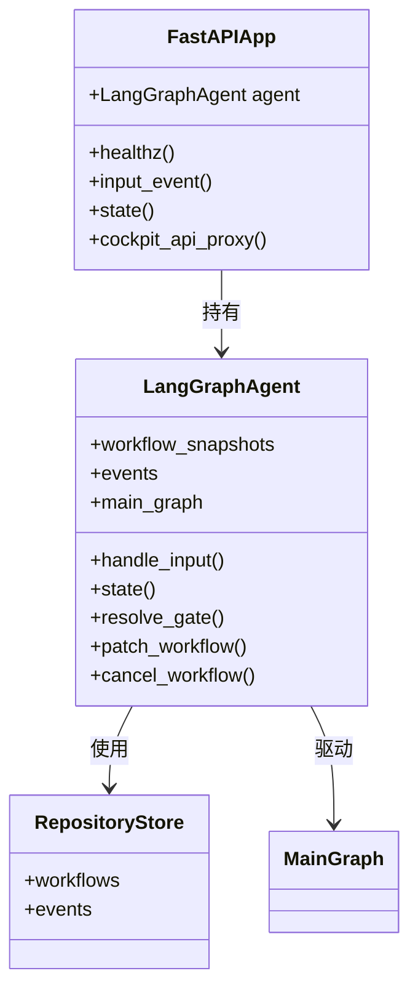
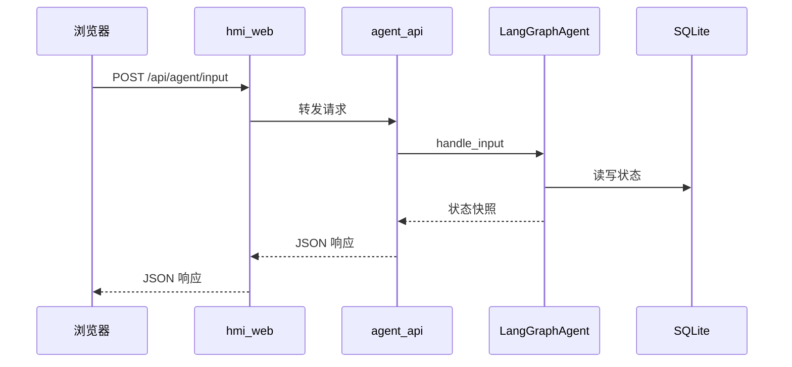
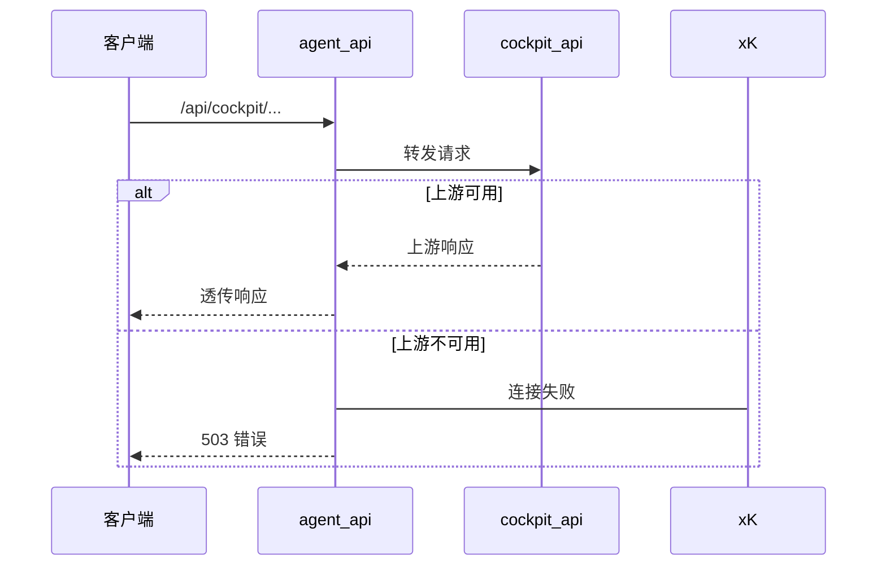
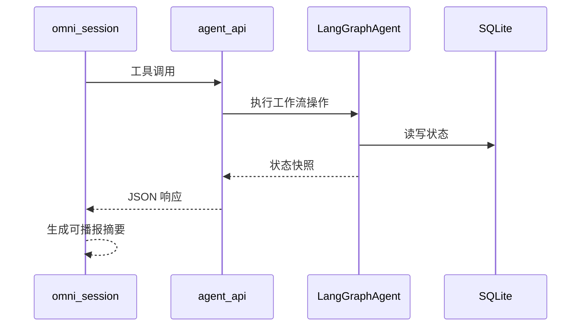

# agent_api 后端服务

<details>
<summary>Relevant source files</summary>

The following files were used as context for generating this wiki page:

- [services/agent_api/app.py](services/agent_api/app.py)
- [services/agent_api/__init__.py](services/agent_api/__init__.py)
- [src/aidv_agent/orchestrator/agent.py](src/aidv_agent/orchestrator/agent.py)
- [tests/contract/test_wire_payload_shape.py](tests/contract/test_wire_payload_shape.py)
</details>

# agent_api 后端服务

`agent_api` 是 AIDV Agent 的 API 面核心服务，也是内核装配点和唯一 ASGI 入口，负责对外提供 `/api/agent/*` 工作流接口。它通过 `LangGraphAgent` 暴露 `handle_input`、`state`、`resolve_gate`、`patch_workflow`、`cancel_workflow` 等能力，将 HMI 文本输入、语音会话工具调用、Gate 动作和 Patch 请求统一收敛到本地 LangGraph 工作流内核。`agent_api` 不承载浏览器 HTML Shell，而是以 API 服务形态存在，并附带只读调试台。  
Sources: [services/agent_api/__init__.py:1-2](), [src/aidv_agent/orchestrator/agent.py:1-65](), [services/agent_api/app.py:1-78]()

在部署拓扑中，`agent_api` 本地端口为 `18012`，Docker 宿主默认映射为 `18112`。`hmi_web` 作为浏览器面唯一 HTTPS 入口，会把 `/api/agent/*` 请求转发到 `agent_api`；`omni_session` 的语音任务执行器也会通过真实 HTTP 调用 `agent_api` 端点，而不是在进程内直接驱动内核。  
Sources: [README.md:1-87](), [compose.yaml:1-73](), [services/hmi_web/app.py:191-251](), [services/omni_session/shared/agent_api_tools.py:1-69]()

## 服务定位与运行拓扑

`agent_api` 位于 API 面，是 HMI、语音会话和调试台访问工作流内核的主要入口。它向下持有 `LangGraphAgent`，向上通过 FastAPI 暴露 JSON API，并代理部分 `/api/cockpit/*` 兼容请求到 `cockpit_api`。



该拓扑体现了 `agent_api` 的枢纽角色：HMI 的 `/api/agent/*` 数据请求经 `hmi_web` 转发；语音会话通过 `AgentApiTaskToolDispatcher` 调用 `agent_api`；`agent_api` 内部再驱动 `LangGraphAgent` 和 SQLite 状态存储。  
Sources: [services/hmi_web/app.py:191-251](), [services/omni_session/shared/agent_api_tools.py:1-69](), [src/aidv_agent/orchestrator/agent.py:1-65](), [services/agent_api/app.py:1-78]()

## 应用入口与运行时对象

`services/agent_api/app.py` 创建 FastAPI 应用，并在模块级初始化 `LangGraphAgent` 单例。应用标题固定为 `AIDV Agent API - Standalone LangGraph Runtime`，`COCKPIT_API_URL` 通过 `service_url` 从端口配置解析。

```python
agent = LangGraphAgent()
app = FastAPI(title="AIDV Agent API - Standalone LangGraph Runtime")
```

`healthz` 接口返回服务名、运行时后端、端口、状态存储类型和 `cockpit_api` 地址，表明该服务使用 LangGraph 运行时和 SQLite 状态存储。

```python
return {
    "status": "ok",
    "service": "agent_api",
    "runtime_backend": "langgraph",
    "port": AGENT_API_PORT,
    "state_store": "sqlite",
    "mock": False,
    "cockpit_api": COCKPIT_API_URL,
}
```

Sources: [services/agent_api/app.py:1-78](), [services/agent_api/app.py:55-130](), [tests/integration/test_gateway_compat.py:1-27]()

## API 端点

`agent_api` 的端点分为健康检查、调试台、工作流 API、调试状态 API 和 cockpit 兼容代理几类。契约测试锁定了若干冻结路由，确保 API 面不会重新混入 HTML Shell 路由。

| 路径 | 方法 | 说明 |
|---|---|---|
| `/healthz` | `GET` | 返回服务健康、运行时后端、端口、状态存储和 cockpit 地址 |
| `/debug` | `GET` | 重定向到 `/debug/` |
| `/debug/` | `GET` | 返回只读调试台 HTML，禁止缓存 |
| `/api/agent/state` | `GET` | 返回指定 session 和 workflow 的状态快照 |
| `/api/agent/input` | `POST` | 接收文本输入并驱动 `agent.handle_input` |
| `/api/agent/workflows/{workflow_id}` | `GET` | 返回指定 workflow 快照，不存在则 404 |
| `/api/agent/workflows/{workflow_id}/cancel` | `POST` | 取消 workflow，默认原因为 `hmi_cancel` |
| `/api/agent/workflows/{workflow_id}/patch` | `POST` | 冻结路由，用于 Patch 工作流 |
| `/api/agent/workflows/{workflow_id}/gates/{gate_id}/actions` | `POST` | 冻结路由，用于 Gate 动作 |
| `/api/agent/debug/state` | `GET` | 返回当前活动或最近终态 workflow 的状态 |
| `/api/cockpit/{path}` | `GET/POST/PUT/PATCH/DELETE` | 代理 cockpit 兼容请求到 `cockpit_api` |

Sources: [services/agent_api/app.py:55-130](), [services/agent_api/app.py:194-239](), [tests/integration/test_gateway_compat.py:1-27]()

`tests/integration/test_gateway_compat.py` 明确验证 `agent_api` 不包含 `/`、`/pad/` 等 HTML Shell 路由，同时要求保留 `/healthz`、`/debug/`、`/api/agent/input`、`/api/agent/state`、`/api/agent/workflows/{workflow_id}/patch` 和 `/api/agent/workflows/{workflow_id}/gates/{gate_id}/actions`。  
Sources: [tests/integration/test_gateway_compat.py:1-27]()

## 请求模型

`agent_api` 使用 Pydantic 模型约束主要输入。`InputRequest` 用于文本输入，`GateActionRequest` 用于 Gate 动作，`PatchRequest` 用于工作流 Patch。

| 模型 | 字段 | 类型 / 约束 | 说明 |
|---|---|---|---|
| `InputRequest` | `text` | `str`, `min_length=1` | 用户文本输入 |
| `InputRequest` | `session_id` | `str \| None` | 会话 ID，缺省时自动生成 |
| `InputRequest` | `workflow_id` | `str \| None` | 可选 workflow ID |
| `InputRequest` | `event_id` | `str \| None` | 事件 ID |
| `InputRequest` | `idempotency_key` | `str \| None` | 幂等键 |
| `InputRequest` | `source` | `str`, 默认 `hmi_text` | 输入来源 |
| `GateActionRequest` | `event_id` | `str \| None` | 事件 ID |
| `GateActionRequest` | `idempotency_key` | `str \| None` | 幂等键 |
| `GateActionRequest` | `plan_version` | `int \| None` | 计划版本 |
| `GateActionRequest` | `state_version` | `int \| None` | 状态版本 |
| `GateActionRequest` | `action` | `str \| None` | Gate 动作 |
| `GateActionRequest` | `selected_index` | `int \| None` | 选中项索引 |
| `GateActionRequest` | `text` | `str \| None` | 可选文本 |
| `GateActionRequest` | `source` | `str`, 默认 `touch` | 动作来源 |
| `PatchRequest` | `text` | `str`, `min_length=1` | Patch 文本 |
| `PatchRequest` | `session_id` | `str` | 必填会话 ID |
| `PatchRequest` | `plan_version` | `int` | 必填计划版本 |
| `PatchRequest` | `state_version` | `int` | 必填状态版本 |
| `PatchRequest` | `event_id` | `str \| None` | 事件 ID |
| `PatchRequest` | `idempotency_key` | `str \| None` | 幂等键 |
| `PatchRequest` | `source` | `str`, 默认 `hmi_text` | 输入来源 |

`_session_id` 会在调用方未提供 `session_id` 时生成 `session_<16位hex>`，保证无会话输入也能进入内核。  
Sources: [services/agent_api/app.py:1-78](), [services/agent_api/app.py:55-130]()

## 错误处理策略

`agent_api` 对内核抛出的 `ValueError` 和 `RuntimeError` 做结构化 JSON 转换，避免返回空 500。

| 异常 | HTTP 状态 | 错误类型 | 说明 |
|---|---:|---|---|
| `ValueError` | `422` | `invalid_request_or_plan` | 非法输入或被拒绝的计划 |
| `RuntimeError` | `500` | `runtime_failure` | 运行时或 Provider 失败 |
| cockpit 上游不可用 | `503` | `cockpit_api_unavailable` | `/api/cockpit/*` 代理失败 |

```python
@app.exception_handler(ValueError)
async def value_error_handler(request: Request, exc: ValueError) -> JSONResponse:
    """Invalid input or rejected plan: structured JSON, never an empty 500."""
    return JSONResponse(
        status_code=422,
        content={"ok": False, "error": {"type": "invalid_request_or_plan", "message": str(exc)}},
    )
```

Sources: [services/agent_api/app.py:1-78](), [tests/integration/test_compat_proxy.py:45-89]()

## 状态载荷契约

`tests/contract/test_wire_payload_shape.py` 将前端消费面的线上载荷键集锁死。`agent.state()` 返回的 state 载荷必须严格包含 10 个键：

| State 键 | 说明 |
|---|---|
| `session_id` | 会话标识 |
| `session` | 会话信息 |
| `workflow` | 工作流数据 |
| `active_gate` | 当前活动 Gate |
| `artifacts` | 工件 |
| `handoffs` | 跨域交接 |
| `tool_trace` | 工具调用轨迹 |
| `trace` | 执行轨迹 |
| `fast_actions` | 快速动作 |
| `backend` | 后端信息 |

Envelope 响应在 state 基础上增加 `accepted_event` 和 `result`：

```text
ENVELOPE_KEYS = STATE_KEYS | {"accepted_event", "result"}
```

`result` 键集是跨路由并集，新增键必须显式扩展契约。Patch 是唯一裸 payload，其键集为：

```text
PATCH_KEYS = {"ok", "patch", "affected_task_ids", "outcome", "workflow", "answer"}
```



Sources: [tests/contract/test_wire_payload_shape.py:1-92]()

## LangGraphAgent 组合根

`LangGraphAgent` 是 `agent_api` 的核心对象，承担组合根、门面和事务边界三类职责。它负责装配服务、持有存储，并暴露给 `services/agent_api` 的公开 API 面。

| 职责 | 说明 |
|---|---|
| 组合根 | 装配服务、用例和存储 |
| 门面 | 暴露 `handle_input`、`state`、`resolve_gate`、`patch_workflow`、`cancel_workflow` |
| 事务边界 | 通过 `advance_to_boundary` 驱动 workflow 到下一相位边界 |

`LangGraphAgent.__init__` 会解析 `AIDV_PROJECT_ROOT` 和 `AIDV_AGENT_STATE_DB`，创建 `RepositoryStore`，并持有 `workflow_snapshots`、`events` 和 `main_graph`。默认状态库路径为 `.aidv/state/aidv_agent.sqlite3`。



Sources: [src/aidv_agent/orchestrator/agent.py:1-65](), [services/agent_api/app.py:1-78]()

## 输入与工作流执行流程

`/api/agent/input` 是 HMI 文本输入的主要入口。请求进入 `agent_api` 后，`_session_id` 会补齐会话 ID，然后调用 `agent.handle_input`。`LangGraphAgent` 再驱动主图、事件摄入、规划子图和工具分发，最终返回状态快照。



`hmi_web` 的 `/api/agent/{path}` 路由会把请求转发到 `AGENT_API_URL`，因此浏览器实际访问的是 `hmi_web`，但工作流执行仍落在 `agent_api`。  
Sources: [services/agent_api/app.py:55-130](), [services/hmi_web/app.py:191-251](), [src/aidv_agent/orchestrator/agent.py:1-65]()

## 调试台

`agent_api` 提供只读 workflow inspector。`/debug` 会重定向到 `/debug/`，`/debug/` 返回 `static/debug.html`，并设置 `Cache-Control: no-store`。

`/api/agent/debug/state` 用于调试台读取状态：当未指定 `workflow_id` 时，优先取当前活动 workflow，否则取最近终态 workflow。

调试视图接口支持以下 kind 映射：

| kind | workflow 字段 |
|---|---|
| `plan` | `plan_ir` |
| `artifacts` | `artifacts` |
| `handoffs` | `handoffs` |
| `scheduler` | `task_states` |
| `trace` | `trace` |

未知 kind 会返回 404 `unknown debug view`。  
Sources: [services/agent_api/app.py:55-130](), [services/agent_api/app.py:194-239](), [README.md:1-87]()

## Cockpit 兼容代理

`agent_api` 还保留 `/api/cockpit/{path}` 代理，用于让 HMI Shell 的状态卡片、地图配置和直接车控/媒体控制继续访问真实车辆服务。该代理只转发 `content-type` 和 `accept` 头，并使用 `httpx.AsyncClient` 请求 `COCKPIT_API_URL`。



当上游不可用时，代理返回 `503`，错误类型为 `cockpit_api_unavailable`。该行为由 `tests/integration/test_compat_proxy.py` 锁定。  
Sources: [services/agent_api/app.py:194-239](), [tests/integration/test_compat_proxy.py:45-89]()

## 语音会话执行路径

`omni_session` 的 `AgentApiTaskToolDispatcher` 是语音工具到 `agent_api` 的真实执行器。它不直接调用进程内内核，而是通过 HTTP 调用契约锁定的 `agent_api` 端点，再从返回的状态快照派生可播报摘要。

| 会话上下文 | 说明 |
|---|---|
| `session_id` | HMI cockpit 会话 ID，保证语音创建的工作流落入 HMI 轮询的同一会话 |
| `last_workflow_id` | 最近活动 workflow ID，用于模型丢失 `workflow_id` 时的回退 |
| `_TIMEOUT` | 连接 3 秒、读取 30 秒、写入 5 秒、连接池 5 |
| 错误纪律 | HTTP 4xx/5xx 或传输失败返回 `{"status": "error", ...}`，不伪造成功 |



`tests/integration/test_omni_task_pipeline.py` 使用真实 HTTP socket 启动 `agent_api`，并将 `LangGraphAgent` 替换为离线内核，以验证语音到任务脑的完整链路。  
Sources: [services/omni_session/shared/agent_api_tools.py:1-69](), [tests/integration/test_omni_task_pipeline.py:1-75]()

## 配置与部署

`agent_api` 的端口、绑定地址和状态库路径由端口配置与环境变量共同决定。`compose.yaml` 将容器内 `18012` 映射到宿主默认 `18112`，并设置 `AIDV_AGENT_API_BIND_HOST=0.0.0.0` 和容器内状态库路径。

| 配置项 | 来源 | 说明 |
|---|---|---|
| `AGENT_API_PORT` | `aidv_agent.ports` | `agent_api` 端口，`healthz` 返回该值 |
| `AIDV_AGENT_API_BIND_HOST` | `compose.yaml` | 容器内绑定地址，默认 `0.0.0.0` |
| `AIDV_AGENT_STATE_DB` | `compose.yaml` / `agent.py` | 状态库路径；compose 默认 `/var/lib/aidv/agent.sqlite3` |
| `AIDV_PROJECT_ROOT` | `agent.py` | 项目根目录，用于默认状态库路径 |
| `COCKPIT_API_URL` | `agent_api/app.py` | cockpit 代理目标地址 |
| `AIDV_HOST_AGENT_PORT` | `compose.yaml` | Docker 宿主端口，默认 `18112` |

| 平面 | 本地端口 | Docker 宿主端口 |
|---|---:|---:|
| API 面 `agent_api` | `18012` | `18112` |
| API 面 `cockpit_api` | `18011` | `18111` |
| API 面 `omni_session` | `18013` | `18113` |

Sources: [README.md:1-87](), [compose.yaml:1-73](), [src/aidv_agent/orchestrator/agent.py:1-65](), [services/agent_api/app.py:1-78]()

## 测试与契约覆盖

`agent_api` 的行为由多层测试锁定：

| 测试 | 覆盖点 |
|---|---|
| `tests/integration/test_gateway_compat.py` | 应用标题、API-only 路由、冻结路由 |
| `tests/contract/test_wire_payload_shape.py` | state、envelope、result、patch 载荷键集 |
| `tests/integration/test_compat_proxy.py` | `/api/cockpit/*` 代理透传和 503 错误 |
| `tests/integration/test_hmi_gateway.py` | HMI 到 `agent_api` 的代理转发 |
| `tests/integration/test_omni_task_pipeline.py` | 语音会话通过真实 HTTP 驱动 `agent_api` |

`test_gateway_compat.py` 保证 `agent_api` 不会重新暴露 HTML Shell 路由；`test_wire_payload_shape.py` 保证前端消费键集不漂移；`test_omni_task_pipeline.py` 保证语音链路仍然经过真实 `agent_api` HTTP 边界。  
Sources: [tests/integration/test_gateway_compat.py:1-27](), [tests/contract/test_wire_payload_shape.py:1-92](), [tests/integration/test_compat_proxy.py:45-89](), [tests/integration/test_hmi_gateway.py:1-101](), [tests/integration/test_omni_task_pipeline.py:1-75]()

## 总结

`agent_api` 是 AIDV Agent 中连接前端、语音会话和工作流内核的 API 服务。它通过 FastAPI 暴露 `/api/agent/*` 工作流接口，通过 `LangGraphAgent` 驱动 LangGraph 内核，通过 SQLite 保存状态，并通过结构化错误和契约测试保证线上载荷稳定。其核心边界是：HMI 和语音会话不直接操作内核，而是通过 `agent_api` 的 HTTP API 进入统一工作流执行面。  
Sources: [services/agent_api/__init__.py:1-2](), [services/agent_api/app.py:1-239](), [src/aidv_agent/orchestrator/agent.py:1-65](), [tests/contract/test_wire_payload_shape.py:1-92](), [services/omni_session/shared/agent_api_tools.py:1-69]()

---

**关联源文件:** `services/agent_api/app.py`, `services/agent_api/__init__.py`, `src/aidv_agent/orchestrator/agent.py`, `tests/contract/test_wire_payload_shape.py`
