# 部署、基础设施与验收

<details>
<summary>Relevant source files</summary>

The following files were used as context for generating this wiki page:

- [README.md](README.md)
- [compose.yaml](compose.yaml)
- [docker/Dockerfile.runtime](docker/Dockerfile.runtime)
- [docker/Dockerfile.dev](docker/Dockerfile.dev)
- [scripts/start_stack.sh](scripts/start_stack.sh)
- [scripts/stop_stack.sh](scripts/stop_stack.sh)
- [scripts/real_acceptance.sh](scripts/real_acceptance.sh)
</details>

# 部署、基础设施与验收

AIDV Agent 的部署、基础设施与验收体系围绕“可本地运行、可容器化、可离线验证、可真实探针”展开。项目提供本地 Python 栈与 Docker Compose 两种主要运行形态：本地栈面向开发调试，Docker 栈面向一键部署与 CI 冒烟；两者共享同一套端口契约、环境变量边界和服务入口约定。系统强调确定性内核与离线优先：无 key、无网、无外部服务时，核心回归仍可端到端跑通；真实 LLM、语音、高德、瑞幸、麦当劳、猫眼等外部能力则通过 `.env`、本地探针和 `evals/` 分层接入。

当前仓库状态明确为“离线部署语音已上线、全仓重构完成、简单端到端链路打通，但详细测试尚未完全覆盖，可能存在 bug”，因此部署与验收文档的重点是理解整体逻辑、契约边界和验证闭环，而不是生产级保证。Sources: [README.md:1-87](), [CHANGELOG.md:1-23]()

## 部署形态

### 本地 Python 栈

本地运行要求 Python 3.12，默认使用 `uv` 创建虚拟环境并安装可编辑包及测试/开发依赖。首次使用需要注册 `pre-commit` 钩子，使提交前自动执行卫生检查、ruff lint/format 和 commit message 格式检查。`.env` 从 `.env.example` 复制而来，不进入 Git；离线功能不依赖外部凭据即可运行。

```bash
cd <仓库根目录>

uv venv --python=3.12
uv pip install -e '.[test,dev]'

.venv/bin/pre-commit install
.venv/bin/pre-commit install --hook-type commit-msg

cp .env.example .env
./scripts/start_stack.sh
```

启动后，`agent_api` 是 API 面核心服务，探活地址为 `http://127.0.0.1:18012/healthz`；HMI 浏览器入口为 `https://127.0.0.1:8081/`，调试台为 `http://127.0.0.1:18012/debug/`。停栈通过 `./scripts/stop_stack.sh` 按 PID 目录停止服务并确认端口释放。

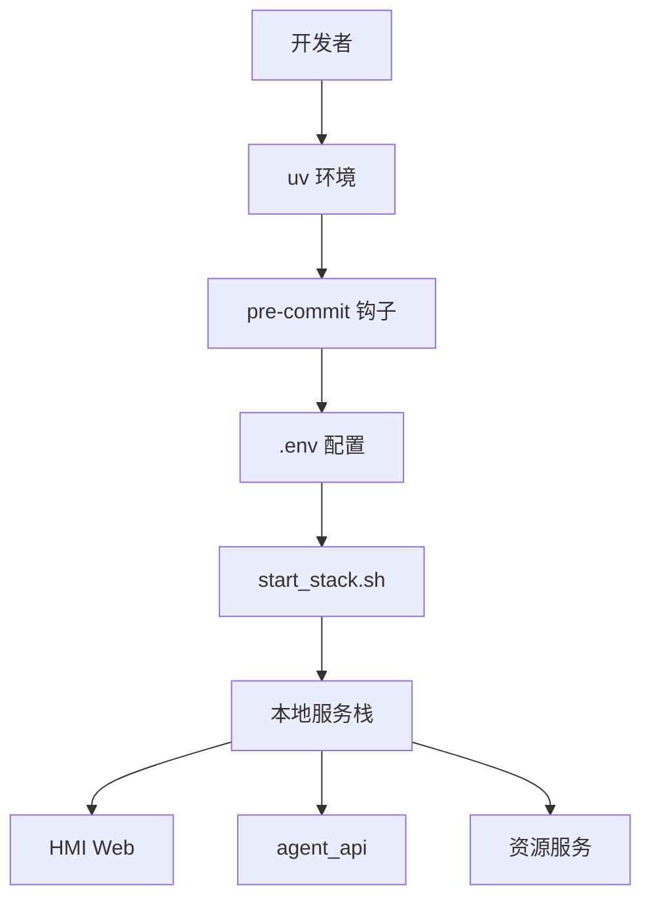

Sources: [README.md:1-87]()

### Docker Compose 栈

Docker 形态通过 `docker compose --profile core up -d --build aidv-agent` 构建并启动全栈。README 将其描述为 11 个服务，容器内具备自监督与 60 秒崩溃自愈能力。`compose.yaml` 片段展示了 `aidv-agent` 容器暴露 11 个宿主端口，并通过 `aidv-state`、`aidv-logs`、`aidv-tls` 三个 named volume 分别保存状态库、日志和 TLS 资产。

```bash
docker compose --profile core up -d --build aidv-agent
curl -fsS --noproxy 127.0.0.1 http://127.0.0.1:18112/healthz
```

Docker 宿主侧默认使用 +100 号段，避免与本地开发栈和隔离验收栈抢端口。容器内部端口与本地一致，仅宿主侧整体偏移。宿主端口可用 `AIDV_HOST_*` 环境变量覆盖。镜像依赖按 `requirements.lock` 精确安装；修改 `pyproject.toml` 后必须同步刷新 `uv.lock` 与 `requirements.lock`，CI 会校验双锁一致。网络受限时可通过 `PIP_INDEX_URL` 指定 PyPI 镜像，但所有下载仍按锁文件 hash 校验。

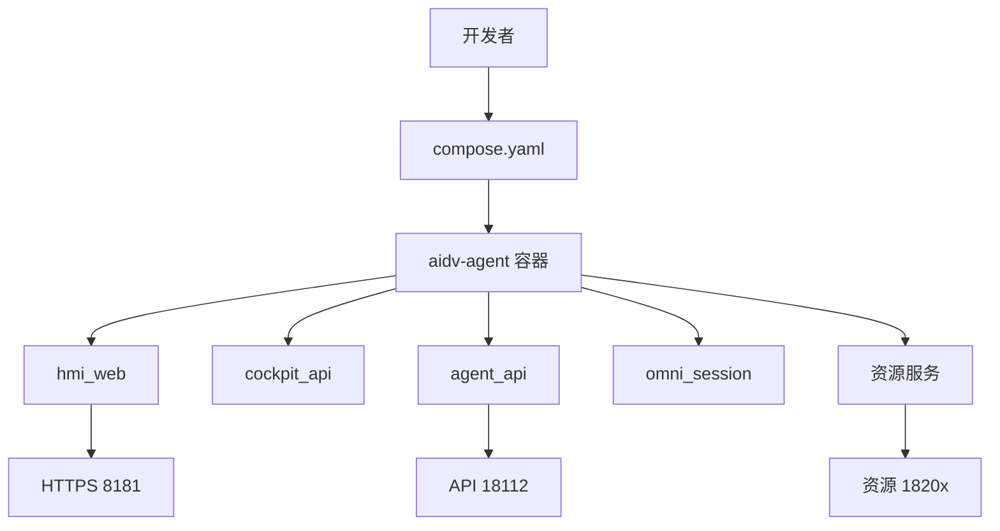

Sources: [README.md:1-87](), [compose.yaml:1-73]()

### 服务端口表

端口是部署基础设施的核心契约。浏览器面唯一对外入口是 `hmi_web`，本地端口 `8081`，Docker 宿主默认 `8181`；API 面使用 `1801x`，资源面使用 `1810x`。内部服务间使用明文 HTTP，TLS 只在 `hmi_web` 边缘终结。

| 服务 | 平面 | 本地端口 | Docker 宿主端口 |
|---|---|---:|---:|
| `hmi_web` | 浏览器面 | 8081 | 8181 |
| `cockpit_api` | API 面 | 18011 | 18111 |
| `agent_api` | API 面 | 18012 | 18112 |
| `omni_session` | API 面 | 18013 | 18113 |
| `online/navigation` | 资源面 | 18101 | 18201 |
| `tool_gateway` | 资源面 | 18102 | 18202 |
| `vehicle/context` | 资源面 | 18103 | 18203 |
| `vehicle/climate` | 资源面 | 18104 | 18204 |
| `vehicle/window` | 资源面 | 18105 | 18205 |
| `vehicle/seat` | 资源面 | 18106 | 18206 |
| `online/media` | 资源面 | 18107 | 18207 |

Sources: [README.md:73-147](), [compose.yaml:1-73]()

## 端口与入口契约

`src/aidv_agent/ports.py` 是服务端口的单一事实源。契约测试从四个方向锁死端口表：源码中不得硬编码服务 URL；`scripts/start_stack_impl.sh` 必须启动且只启动端口表中的服务；`compose.yaml` 容器侧端口必须与端口表一致；`docker/Dockerfile.runtime` 的 `EXPOSE` 必须与端口表一致。

`tests/contract/test_ports.py` 使用正则扫描 `src/` 与 `services/` 下的 Python 文件，禁止出现 `127.0.0.1:18xxx` 或 `127.0.0.1:8081` 这类硬编码服务地址，除非位于 `ports.py`。该约束迫使所有服务间调用从 `aidv_agent.ports` 导入端口，而不是散落硬编码。

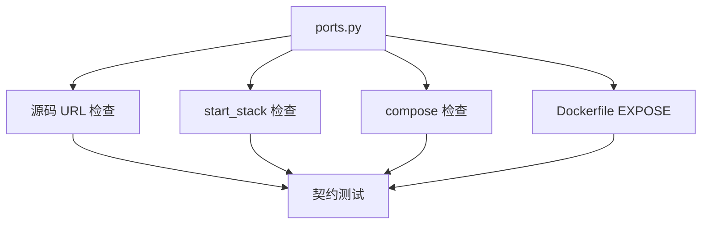

Sources: [tests/contract/test_ports.py:1-59](), [tests/contract/test_ports.py:42-71]()

入口契约还要求 README 可发现且无版本代号。`tests/contract/test_neutral_project_entrypoints.py` 检查 README 必须包含 `./scripts/start_stack.sh` 和 `https://127.0.0.1:8081/`，并且不得出现 `V9`、`v9`、`Legacy`、`legacy` 等历史代号。`scripts/start_stack.sh` 必须委托给 `start_stack_impl.sh`，并透传参数。

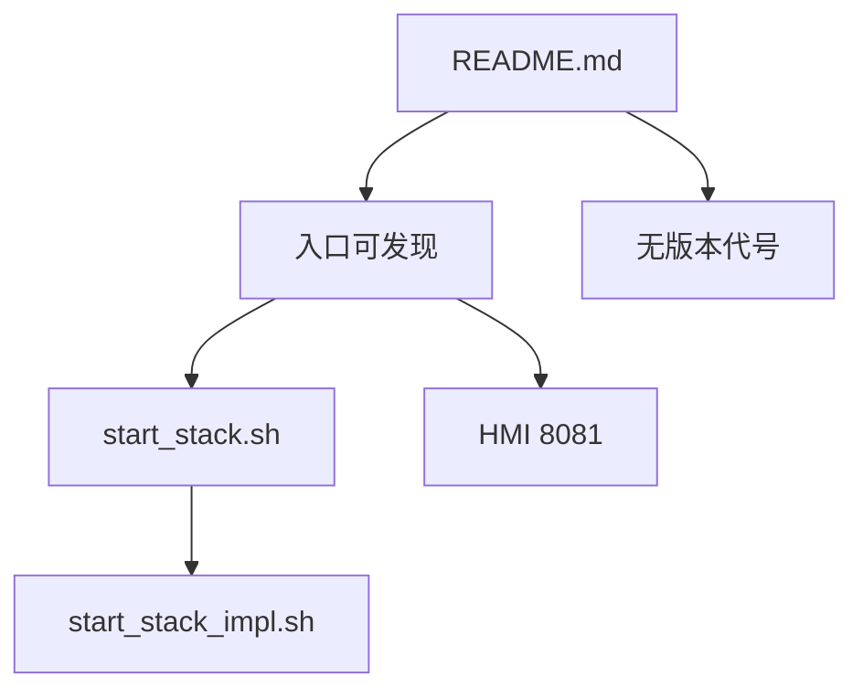

Sources: [tests/contract/test_neutral_project_entrypoints.py:1-24]()

## 配置、凭据与 TLS

### `.env` 配置边界

`.env.example` 是环境变量全仓唯一清单，并由契约测试锁定与代码同步。`start_stack.sh` 经 `start_stack_impl.sh` 自动加载根目录 `.env`；如果手动在当前 Shell 运行 `uvicorn`、`pytest` 或 LangGraph 驱动命令，则需要显式加载：

```bash
set -a && source .env && set +a
```

凭据不得提交 Git；模型与凭据属于本地运行资产。离线开发不依赖任何外部凭据。

| 配置组 | 关键变量 | 作用 |
|---|---|---|
| LLM 规划 | `AIDV_LLM_API_KEY`、`AIDV_LLM_API_BASE_URL`、`AIDV_LLM_MODEL` | 真实任务规划；缺失时栈可启动，但真实规划显式失败 |
| 语音 | `AIDV_VOICE_PROVIDER`、`AIDV_VOICE_WS_URL`、`AIDV_VOICE_API_KEY`、`AIDV_VOICE_MODEL`、`AIDV_VOICE_TIMBRE` | 本地或云端语音；缺失时语音入口置灰，文字对话不受影响 |
| 高德 | `AMAP_WEB_SERVICE_KEY`、`AMAP_JS_API_KEY`、`AMAP_JS_SECURITY_CODE` | 路线规划、地点检索、壳页地图 |
| 瑞幸 | `LUCKIN_MCP_TOKEN` | 瑞幸 MCP 访问 |
| 麦当劳 | `MCD_TOKEN` | 麦当劳访问 |
| 猫眼 | 不走 `.env` | authkey 保存在本机用户配置目录；具体凭据文件位置不公开 |
| 网易云 | 不占 `.env` | 可选安装真实 Provider |

Sources: [README.md:73-147](), [README.md:176-258]()

### 配置生效方式

本地栈修改 `.env` 后需要重启对应服务或整栈重启；Docker 形态需要 `docker compose --profile core up -d` 重建容器。`compose.yaml` 通过 `x-aidv-environment` 将 LLM、语音、高德、瑞幸、麦当劳等变量注入容器，避免凭据写入镜像。

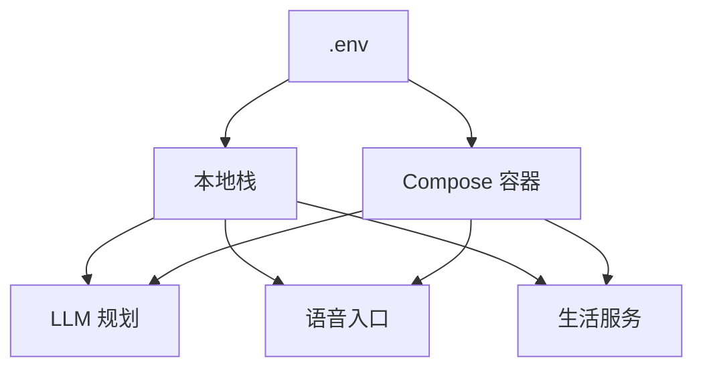

Sources: [README.md:73-147](), [compose.yaml:1-73]()

### HMI HTTPS / TLS

本地或内网默认零配置：`start_stack.sh` 首次启动自动生成自签 CA 与证书到 `.aidv/tls/`。浏览器首次访问 `https://<host>:8081/` 需要点“高级→继续前往”；手机或 Pad 可下载 `https://<host>:8081/pad/ca.crt` 安装 CA 以消除告警。换 IP 或网卡时需要手动运行 `./scripts/setup_hmi_https.sh [IP...]` 重签证书。

公网部署使用真实证书时，设置 `AIDV_HMI_TLS_CERT` 与 `AIDV_HMI_TLS_KEY` 指向真实证书文件。Compose 侧可用 `AIDV_HOST_HMI_WEB_PORT=443` 将 `8081` 映射到标准 HTTPS 端口。此时自动生成证书被禁用；证书文件缺失会直接报错，不静默降级为明文。公网部署还需要在高德控制台配置 JS key 白名单与 `securityJsCode`，否则地图不加载。

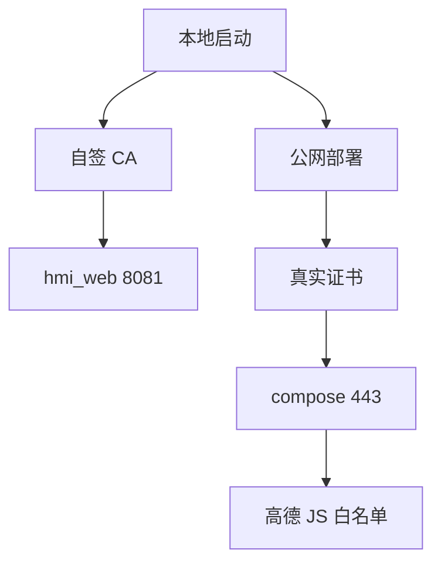

Sources: [README.md:176-258](), [compose.yaml:1-73]()

## 可观测性与调试入口

`services/agent_api/static/debug.html` 提供只读 Runtime Inspector，用于观察 HMI Session 对应的 workflow 状态。页面顶部支持输入 Session ID、连接 Session、立即刷新、复制完整 JSON，以及自动刷新。页面明确标注“只读后台观测窗口 · 不修改任务状态”。

| 面板 | 观测内容 |
|---|---|
| Connection | 当前 Session 连接状态 |
| Workflow | `workflow_id` 与状态 |
| Active Gate | 当前 Gate 的 `stage_id` |
| Cloud Tokens | LLM 调用累计 token |
| Pre-Arbitration / Domain | 输入文本、域决策、最后决策、session |
| Candidate Tool List | 候选工具列表 |
| Plan IR / Patch | `plan_ir` 与 `patch_history` |
| Active Gate / Fast Actions | 当前 Gate 与快速车控动作 |
| 真实 Tool Trace | 工具调用、真实标记、结果、延迟、错误 |
| Runtime Timeline | 事件时间线 |
| Token / Latency Metrics | LLM 调用 token 与延迟 |
| Artifacts / Handoffs | 工件与跨域交接 |
| 完整 State JSON | 原始状态快照 |

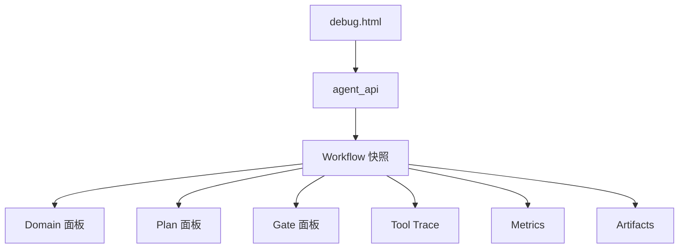

Sources: [services/agent_api/static/debug.html:1-82](), [README.md:1-87]()

## 验收与测试体系

### 离线回归与质量门禁

项目验证闭环要求每次改动后先跑离线全量测试，再跑门禁全量检查。离线回归命令为：

```bash
.venv/bin/python -m pytest tests -m "not real_service" -q
```

门禁全量检查为：

```bash
.venv/bin/pre-commit run --all-files
```

`AGENTS.md` 将这两条命令定义为本地验证闭环的核心。`CONTRIBUTING.md` 进一步说明本地钩子包括卫生检查、ruff lint/format、提交信息格式检查；远端 CI 包括 `lint`、`test`、`pr-title`、`pr-size` 四个 job。其中 `lint` 与 `test` 是强制拦截项，`pr-size` 是提示性体量提醒。

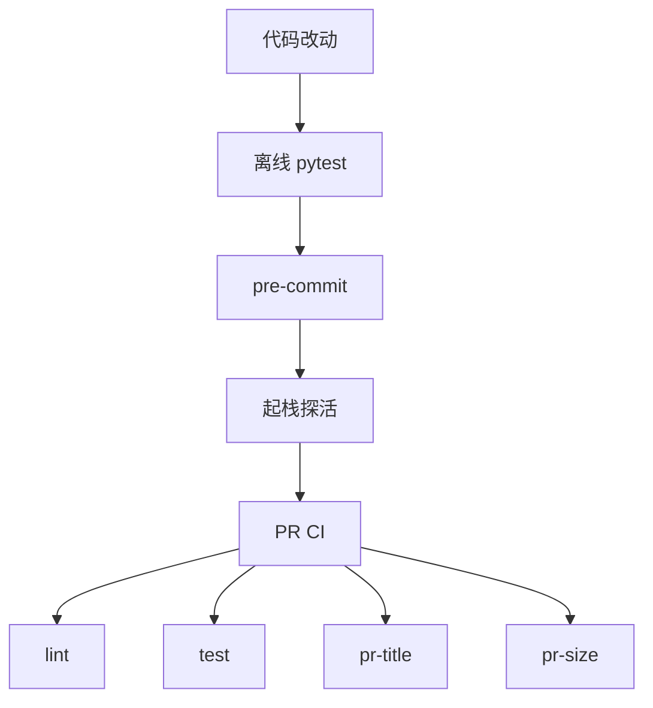

Sources: [AGENTS.md:1-43](), [CONTRIBUTING.md:1-120](), [README.md:176-258]()

### CI 离线测试与 Docker 冒烟

`.github/workflows/ci.yml` 中的 `test` job 执行离线全量 pytest，与 AGENTS.md 的验证闭环同一条命令。`docker` job 负责部署链路执法：先校验 `pyproject.toml`、`uv.lock`、`requirements.lock` 的一致性，再构建运行时镜像，启动全栈并等待健康检查，最后探活外部入口。

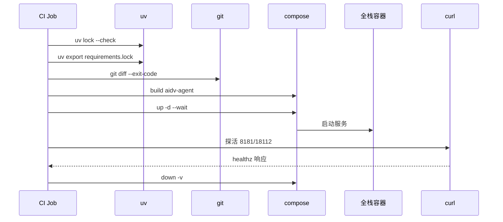

| Docker CI 步骤 | 命令或行为 | 目的 |
|---|---|---|
| Lockfile sync | `uv lock --check`、`uv export ... -o requirements.lock`、`git diff --exit-code` | 防止依赖锁漂移 |
| Build runtime image | `docker compose --profile core build aidv-agent` | 验证镜像可构建 |
| Boot full stack | `docker compose --profile core up -d --wait --wait-timeout 180 aidv-agent` | 验证容器栈可启动 |
| Probe external entries | `curl -kfsS https://127.0.0.1:8181/healthz`、`curl -fsS http://127.0.0.1:18112/healthz` | 验证 HMI 与 agent_api 入口 |
| Service logs on failure | `docker compose --profile core logs --tail 100` | 失败时保留诊断信息 |
| Tear down | `docker compose --profile core down -v` | 清理容器与 volume |

Sources: [.github/workflows/ci.yml:71-120](), [CONTRIBUTING.md:1-120]()

### 离线语音任务管线

`tests/integration/test_omni_task_pipeline.py` 覆盖语音到任务脑的离线全链路：`FakeOmni` 驱动真实 dispatcher，真实 `agent_api` 通过真实 HTTP socket 运行，而 `LangGraphAgent` 被替换为离线内核，即 `FakeToolDispatcher + ScriptedPlanningService`。该测试固定了 dispatch pipeline、参数映射、闲聊降级、快速车控路径，以及模型遗漏 `workflow_id` 时按 session 最后活动 workflow 回退的行为。

该测试不评估模型决策质量；模型决策质量属于 `evals/` 层。它验证的是“如果模型决定调用某工具，系统是否能正确路由、执行并回传可播报摘要”。

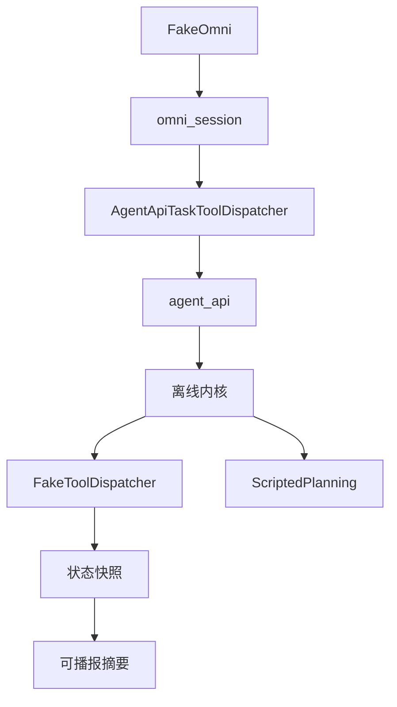

Sources: [tests/integration/test_omni_task_pipeline.py:1-75]()

### 隔离验收栈

为了避免验收栈覆盖正式栈，项目支持端口偏移与独立状态库。使用 `AIDV_PORT_OFFSET=100` 时，服务启动到 `8181 / 1811x / 1820x`，并自动使用独立日志与 PID 目录。验收还必须使用独立业务状态库，否则共享 Workflow 数据。

```bash
AIDV_PORT_OFFSET=100 \
AIDV_AGENT_STATE_DB=.aidv/state/acceptance_18112.sqlite3 \
./scripts/start_stack.sh
```

`scripts/real_acceptance.sh` 内部使用该形态。离线层无需任何凭据；`WITH_LLM=1` 增加真实 LLM planning 探针；`WITH_EXTERNAL=1` 增加外部 Provider 探针，需要有效凭据。

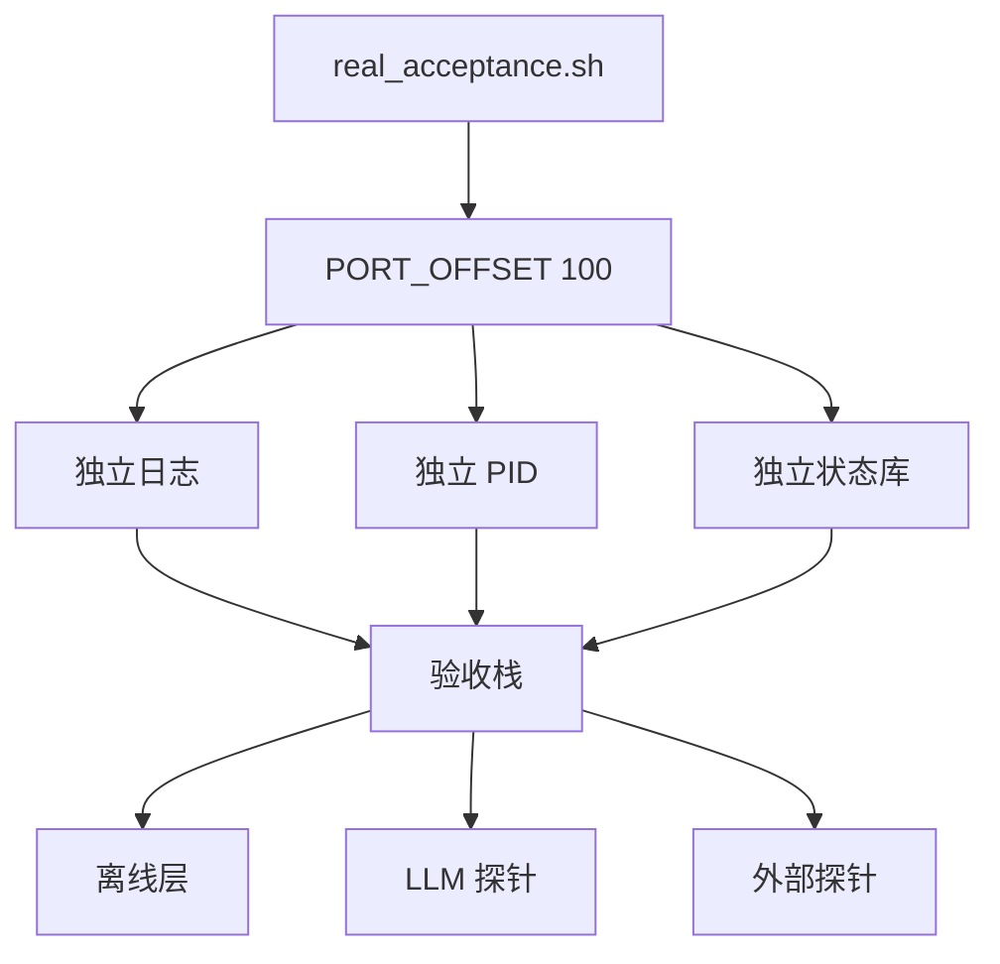

Sources: [README.md:176-258]()

### 真实探针与 evals

`scripts/probe_real/` 是人工运行的真实服务冒烟探针，不属于 pytest 自动化测试。它分为三类：真实 LLM 探针、真实外部服务探针、本地栈冒烟探针。自动化回归仍使用 `pytest tests -m "not real_service"`；真实服务的正式测试位于 `tests/` 下并带 `real_service` 标记。

| 探针类型 | 示例脚本 | 依赖 |
|---|---|---|
| 真 LLM | `probe_planning_golden_real.py`、`probe_conversation_real.py`、`probe_planning_graph_real.py`、`probe_main_planning_graph_real.py` | `AIDV_LLM_*` |
| 真外部服务 | `probe_luckin_real.py` | 有效 MCP token |
| 本地栈冒烟 | `probe_gateway.py`、`probe_{vehicle}_adapter_real.py`、`probe_navigation_adapter_real.py`、`probe_media_adapter_real.py`、`probe_{luckin,maoyan,mcdonald}_adapter_real.py` | 本地栈，部分需要外部 token 或登录态 |

`evals/` 是真实调用层终态基准，用于换模型或改 prompt 后回归最终表现。它不经过 pytest 锁定，证据落到 `/tmp`，不进入 Git。通过判据没有硬性指标，主要与用户协商调优。

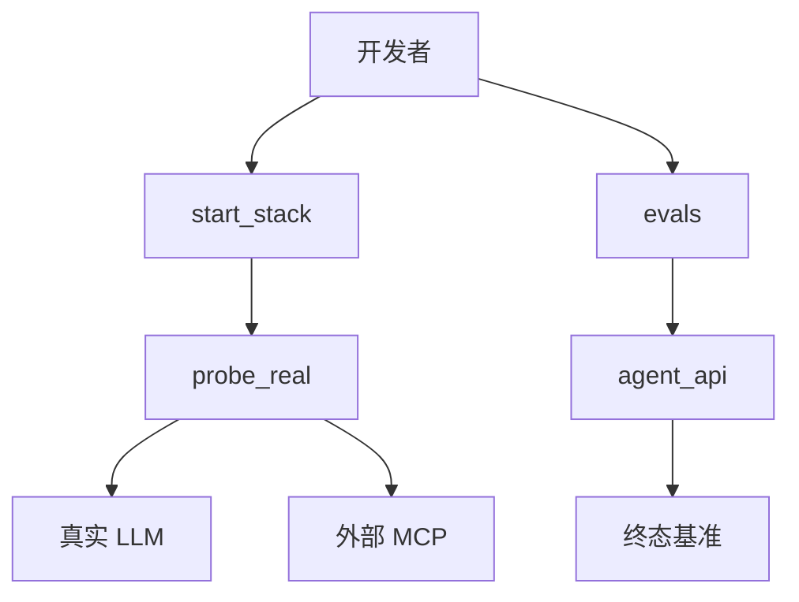

Sources: [scripts/probe_real/README.md:1-47](), [evals/README.md:1-35]()

### HMI 快速验收 Prompt

HMI 快速测试要求先拉起服务，再打开 HMI 入口。本地入口为 `https://127.0.0.1:8081/`，Docker 入口为 `https://127.0.0.1:8181/`。每条 Prompt 使用新会话，并等待当前 Gate 处理完再运行下一条。车辆默认起点已内置；语音交互通过 AI 面板麦克风触发。

| 类型 | Prompt 示例 | 预期主链路 |
|---|---|---|
| 单目的地导航 | `规划从当前位置去广州塔的路线，只预览，不开始导航。` | Navigation 路线预览→地图显示→确认 Gate |
| 多途经点 | `从当前位置出发，先经过广州塔，再经过广东省博物馆，最后到广州南站，只规划并预览路线。` | 起点→两个途经点→终点→路线预览 |
| 瑞幸商品约束 | `查询附近瑞幸的生椰拿铁，只查看门店和商品，不创建订单。` | 附近门店 Gate→生椰拿铁候选 Gate→订单预览 |
| 麦当劳商品约束 | `查询附近麦当劳的麦旋风，只查看门店、商品和价格，不创建订单。` | 附近门店 Gate→麦旋风候选 Gate→价格预览 |
| 电影与影院 | `查询广州最近上映的电影和影院，然后规划去选中影院的路线；只查询场次和路线，不购票。` | 电影→影院→场次 Gate→影院 Handoff→导航预览 |
| 三域组合 | `先查附近瑞幸的生椰拿铁，再查附近麦当劳的麦旋风，最后规划去广州塔的路线；只查询商品、价格和路线预览，不创建订单、不支付。` | Luckin Gates→McDonald Gates→Navigation Preview |
| 四域复杂编排 | `我想去机场，顺便买个汉堡，再买个咖啡，再看个电影；全部只做候选和预览，不下单、不购票、不支付。` | McDonald→Luckin→Maoyan 多级 Gates→Navigation Preview |
| Gate 期间侧向车控 | 在任意选择 Gate 弹出时说：`空调调到23度` | 本地车控执行；原 Active Gate 保留并可继续选择 |
| 局部 Patch | `麦当劳不要了，咖啡保留，继续去机场` | 取消麦当劳分支；保留未受影响状态；重算受影响后继任务 |
| 终点 Patch | `不去机场了，改去广州南站` | 替换导航终点；失效旧路线 Artifact；重新预览 |

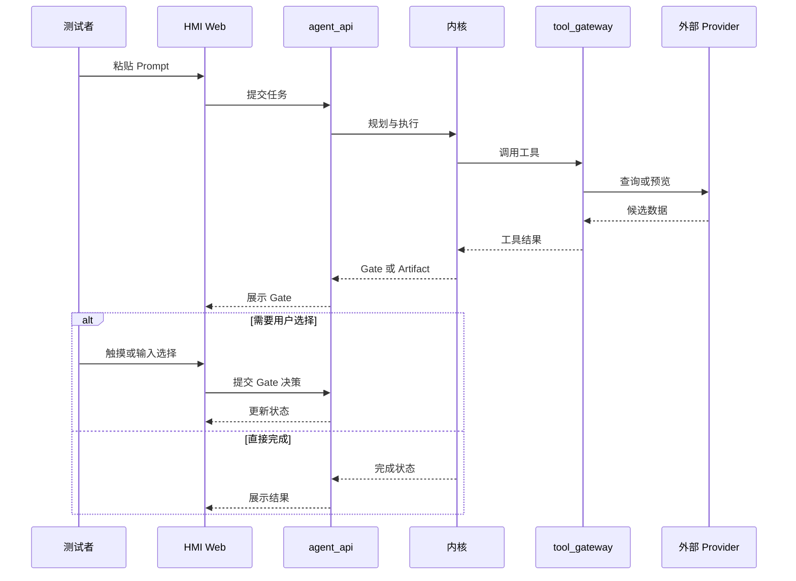

Sources: [README.md:128-199]()

### 真实 Provider 边界

真实 Provider 探针只允许查询、候选、详情和预览；禁止创建订单、取消订单、支付、调用支付链接或开始导航。HMI 快速测试 Prompt 也全部限定在查询、候选、价格、路线预览范围内。该边界是验收安全性的核心约束，防止自动化或人工调试触发真实交易副作用。

Sources: [README.md:128-199](), [README.md:176-258]()

## 部署链路 CI 执法

Docker 部署链路不能只靠 compose 文件本身。CI 的 `docker` job 将依赖锁、镜像构建、容器启动、健康探活串成一条可重复验证链路。若 `requirements.lock` 与 `uv.lock` 不一致，CI 会在构建前失败；若镜像无法构建或容器健康检查超时，CI 会失败并输出最近 100 行服务日志。

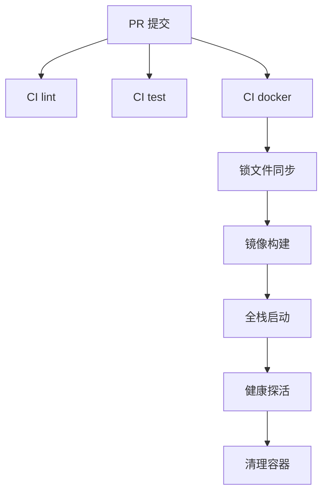

| 执法点 | 来源 | 失败影响 |
|---|---|---|
| 依赖锁一致 | `uv lock --check`、`uv export`、`git diff --exit-code` | 阻止依赖漂移进入 main |
| 镜像可构建 | `docker compose --profile core build aidv-agent` | 阻止 Dockerfile 或依赖层损坏 |
| 全栈可启动 | `up -d --wait --wait-timeout 180` | 阻止服务编排或健康检查失败 |
| 外部入口可访问 | `curl` HMI 与 agent_api healthz | 阻止端口、TLS 或 API 入口回归 |
| 失败可诊断 | `logs --tail 100` | 保留容器日志用于定位 |

Sources: [.github/workflows/ci.yml:71-120](), [README.md:1-87]()

## 当前状态与维护边界

CHANGELOG 记录 2026-10-20 项目重构完成、离线部署语音模型上线、Docker 一键部署链路打通，并说明当前代码以查看整体逻辑为主，不深究所有细节，可能存在 bug。README 顶部也给出相同警告：项目当前状态为离线部署语音已上线、全仓代码重构已完成、简单测试端到端链路打通，但全仓详细测试尚未进行。

因此，部署与验收文档应被理解为“架构逻辑、契约边界、验证路径”的参考，而不是生产 SLA 或完整缺陷清单。后续贡献者应优先遵守 `AGENTS.md` 的架构铁律、`CONTRIBUTING.md` 的质量门禁，以及 `docs/ARCHITECTURE.md`、`docs/PRD.md`、`docs/CONVENTIONS.md` 所定义的需求与实现锚点。

Sources: [CHANGELOG.md:1-23](), [README.md:1-87](), [AGENTS.md:1-43](), [CONTRIBUTING.md:1-120]()

## 结论

AIDV Agent 的部署与基础设施设计以“契约化端口、离线优先、容器化部署、分层验收”为核心。本地栈提供快速开发与调试能力，Docker Compose 提供一键部署与 CI 冒烟能力，`ports.py` 与契约测试保证端口、入口和 Dockerfile 暴露面不漂移。`.env` 将 LLM、语音、生活服务凭据与离线能力解耦；HMI TLS 支持本地自签与公网真实证书两种形态。验收体系从离线 pytest、pre-commit 门禁、隔离验收栈、真实探针到 `evals/` 终态基准逐层递进，同时严格限制真实 Provider 只允许查询与预览，避免触发订单、支付或导航副作用。

---

**关联源文件:** `README.md`, `compose.yaml`, `docker/Dockerfile.runtime`, `docker/Dockerfile.dev`, `scripts/start_stack.sh`, `scripts/stop_stack.sh`, `scripts/real_acceptance.sh`
