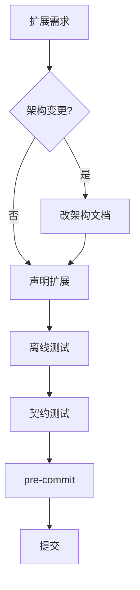
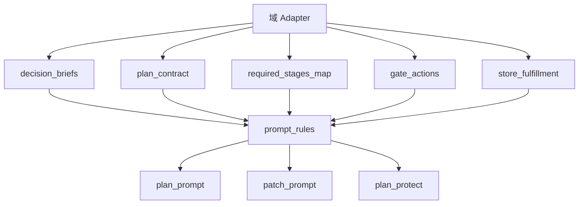
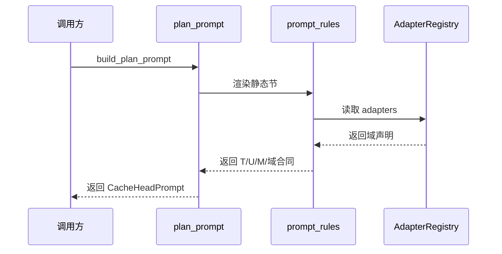
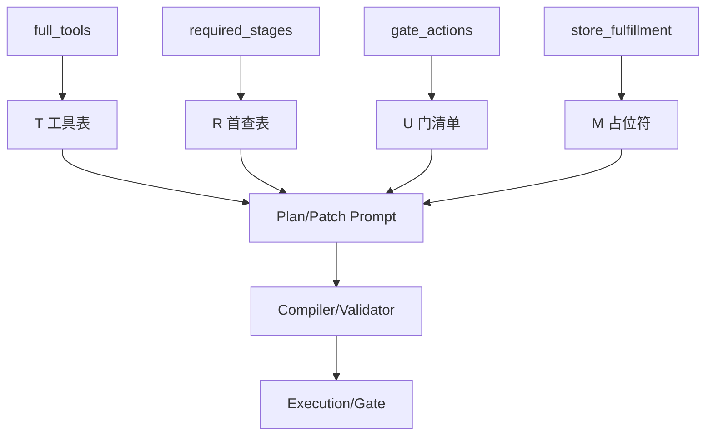
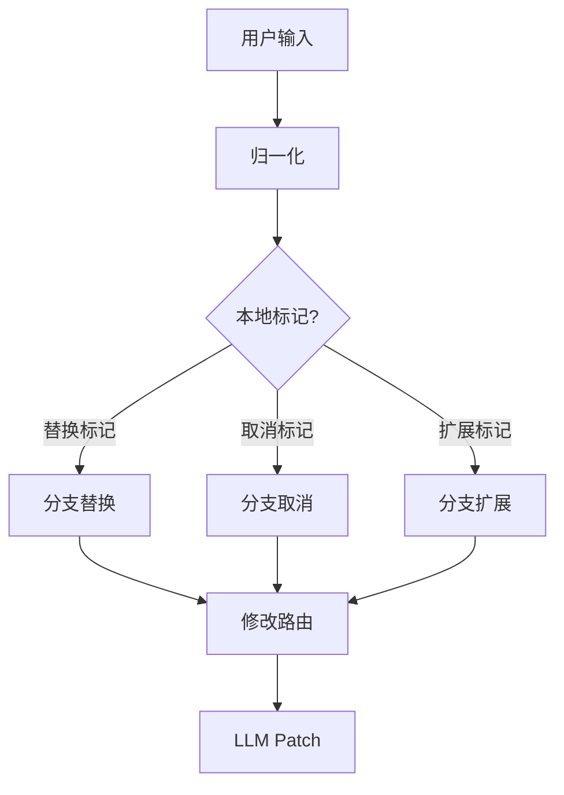
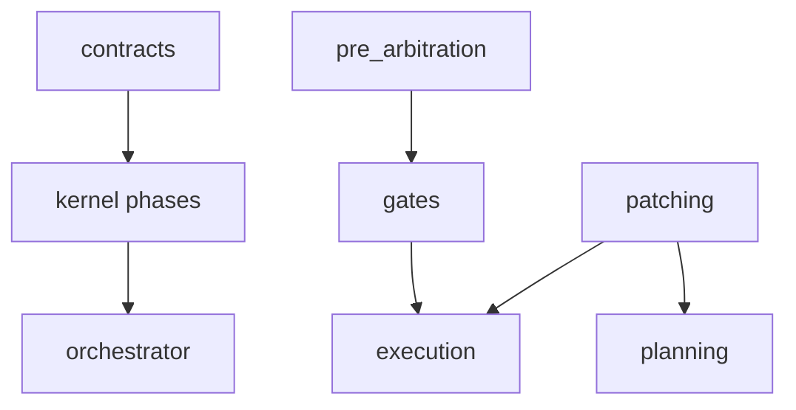
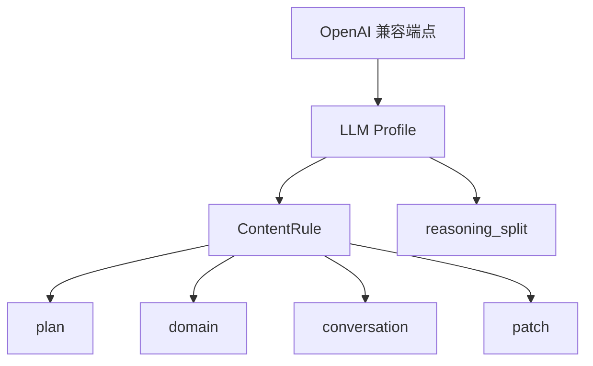
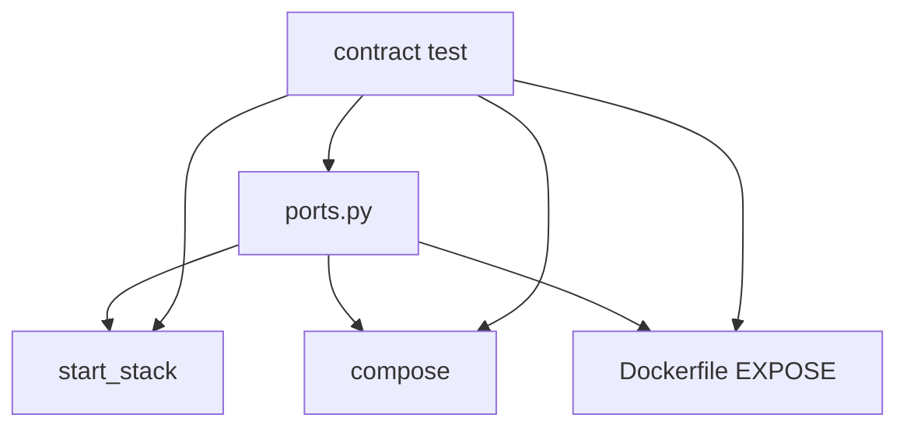
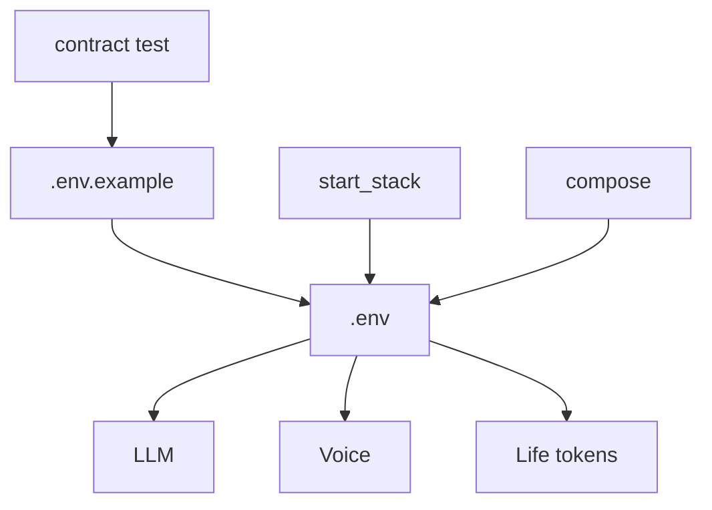
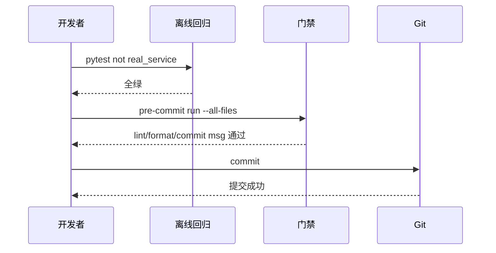

# 扩展与定制

<details>
<summary>Relevant source files</summary>

The following files were used as context for generating this wiki page:

- [AGENTS.md](AGENTS.md)
- [CONTRIBUTING.md](CONTRIBUTING.md)
- [docs/CONVENTIONS.md](docs/CONVENTIONS.md)
- [skills/handoff/SKILL.md](skills/handoff/SKILL.md)
- [tests/contract/test_layering.py](tests/contract/test_layering.py)
- [src/aidv_agent/kernel/planning/prompt_rules.py](src/aidv_agent/kernel/planning/prompt_rules.py)
</details>

# 扩展与定制

AIDV Agent 的扩展与定制围绕“确定性内核 + 声明式域知识 + 契约测试执法”展开。新增能力通常不是直接向内核追加临时规则，而是在既有架构边界内声明新的域、工具、确认门、Handoff 占位符、LLM Provider 行为、端口或外部服务凭据；随后由内核聚合、编译、校验、执行，并通过离线回归与契约测试证明其不破坏既有不变式。

项目对扩展有明确纪律：架构层变更必须先修改 `docs/ARCHITECTURE` 并提交，功能变更必须在 `FakeToolDispatcher + ScriptedPlanningService` 下离线跑通，复杂确定性规则与关键提示词必须人工审核，契约测试红灯不能靠改断言或删测试绕过。Sources: [AGENTS.md:1-43](), [README.md:1-87](), [src/aidv_agent/kernel/__init__.py:1-22]()

## 扩展边界与架构约束

扩展 AIDV Agent 时，首先要判断变更属于“架构变更”还是“功能/域扩展”。架构变更涉及运行拓扑、内核包 DAG、请求生命周期、契约锁清单或部署形态，必须先与开发者商议并修改 `docs/ARCHITECTURE`，禁止直接开发涉及架构变更的代码。功能扩展则应在既有单向 DAG、离线优先、契约锁和命名规范内完成。Sources: [AGENTS.md:1-43](), [README.md:176-258]()

| 约束 | 对扩展的含义 |
|---|---|
| 架构先文档 | 涉及架构层变更时，先修改并提交 `docs/ARCHITECTURE`，再实现代码。 |
| 单向 DAG | `src/aidv_agent` 的 9 个包保持单向依赖，禁止反向引用；出现环时应上移错层文件，而不是合并包。 |
| 离线优先 | 新功能必须在 `FakeToolDispatcher + ScriptedPlanningService` 下端到端跑通，不能只依赖真实 LLM 或外部服务。 |
| 命名无代号 | 服务名必须语义化并按平面命名，例如浏览器面 `hmi_web`、API 面 `agent_api` / `cockpit_api`、资源面 `services/vehicle/*`。 |
| 确定性规则人工审核 | 禁止直接写复杂正则兜底；短期特例优先使用简单全量字符串匹配，复杂规则必须人工设计。 |
| 提示词人工审核 | 关键系统提示词不能由 AI 生成大段不可维护文本后直接提交，修订方向必须由人类主导或审阅。 |
| 坏输入诚实失败 | 非法计划或参数应返回结构化错误，例如 422 与明确 error code，不静默修正架构层问题。 |
| 契约测试执法 | `tests/contract/` 红灯时，应先理解架构为何被破坏，不能为了变绿而改断言或删测试。 |
| 过程状态不进仓库 | 中间状态、调试产物、原始 dump、日志、凭据、SQLite 运行数据、`.aidv/`、`logs/` 不进 Git。 |
| 验证闭环 | 每次改动后运行离线全量 pytest 与 pre-commit 门禁。 |

Sources: [AGENTS.md:1-43](), [README.md:1-87](), [README.md:176-258](), [src/aidv_agent/kernel/__init__.py:1-22]()



该流程强调：扩展不是“先写代码再补文档”，而是先确认架构边界，再通过声明式扩展与离线验证进入提交闭环。Sources: [AGENTS.md:1-43](), [README.md:128-199]()

## 新增业务域：Adapter 声明式扩展

`src/aidv_agent/kernel/planning/prompt_rules.py` 的核心模式是：域知识由 adapter 声明，内核只聚合这些声明，供提示词构建器和编译器消费。文档明确说明，新增一个域时，只要交付对应 adapter，相关 prompt 会自动扩展，内核 prompt 模块中不再手写规则文本或 UI 表。Sources: [src/aidv_agent/kernel/planning/prompt_rules.py:1-56]()

| Adapter 声明项 | 聚合函数 | 扩展用途 |
|---|---|---|
| `decision_briefs` | `decision_domain_entries()` | 生成允许域列表，每个域渲染为 `- {domain}：{brief}`，说明域用途、触发措辞与排除项。 |
| `plan_contract` | `plan_contract_sections()` | 为每个域生成一个 `【domain】` 小节，承载该域全部规划规则。 |
| `required_stages_map` | `declared_required_stages()` | 声明决策域对应的首个必查工具与 UI Gate，供 prompt 与 `plan_protect` 使用。 |
| `gate_actions` | `ui_contracts()` | 声明门 UI 允许的动作；未声明 `gate_actions` 的域不会进入 UI 合同表。 |
| `gate_args_docs` | `ui_contracts()` / `gate_ui_entries()` | 声明门参数文档；其键集同时成为内核清洗白名单。 |
| `store_fulfillment` | `fulfillment_slot_lines()` | 若为真，则生成该域的门店履约占位符行，格式为 `domain={{handoff.fulfillment_location.domain}}`。 |
| patch hints | `_patch_hint_entries()` | 在 patch prompt 中渲染“只改参数、不重排域”的域补丁提示。 |

Sources: [src/aidv_agent/kernel/planning/prompt_rules.py:1-56](), [src/aidv_agent/kernel/planning/prompt_rules.py:42-94](), [src/aidv_agent/kernel/planning/prompt_rules.py:118-162](), [src/aidv_agent/kernel/patching/patch_prompt.py:144-182]()

`plan_contract_sections()` 的实现展示了“声明即扩展”的关键点：内核遍历 `adapter_registry.adapters`，只读取 adapter 的 `domain` 与 `plan_contract`，并将尾部换行去除后原样交给 prompt renderer。Sources: [src/aidv_agent/kernel/planning/prompt_rules.py:42-94]()

```python
return [
    (str(adapter.domain), str(adapter.plan_contract).rstrip("\n"))
    for adapter in adapter_registry.adapters
    if getattr(adapter, "plan_contract", ())
]
```

Sources: [src/aidv_agent/kernel/planning/prompt_rules.py:42-94]()



该图说明：新增域的主要扩展面在 adapter 声明层；`prompt_rules` 是聚合层；`plan_prompt`、`patch_prompt` 与 `plan_protect` 是消费层。Sources: [src/aidv_agent/kernel/planning/prompt_rules.py:1-56](), [src/aidv_agent/kernel/planning/plan_prompt.py:1-75](), [src/aidv_agent/kernel/patching/patch_prompt.py:144-182]()

## 提示词扩展：Plan 与 Patch 的静态头

Plan prompt 的设计目标是让 system 半部分在所有请求中保持 byte-identical，从而匹配服务端 prefix cache。`build_plan_prompt()` 接收用户文本、`DomainDecision` 与 `full_tools`，返回 `CacheHeadPrompt` 与输出预算。system 半部分包含认知头、工具清单、门 UI 清单、门店占位符清单、各域合同清单和输出格式；user 半部分只携带本次请求的 `D`（命中的域名单先验）与 `Q`（用户原话）。Sources: [src/aidv_agent/kernel/planning/plan_prompt.py:56-103]()

| Prompt 组件 | 来源 | 作用 |
|---|---|---|
| `_PLAN_COGNITION` | `plan_prompt.py` 模块常量 | 定义车载座舱任务编排器角色、符号约定和“宁少勿造”原则。 |
| `tool_section()` | `prompt_rules.py` | 渲染全量工具表 `T` 与首查工具表 `R`。 |
| `gate_ui_section()` | `prompt_rules.py` | 渲染确认门 UI 白名单 `U`，无参门显式写 `args:null`。 |
| `placeholder_section()` | `prompt_rules.py` | 渲染门店占位符清单 `M`，条目为 `域名=标记`。 |
| `_render_domain_sections()` | `plan_prompt.py` + `prompt_rules.py` | 将各域 `plan_contract` 聚合为 `【各域合同清单】`。 |
| `_render_output_format()` | `plan_prompt.py` | 规定只输出一个 JSON，`steps` 中混排 `tool` 步与 `ui` 步，参数键必须来自 `T` 或 `U`。 |

Sources: [src/aidv_agent/kernel/planning/plan_prompt.py:1-75](), [src/aidv_agent/kernel/planning/plan_prompt.py:56-103](), [src/aidv_agent/kernel/planning/prompt_rules.py:150-220]()

Patch prompt 同样强调 system 半部分 byte-identical。`build_patch_prompt()` 接收用户变更、当前 `PlanIR`、已完成任务、域列表与全量工具表，并渲染 adapter 声明的 patch hints。`_render_patch_hint_section()` 将每条 hint 渲染为“某域某动作必须且只能对现有工具使用 `update_arguments`，arguments 只放新的参数”的约束行。Sources: [src/aidv_agent/kernel/patching/patch_prompt.py:144-182]()



该序列说明：prompt 扩展不是每次请求动态裁剪工具表，而是通过全量静态头 + 请求尾 `D/Q` 的方式完成。`full_tools` 是 prompt 渲染的超集，静态头不因域变化而变化。Sources: [src/aidv_agent/kernel/planning/plan_prompt.py:56-103](), [src/aidv_agent/kernel/planning/prompt_rules.py:150-220]()

## 工具、UI Gate 与 Handoff 扩展

工具面扩展通过 `full_tools` 与 `tool_rows` 进入 prompt。`tool_section()` 渲染 `T=全量工具表` 和 `R=首查工具表`。`R` 是 `T` 的首查子视图，其工具名来自 `declared_required_stages()`；域名到首查工具再到门的配对知识由各域合同承接，内核侧 `plan_protect` 仍按声明的 required stages 执法。Sources: [src/aidv_agent/kernel/planning/prompt_rules.py:150-220]()

UI Gate 扩展通过 `gate_actions` 与 `gate_args_docs` 完成。`ui_contracts()` 从 adapter 的 `required_stages_map` 中取门步名，从 `gate_args_docs` 中取参数键集，生成 `UIContract`。同一声明既用于 prompt 文案，也用于内核清洗白名单；未声明 `gate_actions` 的域不会进入 UI 合同表，其门会因未知 UI 被编译或校验拒收。Sources: [src/aidv_agent/kernel/planning/prompt_rules.py:118-162]()

Handoff 占位符扩展由 `handoff_slot_marker()` 和 `fulfillment_slot_lines()` 控制。`handoff_slot_marker(domain)` 是跨域槽位标记协议的单一格式来源，返回 `{{handoff.fulfillment_location.{domain}}}`；`fulfillment_slot_lines()` 只遍历 `store_fulfillment` 为真的 adapter，生成 `domain=marker` 行。Sources: [src/aidv_agent/kernel/planning/prompt_rules.py:42-94]()

| 扩展对象 | 声明来源 | Prompt / 内核消费点 | 失败策略 |
|---|---|---|---|
| 工具 | `full_tools` / `tool_rows` | `T` 全量工具表、`R` 首查工具表 | 参数键必须来自工具表，禁止编造值或表外键。 |
| UI Gate | `gate_actions` / `gate_args_docs` | `U` 门 UI 清单、`UIContract` | 未知 UI 被编译或校验拒收。 |
| Handoff 占位符 | `store_fulfillment` | `M` 门店占位符清单、导航参数引用 | 规划期自写 `{{...}}` 引用或越权链路任务会被编译期拒绝。 |
| Patch 行为 | adapter patch hints | `【域补丁提示】` | 指定动作只能对现有工具使用 `update_arguments`。 |

Sources: [src/aidv_agent/kernel/planning/plan_prompt.py:1-75](), [src/aidv_agent/kernel/planning/prompt_rules.py:118-162](), [src/aidv_agent/kernel/planning/prompt_rules.py:150-220](), [src/aidv_agent/kernel/patching/patch_prompt.py:144-182](), [tests/planning/test_plan_protect.py:239-277]()

`tests/planning/test_plan_protect.py` 展示了 Handoff 与参数纪律的验收方式：导航参数可以引用 `{{handoff.fulfillment_location.maoyan_life_service}}`，同时规划期自写 `{{...}}` 引用、生活服务链路工具越权等行为必须在编译期被拒绝。Sources: [tests/planning/test_plan_protect.py:239-277]()

`tests/integration/test_use_case_pipeline.py` 则展示了扩展后的 use case 管线如何被集成测试覆盖：它导入 `ExecutionService`、`GateApplicationService`、`PatchApplicationService`、orchestrator use cases、`SQLiteDatabase` 与 `WorkflowRepository`，并使用 `RecordedDispatcher` 记录工具调用。测试中的 `PlanTask` 结构包含 `task_id`、`domain`、`kind`、`tool`、`ui`、`arguments`、`depends_on` 与 `allowed_actions`。Sources: [tests/integration/test_use_case_pipeline.py:1-47]()



Sources: [src/aidv_agent/kernel/planning/prompt_rules.py:150-220](), [src/aidv_agent/kernel/planning/plan_prompt.py:56-103](), [tests/integration/test_use_case_pipeline.py:1-47]()

## 预仲裁路由扩展

`src/aidv_agent/kernel/pre_arbitration/engine.py` 展示了本地预仲裁如何基于归一化文本、分支词表和标记词决定路由。对于活跃工作流中的分支取消或替换，引擎会检查 `branch_lexicons` 中命中的分支；如果命中多个分支且出现替换标记，则匹配 `ACTIVE_WORKFLOW_BRANCH_REPLACEMENT`，否则匹配 `ACTIVE_WORKFLOW_BRANCH_CANCEL`，并返回 `RouteName.WORKFLOW_MODIFY`。Sources: [src/aidv_agent/kernel/pre_arbitration/engine.py:225-254]()

对于活跃工作流中的扩展类措辞，`_route_active_branch_extension_modify()` 检查是否存在 `active_workflow_id` 且归一化文本命中 `EXTENSION_MARKERS`。该路径被描述为“唯一本地认领的 modify family”，具体要添加什么由 LLM 根据原始文本决定。Sources: [src/aidv_agent/kernel/pre_arbitration/engine.py:225-254]()

| 本地信号 | 匹配规则 | 路由结果 |
|---|---|---|
| 多分支命中 + 替换标记 | `ACTIVE_WORKFLOW_BRANCH_REPLACEMENT` | `RouteName.WORKFLOW_MODIFY` |
| 分支命中 + 取消语义 | `ACTIVE_WORKFLOW_BRANCH_CANCEL` | `RouteName.WORKFLOW_MODIFY` |
| 活跃工作流 + 扩展标记 | extension modify | `RouteName.WORKFLOW_MODIFY` |

Sources: [src/aidv_agent/kernel/pre_arbitration/engine.py:225-254]()

扩展预仲裁规则时必须遵守 AGENTS.md 的确定性规则纪律：不要直接写复杂正则，先明确要防御的具体案例，再制定最小防御规则或正则；短期解决不了的特例可使用简单全量字符串匹配兜底。Sources: [AGENTS.md:1-43](), [README.md:1-87]()



Sources: [src/aidv_agent/kernel/pre_arbitration/engine.py:225-254](), [AGENTS.md:1-43]()

## 契约与内核分层扩展

`src/aidv_agent/contracts/__init__.py` 导出了版本化契约面，包括计划、补丁、工作流、事件与词表类型。扩展新功能时，跨模块共享的数据结构应优先落在这些契约中，而不是在各 phase 内私有复制。Sources: [src/aidv_agent/contracts/__init__.py:1-40]()

| 契约类别 | 导出符号 | 扩展意义 |
|---|---|---|
| 计划 | `PlanIR`、`PlanTask`、`PlanResultSpec`、`DomainDecision` | 描述规划输出、任务结构、域决策与结果规格。 |
| 补丁 | `PlanPatchIR`、`PatchTask`、`PatchResultSpec` | 描述局部修改、补丁任务与结果规格。 |
| 工作流 | `WorkflowSnapshot` | 描述工作流快照，供 orchestrator 与持久化使用。 |
| 事件 | `InputEvent` | 描述输入事件契约。 |
| 词表 | `RouteName`、`RouteTarget`、`GateAction`、`FastNluIntent`、`ControlAction`、`PRE_ARBITRATION_ROUTE_TABLE` | 描述路由、门动作、快速 NLU 意图与控制动作等受控词表。 |

Sources: [src/aidv_agent/contracts/__init__.py:1-40]()

`src/aidv_agent/kernel/__init__.py` 说明内核由五个 phase 包组成：`gates`、`planning`、`execution`、`patching`、`pre_arbitration`。每个 phase 内部按确定性拆分：纯模块持有无 I/O 决策核心，可选 `service/` 子包持有 dispatcher、provider、repository 等 I/O 编排。`tests/contract/test_layering.py` 锁定的规则包括：I/O faces 只能从 phase 的 `service/` 子包或注册顶层 I/O 模块导入；纯模块不能导入自己的 `service/`；跨 phase 导入必须是注册边；phase `__init__` 只 re-export 纯面。Sources: [src/aidv_agent/kernel/__init__.py:1-22]()

已注册的跨 phase 边包括：`pre_arbitration -> gates`、`patching -> execution`、`patching -> planning`、`gates -> execution`。上层 `graph` / `orchestrator` 可以依赖 kernel，但 kernel 内部不能依赖上层。Sources: [src/aidv_agent/kernel/__init__.py:1-22]()



Sources: [src/aidv_agent/contracts/__init__.py:1-40](), [src/aidv_agent/kernel/__init__.py:1-22](), [tests/integration/test_use_case_pipeline.py:1-47]()

## LLM Provider 与 Profile 定制

`src/aidv_agent/providers/llm/profiles/minimax.py` 展示了 Provider 级定制的形态：通过 `ContentRule` 声明特定 Provider 的内容修正规则，并用 `applies_to` 限定作用面。例如 `expand_candidate_object_echo` 的触发条件是 MiniMax 对 tool/ui 回显紧凑的 `{n: name}` 候选对象，其 `applies_to` 限定为 `plan`。Sources: [src/aidv_agent/providers/llm/profiles/minimax.py:68-83]()

| Profile 项 | 内容 | 扩展意义 |
|---|---|---|
| `applies_to` | 可包含 `plan`、`domain`、`conversation`、`patch` | 将 Provider 修正规则限定到具体请求面。 |
| `expand_candidate_object_echo` | 展开 MiniMax 回显的紧凑候选对象 | 只作用于 `plan` 面，避免污染其他面。 |
| notes | `response_format json_object` 返回 HTTP 400、观察到 fenced JSON、M-series thinking 在 content 中 | 记录 Provider 行为差异，供 `reasoning_split` 等处理路由。 |

Sources: [src/aidv_agent/providers/llm/profiles/minimax.py:68-83]()

README 说明 LLM 配置使用 OpenAI 兼容端点，支持本地部署（如 vLLM）或云厂商 API。关键变量包括 `AIDV_LLM_API_KEY`、`AIDV_LLM_API_BASE_URL` 与 `AIDV_LLM_MODEL`。不配置 LLM 时栈仍可启动、离线回归可跑，但真实任务规划会失败。Sources: [README.md:73-147]()

| 变量 | 说明 |
|---|---|
| `AIDV_LLM_API_KEY` | 必填；缺失时真实任务规划显式报错。 |
| `AIDV_LLM_API_BASE_URL` | OpenAI 兼容模式地址。 |
| `AIDV_LLM_MODEL` | 模型名或模型 ID。 |

Sources: [README.md:73-147]()



Sources: [src/aidv_agent/providers/llm/profiles/minimax.py:68-83](), [README.md:73-147]()

## 服务与端口扩展

README 将 `src/aidv_agent/ports.py` 定义为端口单一事实源，并由 `tests/contract/test_ports.py` 四重锁定：源码零硬编码、`start_stack` 对齐、compose 覆盖、Dockerfile EXPOSE 覆盖。端口分段为：浏览器面 `8081`（`hmi_web`，HTTPS 唯一对外入口）；API 面 `1801x`，后续新增 API 服务从 `18014` 起顺延；资源面 `1810x`。内部服务间使用明文 HTTP，TLS 只在 `hmi_web` 边缘终结。Sources: [README.md:73-147]()

| 服务 | 平面 | 本地端口 | Docker 宿主端口（默认） |
|---|---|---:|---:|
| `hmi_web` | 浏览器面 | 8081 | 8181 |
| `cockpit_api` | API 面 | 18011 | 18111 |
| `agent_api` | API 面 | 18012 | 18112 |
| `omni_session` | API 面 | 18013 | 18113 |
| `online/navigation` | 资源面 | 18101 | 18201 |
| `tool_gateway` | 资源面 | 18102 | 18202 |
| `vehicle/context` | 资源面 | 18103 | 18203 |
| `vehicle/climate` | 资源面 | 18104 | 18204 |
| `vehicle/window` | 资源面 | 18105 | 18205 |
| `vehicle/seat` | 资源面 | 18106 | 18206 |
| `online/media` | 资源面 | 18107 | 18207 |

Sources: [README.md:73-147]()

Docker 宿主侧默认映射到 +100 号段，容器内部端口与本地一致，仅宿主侧整体 +100，从而与本地开发栈和隔离验收栈互不抢位。端口可用 `AIDV_HOST_*` 环境变量覆盖。对已经健康的本地端口，启动脚本会保留旧进程，不因源码变更自动重启。Sources: [README.md:73-147]()



Sources: [README.md:73-147](), [AGENTS.md:1-43]()

## 环境、凭据与外部服务定制

`.env.example` 是环境变量全仓唯一清单，并由 `tests/contract/test_env_example.py` 锁定与代码同步。`.env` 不进 Git；本地栈通过 `start_stack.sh` 自动加载根目录 `.env`，Docker 侧由 compose 读取根目录 `.env` 注入容器环境。Sources: [README.md:128-199](), [AGENTS.md:1-43]()

| 配置组 | 关键变量 | 扩展/定制说明 |
|---|---|---|
| LLM | `AIDV_LLM_API_KEY`、`AIDV_LLM_API_BASE_URL`、`AIDV_LLM_MODEL` | 支持 OpenAI 兼容端点；不配置时离线可跑，真实规划失败。 |
| 语音 | `AIDV_VOICE_PROVIDER`、`AIDV_VOICE_WS_URL`、`AIDV_VOICE_API_KEY`、`AIDV_VOICE_MODEL`、`AIDV_VOICE_TIMBRE` | 支持 `local_omni`、`dashscope_omni`、`dashscope_audio`；不配置则纯文本交互。 |
| 高德 | `AMAP_WEB_SERVICE_KEY`、`AMAP_JS_API_KEY`、`AMAP_JS_SECURITY_CODE` | 前一个管路线规划/地点检索，后两个管壳页地图。 |
| 瑞幸 | `LUCKIN_MCP_TOKEN` | 运营侧提供，生命周期短。 |
| 麦当劳 | `MCD_TOKEN` | 运营侧提供。 |
| 猫眼 | 不走 `.env` | authkey 保存在本机用户配置目录；具体凭据文件位置不公开 |
| 网易云 | 不占 `.env` 变量 | 真实 Provider 为可选安装，本地 `npm ci` 或 Docker 构建期 `INSTALL_NETEASE_REAL=1`。 |

Sources: [README.md:73-147](), [README.md:128-199]()

`local_omni` 自部署通常挂自签 TLS，默认关闭证书验证；设置 `AIDV_VOICE_TLS_VERIFY=1` 可改走系统信任链。公网部署 HMI 时，可设置 `AIDV_HMI_TLS_CERT` 与 `AIDV_HMI_TLS_KEY` 指向真实证书；证书文件缺失会直接报错，不静默降级明文。Sources: [README.md:128-199]()

真实 Provider 探针只允许查询、候选、详情和预览；禁止创建订单、取消订单、支付、调用支付链接或开始导航。Sources: [README.md:128-199]()



Sources: [README.md:73-147](), [README.md:128-199](), [AGENTS.md:1-43]()

## 验证闭环与交接定制

每次改动后的验证闭环包括离线全量 pytest 与 pre-commit 门禁。离线全量命令为 `.venv/bin/python -m pytest tests -m "not real_service" -q`，要求无 key、无网、无栈且全绿；门禁命令为 `.venv/bin/pre-commit run --all-files`，与 CI lint job 保持一致。Sources: [AGENTS.md:1-43](), [README.md:128-199]()

测试分层为：`contract`（架构不变式）→ `integration` → `e2e` → `hmi` → `golden` → `provider`。真实验收使用隔离 +100 栈，例如 `scripts/real_acceptance.sh` 跑离线层，`WITH_LLM=1` 增加真实 LLM planning 探针，`WITH_EXTERNAL=1` 增加外部 Provider 探针。Sources: [README.md:128-199]()

| 验证动作 | 命令/脚本 | 目的 |
|---|---|---|
| 离线回归 | `.venv/bin/python -m pytest tests -m "not real_service" -q` | 无 key、无网、无栈下验证全量离线行为。 |
| 门禁 | `.venv/bin/pre-commit run --all-files` | 与 CI lint job 一致的本地门禁。 |
| 真实验收 | `scripts/real_acceptance.sh` | 隔离栈 + 分层探针。 |
| LLM 探针 | `WITH_LLM=1 scripts/real_acceptance.sh` | 增加真实 LLM planning 探针。 |
| 外部 Provider 探针 | `WITH_EXTERNAL=1 scripts/real_acceptance.sh` | 增加外部 Provider 探针，需要有效凭据。 |

Sources: [AGENTS.md:1-43](), [README.md:128-199]()

需要交接任务时，可参考 `skills/handoff` 生成交接清单，默认写入 `plan/HANDOFF.md`。该文件每次新交接覆盖，只保留一份交接内容；文件内容应是可直接粘贴给另一个 agent 的 prompt，不添加额外元数据、标题或包装。交接内容应包含足够上下文，让新 agent 能定位仓库、边界、约束、非目标、验证期望与输出形态，并明确要求接收方先 review、讨论、评估，而不是直接实现。Sources: [skills/handoff/SKILL.md:38-88](), [skills/handoff/SKILL.md:74-97](), [AGENTS.md:1-43]()

| 交接要求 | 说明 |
|---|---|
| 输出路径 | `plan/HANDOFF.md`，位于当前项目根目录或 Git 仓库根目录。 |
| 覆盖策略 | 每次新交接覆盖旧文件，一次只保留一份交接。 |
| 内容形态 | 可直接粘贴给接收 agent 的 prompt，不加元数据或包装。 |
| 质量门槛 | 不编造事实；避免路径泄漏；提供足够上下文但不做巨型倾倒。 |
| 权限边界 | 除非明确要求，不 push、merge、关闭 issue/PR、打标签或发布公开评论。 |

Sources: [skills/handoff/SKILL.md:38-88](), [skills/handoff/SKILL.md:74-97]()



Sources: [AGENTS.md:1-43](), [README.md:128-199]()

## 总结

AIDV Agent 的扩展与定制以“声明式域知识、确定性内核执法、离线可验证、契约测试闭环”为核心。新增业务域主要通过 adapter 声明 `decision_briefs`、`plan_contract`、`required_stages_map`、`gate_actions`、`gate_args_docs`、`store_fulfillment` 与 patch hints；内核通过 `prompt_rules` 聚合这些声明，并由 `plan_prompt`、`patch_prompt`、`plan_protect` 消费。工具、UI Gate、Handoff 占位符、LLM Provider profile、端口、环境凭据和外部服务也都有明确的扩展面与锁定点。

任何扩展都必须遵守架构先文档、单向 DAG、离线优先、人工审核确定性规则与提示词、坏输入诚实失败、契约测试执法等纪律，并通过离线 pytest、pre-commit、真实验收脚本和交接清单完成闭环。Sources: [AGENTS.md:1-43](), [README.md:1-87](), [README.md:73-147](), [README.md:128-199](), [src/aidv_agent/kernel/planning/prompt_rules.py:1-56](), [src/aidv_agent/kernel/planning/plan_prompt.py:1-75](), [src/aidv_agent/kernel/patching/patch_prompt.py:144-182](), [src/aidv_agent/kernel/pre_arbitration/engine.py:225-254](), [src/aidv_agent/kernel/__init__.py:1-22](), [src/aidv_agent/contracts/__init__.py:1-40](), [src/aidv_agent/providers/llm/profiles/minimax.py:68-83](), [tests/integration/test_use_case_pipeline.py:1-47](), [tests/planning/test_plan_protect.py:239-277](), [skills/handoff/SKILL.md:38-88]()

---

**关联源文件:** `AGENTS.md`, `CONTRIBUTING.md`, `docs/CONVENTIONS.md`, `skills/handoff/SKILL.md`, `tests/contract/test_layering.py`, `src/aidv_agent/kernel/planning/prompt_rules.py`
