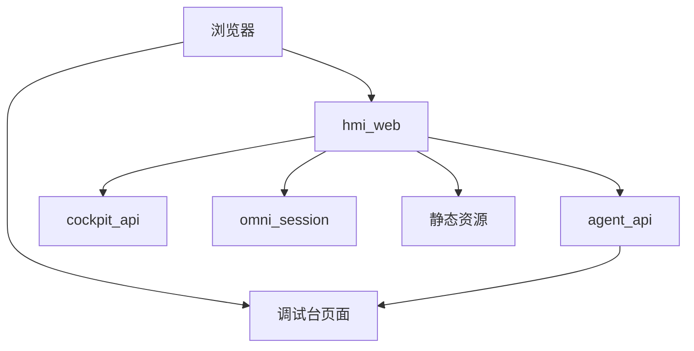
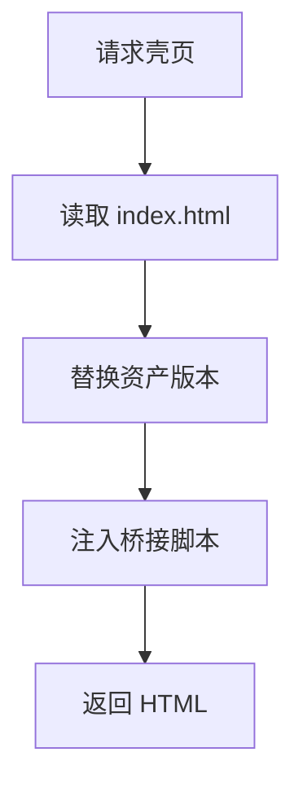
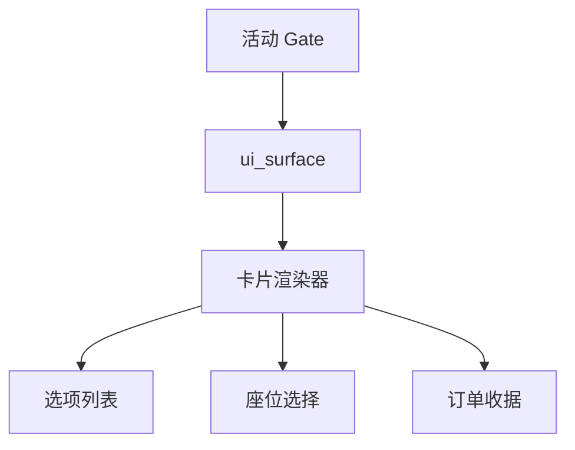
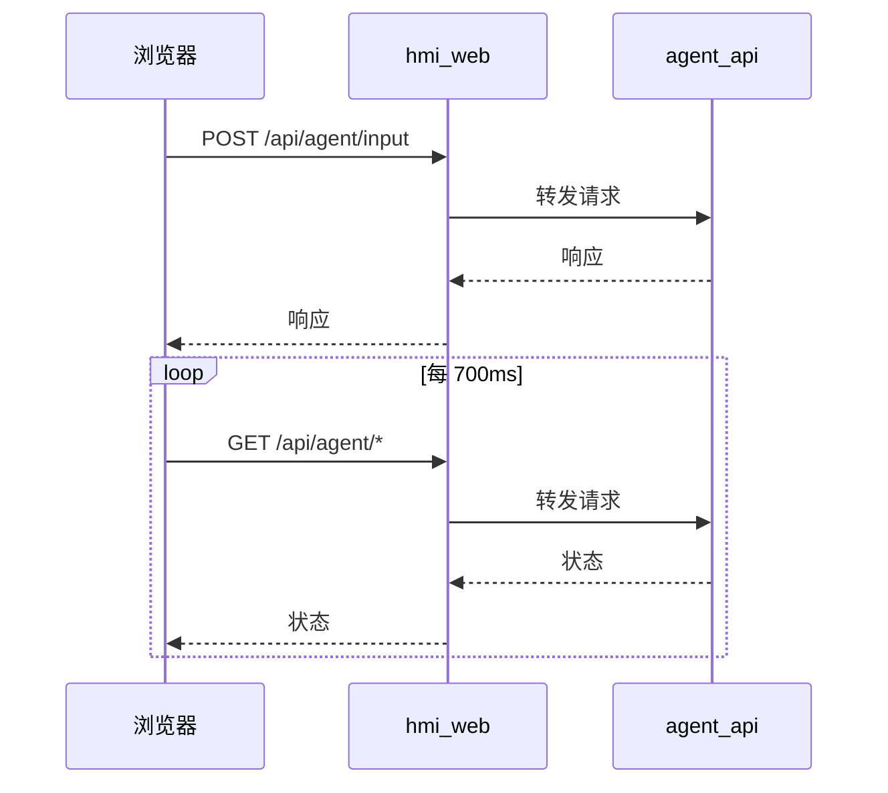
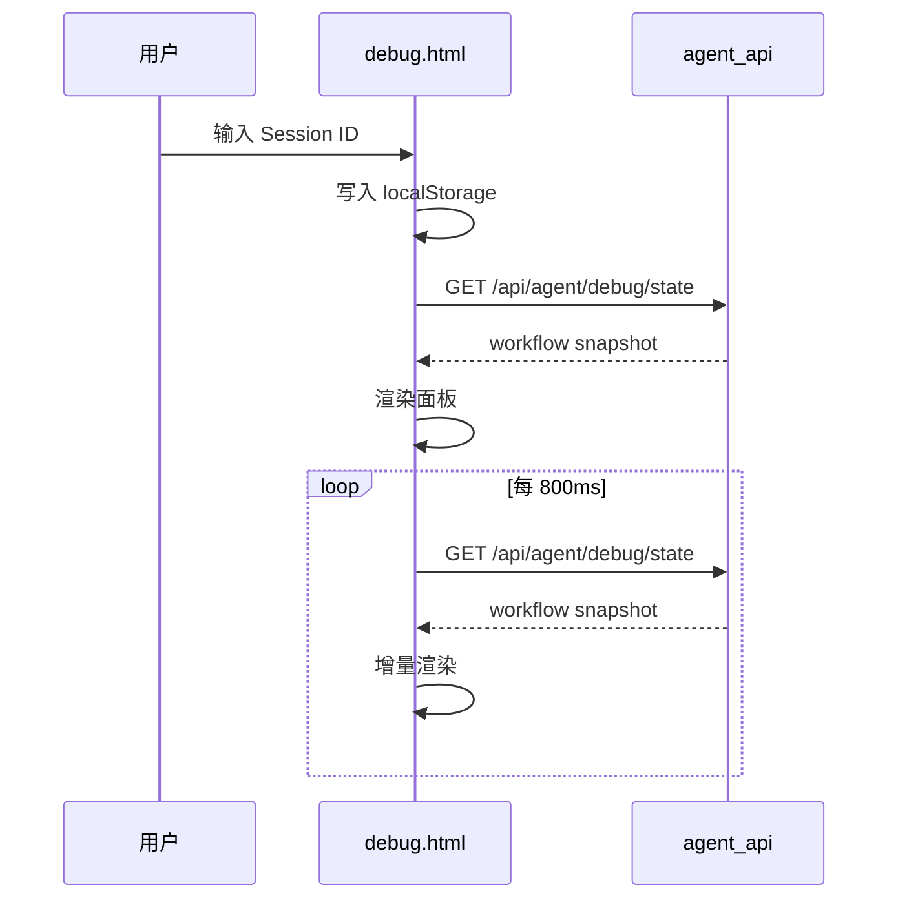

# HMI 前端与调试台

<details>
<summary>Relevant source files</summary>

The following files were used as context for generating this wiki page:

- [services/hmi_web/static/index.html](services/hmi_web/static/index.html)
- [services/hmi_web/static/hmi.js](services/hmi_web/static/hmi.js)
- [services/agent_api/static/debug.html](services/agent_api/static/debug.html)
- [services/agent_api/app.py](services/agent_api/app.py)
</details>

# HMI 前端与调试台

HMI 前端与调试台是 AIDV 项目中面向浏览器、平板和开发观测的两类界面入口。`services/hmi_web` 是唯一的浏览器面服务，负责承载 cockpit 壳页、静态资源、HTTPS CA 下载，并把 `/api/agent/*`、`/api/cockpit/*` 与 `/ws/omni` 转发到内部上游服务；`services/agent_api` 则额外提供只读 Runtime Inspector 调试台，用于观察 workflow、Gate、工具 trace、token 与延迟等运行状态。Sources: [services/hmi_web/app.py:1-64](), [services/agent_api/app.py:55-130](), [README.md:73-147]()

该模块的核心边界是“浏览器面不承载业务逻辑”。`hmi_web` 只负责页面渲染、静态资源、代理转发和语音 WebSocket 中继；自然语言任务入口、工作流状态和调试观测由 `agent_api` 提供；车辆、媒体、导航等真实控制面由 `cockpit_api` 或资源面服务承接。TLS 只在 `hmi_web` 边缘终结，内部服务间使用明文 HTTP。Sources: [services/hmi_web/app.py:1-64](), [README.md:73-147]()

## 服务边界与路由

`hmi_web` 的路由分为三类：壳页路由、静态资源路由、API/WS 代理路由。壳页路由返回 `no-store` HTML，避免浏览器缓存旧壳页；静态资源通过内容哈希做缓存破坏；API 代理只保留 `content-type` 与 `accept` 头，并显式忽略环境代理变量。Sources: [services/hmi_web/app.py:82-163](), [services/hmi_web/app.py:136-199]()

| 路由 | 行为 | 上游或资源 | 说明 |
|---|---|---|---|
| `/` | 重定向到 `/hmi/` | - | 默认入口 |
| `/hmi/` | 渲染 cockpit 壳页 | `static/index.html` | 注入 `agent_bridge.js` |
| `/pad` | 重定向到 `/pad/` | - | Pad 入口短路径 |
| `/pad/` | 渲染 Pad 壳页 | `static/index.html` + `pad.css` | 注入 `body class="hmi-pad-shell"` |
| `/hmi/pad`、`/hmi/pad/` | 重定向到 `/pad/` | - | 兼容别名 |
| `/pad/ca.crt` | 下载项目 CA 证书 | `HMI_CA_CERT_FILE` | 供手机/Pad 安装信任 |
| `/healthz` | 返回健康与上游地址 | - | 包含 `agent_api`、`cockpit_api`、`omni_session_ws` |
| `/static` | 静态资源 | `STATIC_DIR` | 挂载 `StaticFiles` |
| `/api/agent/{path}` | 代理到 `agent_api` | `AGENT_API_URL` | 工作流 API |
| `/api/cockpit/{path}` | 代理到 `cockpit_api` | `COCKPIT_API_URL` | cockpit SOA facade API |
| `/ws/omni` | WebSocket 中继 | `OMNI_SESSION_WS_URL` | 浏览器只看到 `wss://<hmi_web>/ws/omni` |

Sources: [services/hmi_web/app.py:1-64](), [services/hmi_web/app.py:82-163](), [services/hmi_web/app.py:136-199](), [tests/integration/test_hmi_gateway.py:1-69]()



上图表达的是浏览器面与 API 面的分离：`hmi_web` 是浏览器唯一入口，`agent_api` 同时承载工作流 API 与只读调试台，`cockpit_api` 与 `omni_session` 作为上游被代理。Sources: [services/hmi_web/app.py:1-64](), [services/agent_api/app.py:55-130]()

### 代理转发实现

`_forward` 使用 `httpx.AsyncClient` 转发请求，并设置 `trust_env=False`，确保本机服务调用不受环境代理变量影响。读取超时由 `AIDV_HMI_PROXY_READ_TIMEOUT` 控制，默认 20 秒；连接、写入与连接池超时分别为 3 秒、5 秒、3 秒。Sources: [services/hmi_web/app.py:1-64](), [services/hmi_web/app.py:136-199]()

```python
async with httpx.AsyncClient(
    timeout=httpx.Timeout(connect=3, read=FORWARD_READ_TIMEOUT, write=5, pool=3),
    trust_env=False,
) as client:
    upstream = await client.request(
        request.method,
        f"{upstream_base}{request.scope['path']}{query}",
```

Sources: [services/hmi_web/app.py:136-199]()

集成测试用两个本地 `HTTPServer` 桩上游验证代理行为：`/api/agent/input` 的 POST 请求被转发到 agent 上游，`/api/cockpit/navigation/status` 的 GET 请求被转发到 cockpit 上游；当 agent 上游不可达时，`hmi_web` 返回 503，且 `detail.error_type` 为 `hmi_upstream_unavailable`。Sources: [tests/integration/test_hmi_gateway.py:1-69]()

## 页面渲染与静态资产

### 壳页渲染

`/hmi/` 与 `/pad/` 都基于同一个 `static/index.html` 壳页。`_render_cockpit_shell()` 读取 HTML，替换资产版本占位符，并在 `</body>` 前注入 `agent_bridge.js`。响应头设置 `Cache-Control: no-store`，保证壳页每次从服务获取最新结构。Sources: [services/hmi_web/app.py:82-163](), [services/hmi_web/static/index.html:1-58]()

```python
def _render_cockpit_shell() -> HTMLResponse:
    page = _resolve_asset_versions(HMI_FILE.read_text(encoding="utf-8"))
    return HTMLResponse(
        page.replace("</body>", _bridge_tag() + "\n</body>", 1),
        headers={"Cache-Control": "no-store"},
    )
```

Sources: [services/hmi_web/app.py:82-163]()



Sources: [services/hmi_web/app.py:82-163](), [services/hmi_web/static/index.html:1-58]()

### 资产缓存破坏

`index.html` 中静态资源使用 `__V_*__` 占位符，服务端根据文件内容哈希生成版本值。这样每个 CSS/JS 文件可以独立缓存破坏，而不需要整体刷新壳页。Sources: [services/hmi_web/static/index.html:1-58](), [services/hmi_web/app.py:82-163]()

| 占位符 | 对应文件 | 用途 |
|---|---|---|
| `__V_HMI_CSS__` | `hmi.css` | 主 HMI 样式 |
| `__V_RESCUE_CSS__` | `rescue.css` | 白屏救援样式 |
| `__V_VOICE_CSS__` | `voice.css` | 语音交互样式 |
| `__V_HMI_JS__` | `hmi.js` | HMI 基础运行时 |
| `__V_VOICE_JS__` | `voice.js` | 语音运行时 |
| `__V_RESCUE_BLANK__` | `rescue_blank_screen.js` | 白屏救援脚本 |
| `__V_RESCUE_MAP__` | `rescue_static_map.js` | 静态地图恢复脚本 |
| 动态注入 | `agent_bridge.js` | Agent 工作流桥接 |
| Pad 动态注入 | `pad.css` | Pad 响应式样式 |

Sources: [services/hmi_web/app.py:82-163](), [services/hmi_web/static/index.html:276-326]()

### Pad 形态

`/pad/` 在标准 cockpit 壳页基础上做两处替换：在 `</head>` 前注入 `pad.css`，并把 `<body>` 替换为 `<body class="hmi-pad-shell">`。该形态用于平板设备的隔离响应式呈现，同时复用完整 cockpit 壳页。Sources: [services/hmi_web/app.py:136-199]()

```python
page = page.replace("</head>", _pad_css_tag() + "</head>", 1)
page = page.replace("<body>", '<body class="hmi-pad-shell">', 1)
```

Sources: [services/hmi_web/app.py:136-199]()

### HTTPS CA 下载

`/pad/ca.crt` 返回项目自签 CA 证书，供手机、Pad 等客户端设备安装信任。证书路径由 `AIDV_HMI_CA_CERT` 指定，默认位于 `.aidv/tls/aidv-hmi-ca.crt`。如果证书文件不存在，接口返回 404。Sources: [services/hmi_web/app.py:1-64](), [services/hmi_web/app.py:136-199](), [README.md:128-199]()

## 前端运行时

### 页面结构

`static/index.html` 是 cockpit HMI 的主壳页，包含顶栏、左侧 ADAS/地图区域、右侧 Agent 面板、快捷指令按钮、聊天输入框和麦克风按钮。页面加载 `hmi.js`、`voice.js`、`rescue_blank_screen.js` 与 `rescue_static_map.js`；`agent_bridge.js` 由服务端注入。Sources: [services/hmi_web/static/index.html:1-58](), [services/hmi_web/static/index.html:276-326]()

| DOM 元素 | 作用 |
|---|---|
| `#clock` | 顶部时钟 |
| `#musicProvider` | 音乐联动状态 |
| `#systemState` | Agent 在线/降级状态 |
| `#chatInput` | 自然语言输入框 |
| `#chatSendBtn` | 发送按钮 |
| `#micBtn` | 麦克风按钮 |
| `.quick-row button` | 快捷 Prompt 按钮 |

Sources: [services/hmi_web/static/index.html:1-58](), [services/hmi_web/static/index.html:276-326]()

### 会话与本地状态

`hmi.js` 维护一套本地 HMI 状态：会话 ID、用户 ID、空调温度、车窗状态、座椅位置、媒体播放状态、Agent 面板开关、当前域、聚焦 widget、浏览器当前位置等。会话 ID 使用 `localStorage` 持久化，键为 `aidv_hmi_v1_session_id`。Sources: [services/hmi_web/static/hmi.js:1-85]()

```js
const AIDV_STORAGE_PREFIX = "aidv_hmi_v1";
const SESSION_STORAGE_KEY = AIDV_STORAGE_PREFIX + "_session_id";
```

Sources: [services/hmi_web/static/hmi.js:1-85]()

`agent_bridge.js` 另有一套用于 Agent 工作流入口的 `state.sessionId`。其注释说明浏览器刷新应开始干净 cockpit 交互会话，避免旧 waiting Gate 反复重开；代码每次加载生成新的 `hmi_session_*` ID，并写入 `aidv_hmi_hmi_session`。Sources: [services/hmi_web/static/agent_bridge.js:1-48]()

| 标识 | 来源 | 存储键 | 用途 |
|---|---|---|---|
| `sessionId` | `hmi.js` | `aidv_hmi_v1_session_id` | 本地 HMI 状态与位置持久化 |
| `state.sessionId` | `agent_bridge.js` | `aidv_hmi_hmi_session` | Agent 工作流入口会话 |

Sources: [services/hmi_web/static/hmi.js:1-85](), [services/hmi_web/static/agent_bridge.js:1-48]()

### 调试信息渲染

`hmi.js` 提供 `agentDebugSnapshot`，记录 `route`、`trace`、`mcp`、`mcp_detail`、`skill`、`map`、`planner`、`elapsed` 等字段。`renderAgentDebugInfo()` 根据 `agentDebugExpanded` 决定折叠或展开显示；折叠时显示短 session、route、MCP、Skill、compat、Map 与延迟，展开时显示完整 session、trace 和 workflow trace。Sources: [services/hmi_web/static/hmi.js:1-85](), [services/hmi_web/static/hmi.js:73-140]()

```js
agentDebugSnapshot = {
  route: "idle",
  trace: "-",
  mcp: "none",
  mcp_detail: "",
  skill: "none",
  map: "idle",
  planner: "云端 API",
  elapsed: null
};
```

Sources: [services/hmi_web/static/hmi.js:1-85]()

`updateClock()` 每秒刷新 `#clock`；`setSystemState(ok)` 将 `#systemState` 设置为 `AGENT ONLINE` 或 `DEGRADED`，并更新背景、文字与边框颜色。Sources: [services/hmi_web/static/hmi.js:109-199]()

### 位置回退与持久化

`hmi.js` 定义了默认回退位置。公开文档不保留原始地点、精确坐标或含地点信息的来源标识；下例使用 `0, 0` 和通用标签作脱敏示意，并非源码实际默认值或有效定位结果。浏览器当前位置通过 `localStorage` 持久化，键为 `aidv_hmi_v1_browser_location`。Sources: [services/hmi_web/static/hmi.js:1-85](), [services/hmi_web/static/hmi.js:109-199]()

```js
const DEFAULT_FALLBACK_LOCATION = {
  longitude: 0,
  latitude: 0,
  accuracy_meters: null,
  label: "示例位置（脱敏）",
  source: "hmi_dev_fallback_example"
};
```

Sources: [services/hmi_web/static/hmi.js:1-85]()

### 聊天与快捷指令

壳页中的快捷按钮通过 `quickAsk(text)` 触发，聊天输入框通过 `sendChat()` 触发。`agent_bridge.js` 将两者都映射到 `sendHmi(text)`，并清空输入框。`confirmWorkflowPendingAction()` 用于打开当前 `state.activeGate`，`cancelActiveWorkflow()` 通过发送“取消整个任务”触发取消。Sources: [services/hmi_web/static/index.html:276-326](), [services/hmi_web/static/agent_bridge.js:609-660]()

```js
window.sendChat = () => {
  const input = byId("chatInput");
  const text = input?.value?.trim();
  if (input) input.value = "";
  sendHmi(text);
};
window.quickAsk = (text) => sendHmi(text);
```

Sources: [services/hmi_web/static/agent_bridge.js:609-660]()

### Gate 卡片渲染

`agent_bridge.js` 的注释明确：Gate 卡片按声明的 `active_gate.ui_surface` 分发，而不是按 stage-id 前缀或 provider 字段名。渲染器只消费归一化 Gate payload，包括 `stage_label`、`gate_purpose`、`options[].display_name`、`options[].image`、`ui_payload.receipt` 以及座位行列坐标。Sources: [services/hmi_web/static/agent_bridge.js:1-48]()



Sources: [services/hmi_web/static/agent_bridge.js:1-48]()

`agent_bridge.js` 还注入大量样式，覆盖 Gate sheet、选项卡、座位卡、收据行、路线摘要、导航 Gate 全屏布局等。导航 Gate 激活时，`body.hmi-navigation-gate-active` 会让 `#hmiGateModal.hmi-nav-gate` 覆盖全屏，并将路线摘要卡片固定在左侧面板区域。Sources: [services/hmi_web/static/agent_bridge.js:609-660]()

### 轮询刷新

`agent_bridge.js` 在初始化时调用 `refresh()`，并设置 `setInterval(refresh, 700)`，每 700ms 拉取一次 Agent 侧状态。其 `hmi()` 封装统一请求 `/api/agent` 路径，并通过 `hmi_web` 代理到 `agent_api`。Sources: [services/hmi_web/static/agent_bridge.js:1-48](), [services/hmi_web/static/agent_bridge.js:609-660]()



Sources: [services/hmi_web/static/agent_bridge.js:1-48](), [services/hmi_web/static/agent_bridge.js:609-660](), [services/hmi_web/app.py:136-199]()

### 白屏救援

`rescue_blank_screen.js` 提供白屏救援能力。`forceAidvHmiVisible(reason)` 会扫描 `.hmi-shell`、`#clock`、`#systemState`、`#routeState`、`#chatInput` 等关键 DOM 节点，并打印诊断日志。如果 `.hmi-shell` 缺失，则显示 `aidvBlankRescueOverlay` 覆盖层，提示 runtime DOM 缺失。Sources: [services/hmi_web/static/rescue_blank_screen.js:1-47]()

```js
var shell = document.querySelector(".hmi-shell");
var clock = document.getElementById("clock");
var systemState = document.getElementById("systemState");
var routeState = document.getElementById("routeState");
var chatInput = document.getElementById("chatInput");
```

Sources: [services/hmi_web/static/rescue_blank_screen.js:1-47]()

## Agent API 与调试接口

`agent_api` 是工作流 API 服务，`healthz` 声明其运行时后端为 `langgraph`，状态存储为 `sqlite`，`mock` 为 `false`，并暴露 `cockpit_api` 上游地址。Sources: [services/agent_api/app.py:55-130]()

| 端点 | 方法 | 参数 | 说明 |
|---|---|---|---|
| `/healthz` | GET | - | 返回服务健康、端口、状态存储、cockpit 上游 |
| `/debug` | GET | - | 重定向到 `/debug/` |
| `/debug/` | GET | - | 返回只读 Runtime Inspector HTML |
| `/api/agent/state` | GET | `session_id`、可选 `workflow_id` | 返回 Agent 状态 |
| `/api/agent/input` | POST | `InputRequest` | 提交自然语言或事件输入 |
| `/api/agent/workflows/{workflow_id}` | GET | `session_id` | 返回指定 workflow 快照 |
| `/api/agent/workflows/{workflow_id}/cancel` | POST | `session_id`、可选 `reason` | 取消 workflow |
| `/api/agent/debug/state` | GET | `session_id`、可选 `workflow_id` | 返回 active 或 latest terminal workflow |
| `/api/cockpit/{path}` | GET/POST/PUT/PATCH/DELETE | `path` | 代理到 `cockpit_api` |

Sources: [services/agent_api/app.py:55-130](), [services/agent_api/app.py:194-239]()

### 输入模型

`InputRequest` 用于 `/api/agent/input`。从处理函数可见，它至少包含 `text`、`session_id`、`workflow_id`、`event_id`、`idempotency_key`、`source` 等字段；`session_id` 缺失时由 `_session_id()` 生成 `session_<uuid16>`。Sources: [services/agent_api/app.py:55-130]()

```python
session_id = _session_id(request.session_id)
return agent.handle_input(
    session_id,
    request.text,
    source=request.source,
    workflow_id=request.workflow_id,
    event_id=request.event_id,
    idempotency_key=request.idempotency_key,
)
```

Sources: [services/agent_api/app.py:55-130]()

`PatchRequest` 用于局部 patch 场景，要求 `text` 非空，并携带 `session_id`、`plan_version`、`state_version`，可选 `event_id`、`idempotency_key`，默认 `source` 为 `hmi_text`。Sources: [services/agent_api/app.py:55-130]()

| 字段 | 类型 | 约束 | 说明 |
|---|---|---|---|
| `text` | `str` | `min_length=1` | patch 文本 |
| `session_id` | `str` | 必填 | 会话 ID |
| `plan_version` | `int` | 必填 | 计划版本 |
| `state_version` | `int` | 必填 | 状态版本 |
| `event_id` | `str \| None` | 可选 | 事件 ID |
| `idempotency_key` | `str \| None` | 可选 | 幂等键 |
| `source` | `str` | 默认 `hmi_text` | 来源 |

Sources: [services/agent_api/app.py:55-130]()

### 调试状态接口

`/api/agent/debug/state` 是只读调试台的主要数据源。当未提供 `workflow_id` 时，它优先取当前 active workflow，否则取 latest terminal workflow。Sources: [services/agent_api/app.py:194-239]()

```python
target = agent.workflow_snapshots.current(session_id) or (
    agent.workflow_snapshots.latest_snapshot(session_id)
)
target_id = target.get("workflow_id") if target else None
return agent.state(session_id, target_id)
```

Sources: [services/agent_api/app.py:194-239]()

源码片段还显示一个调试视图处理函数，支持按 `kind` 返回 `plan`、`artifacts`、`handoffs`、`scheduler`、`trace` 等子视图，分别映射到 workflow 数据中的 `plan_ir`、`artifacts`、`handoffs`、`task_states`、`trace`。未知 `kind` 返回 404。Sources: [services/agent_api/app.py:194-239]()

| `kind` | workflow 字段 |
|---|---|
| `plan` | `plan_ir` |
| `artifacts` | `artifacts` |
| `handoffs` | `handoffs` |
| `scheduler` | `task_states` |
| `trace` | `trace` |

Sources: [services/agent_api/app.py:194-239]()

### cockpit 代理

`agent_api` 也提供 `/api/cockpit/{path:path}` 代理。其注释说明：HMI bridge 负责自然语言与工作流入口，而该代理用于壳页状态卡片、AMap JS 配置和直接车辆/媒体控制，避免客户端在挂载到 `agent_api` 端口时静默退化成伪造显示。Sources: [services/agent_api/app.py:194-239]()

```python
@app.api_route("/api/cockpit/{path:path}", methods=["GET", "POST", "PUT", "PATCH", "DELETE"])
async def cockpit_api_proxy(path: str, request: Request) -> Response:
```

Sources: [services/agent_api/app.py:194-239]()

## 调试台 UI

`/debug/` 返回 `static/debug.html`，标题为 `AIDV Runtime Inspector`，副标题明确“只读后台观测窗口 · 不修改任务状态”。Sources: [services/agent_api/app.py:55-130](), [services/agent_api/static/debug.html:1-49]()

调试台顶部提供 Session ID 输入、连接 Session、立即刷新、复制完整 JSON、自动刷新开关。卡片区域显示 `Connection`、`Workflow`、`Status`、`Active Gate`、`Cloud Tokens`、`Updated`。Sources: [services/agent_api/static/debug.html:1-49]()

| 面板 | DOM 目标 | 内容 |
|---|---|---|
| Pre-Arbitration / Domain | `#domainView` | 输入文本、最后决策、域决策、session |
| Candidate Tool List | `#candidateView` | 候选工具列表 |
| Plan IR / Patch | `#planView` | `plan_ir` 与 `patch_history` |
| Active Gate / Fast Actions | `#gateView` | 活动 Gate 与 fast actions |
| 真实 Tool Trace | `#toolTraceView` | 工具调用表：task、tool、real、result、latency、error |
| Runtime Timeline | `#timelineView` | 事件时间线 |
| Token / Latency Metrics | `#metricsView` | token 汇总与 LLM 调用指标 |
| Artifacts / Handoffs | `#artifactView` | artifacts 与 handoffs |
| Raw | `#rawView` | 完整 JSON |

Sources: [services/agent_api/static/debug.html:1-49](), [services/agent_api/static/debug.html:71-98]()



Sources: [services/agent_api/static/debug.html:71-98](), [services/agent_api/app.py:194-239]()

调试台通过 `fetch('/api/agent/debug/state?session_id=...')` 拉取状态，并设置 `cache: no-store`。渲染前会计算 `lastRenderKey`，由 `workflow_id`、`state_version`、`status`、`updated_at`、`active_gate.state_version` 以及 fast actions 的 ID/状态/更新时间组成，避免无变化时重复渲染。Sources: [services/agent_api/static/debug.html:71-98]()

```js
const response = await fetch(
  `/api/agent/debug/state?session_id=${encodeURIComponent(session())}`,
  {cache:"no-store"}
);
```

Sources: [services/agent_api/static/debug.html:71-98]()

自动刷新间隔为 800ms。当自动刷新关闭时，清除定时器并移除 `liveDot` 的 `on` 状态。Sources: [services/agent_api/static/debug.html:71-98]()

## 配置与端口

### 环境变量

`hmi_web` 的关键配置包括上游 URL、CA 证书路径和代理读取超时。上游 URL 通过 `service_url()` 生成，可被环境变量覆盖。Sources: [services/hmi_web/app.py:1-64]()

| 变量 | 默认/来源 | 说明 |
|---|---|---|
| `AIDV_AGENT_API_URL` | `AGENT_API_PORT` | agent_api 上游 |
| `AIDV_COCKPIT_API_URL` | `COCKPIT_API_PORT` | cockpit_api 上游 |
| `AIDV_OMNI_WS_URL` | `OMNI_SESSION_PORT` | omni_session WS 上游 |
| `AIDV_HMI_CA_CERT` | `.aidv/tls/aidv-hmi-ca.crt` | HMI HTTPS CA 证书 |
| `AIDV_HMI_PROXY_READ_TIMEOUT` | `20` | API 代理读取超时，秒 |

Sources: [services/hmi_web/app.py:1-64]()

### 端口布局

README 给出本地与 Docker 宿主端口映射。`hmi_web` 是唯一对外 HTTPS 服务；内部服务间使用明文 HTTP。Docker 宿主侧默认映射到 +100 号段，容器内部端口与本地一致。Sources: [README.md:73-147]()

| 服务 | 平面 | 本地端口 | Docker 宿主端口 |
|---|---|---:|---:|
| `hmi_web` | 浏览器面 | 8081 | 8181 |
| `cockpit_api` | API 面 | 18011 | 18111 |
| `agent_api` | API 面 | 18012 | 18112 |
| `omni_session` | API 面 | 18013 | 18113 |
| `online/navigation` | 资源面 | 18101 | 18201 |
| `tool_gateway` | 资源面 | 18102 | 18202 |
| `vehicle/context` | 资源面 | 18103 | 18203 |
| `vehicle/climate` | 资源面 | 18104 | 18204 |
| `vehicle/window` | 资源面 | 18105 | 18205 |
| `vehicle/seat` | 资源面 | 18106 | 18206 |
| `online/media` | 资源面 | 18107 | 18207 |

Sources: [README.md:73-147]()

### TLS 边界

本地或内网默认使用自签 CA 与证书，首次启动可自动生成到 `.aidv/tls/`。浏览器访问 `https://<host>:8081/` 时首次需要继续访问；手机或 Pad 可通过 `/pad/ca.crt` 安装 CA。公网部署可设置 `AIDV_HMI_TLS_CERT` 与 `AIDV_HMI_TLS_KEY` 指向真实证书，并通过 `AIDV_HOST_HMI_WEB_PORT=443` 映射标准 HTTPS 端口。Sources: [README.md:128-199](), [services/hmi_web/app.py:1-64]()

## 测试契约

`tests/integration/test_hmi_gateway.py` 固定 HMI 网关的关键契约：壳页渲染、bridge 注入、Pad 样式注入、静态资源服务、agent/cockpit 代理路由、上游不可用映射。Sources: [tests/integration/test_hmi_gateway.py:1-69]()

| 测试 | 验证点 |
|---|---|
| `test_healthz_reports_both_upstreams` | `/healthz` 返回 `agent_api` 与 `cockpit_api` 上游 |
| `test_shell_page_renders_with_bridge_injected` | `/` 返回 200，且包含 `agent_bridge.js` 与 `</html>` |
| `test_pad_page_adds_pad_stylesheet_and_body_class` | `/pad/` 包含 `pad.css` 与 `hmi-pad-shell` |
| `test_static_assets_are_served` | `/static/agent_bridge.js` 与 `/static/pad.css` 可访问 |
| `test_agent_api_calls_forward_to_the_backend` | `/api/agent/input` 转发到 agent 上游 |
| `test_cockpit_api_calls_forward_to_cockpit_api` | `/api/cockpit/navigation/status` 转发到 cockpit 上游 |
| `test_unreachable_agent_backend_maps_to_503` | agent 上游不可达时返回 503 与 `hmi_upstream_unavailable` |

Sources: [tests/integration/test_hmi_gateway.py:1-69]()

测试 fixture 使用两个本地 `HTTPServer` 作为桩上游，并通过 `monkeypatch` 覆盖 `hmi.AGENT_API_URL` 与 `hmi.COCKPIT_API_URL`，从而在不依赖真实服务的情况下验证代理行为。Sources: [tests/integration/test_hmi_gateway.py:1-69]()

## 总结

HMI 前端与调试台由 `hmi_web` 的浏览器壳页、静态资产、代理网关，以及 `agent_api` 的只读 Runtime Inspector 共同组成。`hmi_web` 通过内容哈希、`no-store` 壳页、bridge 注入和 CA 下载保证浏览器面可维护、可信任、可缓存；`agent_bridge.js` 与 `hmi.js` 分别承担工作流交互和本地 HMI 状态；`debug.html` 提供面向开发者的只读运行观测窗口。整体设计保持了浏览器面、API 面与资源面的清晰边界，并通过集成测试固定关键代理与渲染契约。Sources: [services/hmi_web/app.py:1-64](), [services/hmi_web/static/agent_bridge.js:1-48](), [services/hmi_web/static/hmi.js:1-85](), [services/agent_api/static/debug.html:1-49](), [tests/integration/test_hmi_gateway.py:1-69]()

---

**关联源文件:** `services/hmi_web/static/index.html`, `services/hmi_web/static/hmi.js`, `services/agent_api/static/debug.html`, `services/agent_api/app.py`
