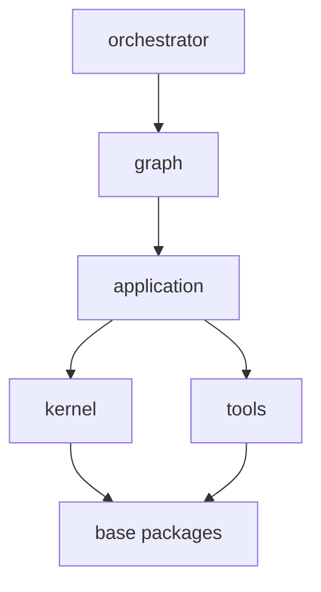
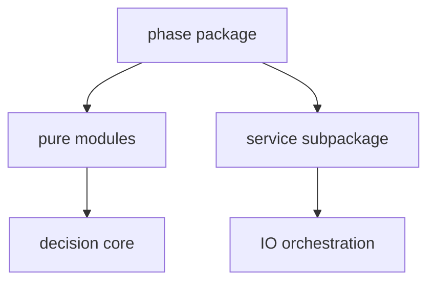
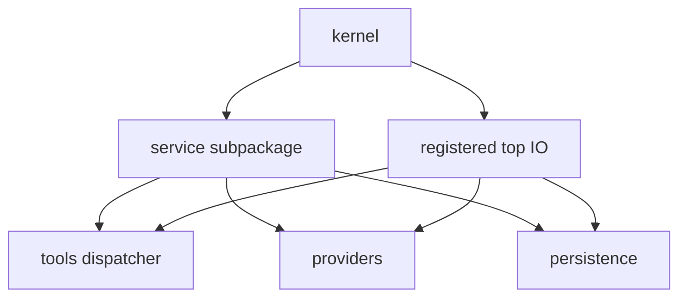
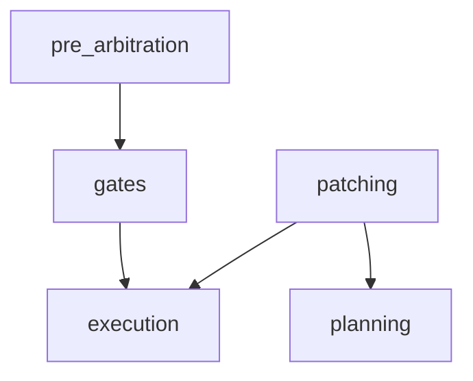
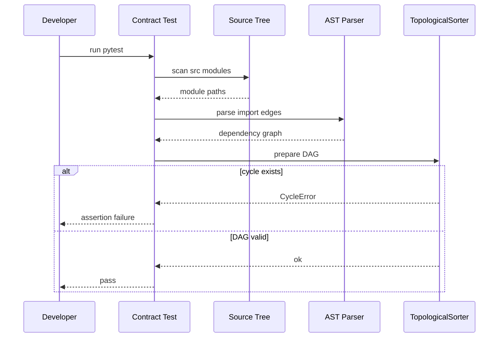
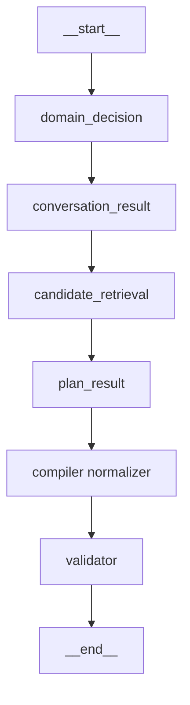

# 内核包 DAG 与分层契约

<details>
<summary>Relevant source files</summary>

The following files were used as context for generating this wiki page:

- [docs/ARCHITECTURE.md](docs/ARCHITECTURE.md)
- [AGENTS.md](AGENTS.md)
- [src/aidv_agent/__init__.py](src/aidv_agent/__init__.py)
- [tests/contract/test_layering.py](tests/contract/test_layering.py)
- [tests/contract/test_ports.py](tests/contract/test_ports.py)
</details>

# 内核包 DAG 与分层契约

“内核包 DAG 与分层契约”描述 `src/aidv_agent` 内部的包依赖方向、内核五相位包的垂直布局，以及由 `tests/contract/test_layering.py` 锁定的架构不变式。该机制的核心目标是保持依赖图始终为有向无环图（DAG），防止高层反向依赖低层、内核相位之间随意互导、I/O 逻辑泄漏进确定性纯模块，或 `graph` / `orchestrator` 之间重新形成环。

项目文档将这一约束概括为：`src/aidv_agent` 保持 9 包单向依赖；`tests/contract/test_layering.py` 在包级和模块级同时锁定该不变式。内核包 `kernel` 内部进一步按“确定性”拆分：每个相位包包含无 I/O 的纯模块，以及可选的 `service/` 子包承载 I/O 编排。违反该分层契约会被视为架构破坏，而不是普通实现细节。  
Sources: [README.md:176-258](), [tests/contract/test_layering.py:1-69](), [src/aidv_agent/kernel/__init__.py:1-22](), [AGENTS.md:1-43]()

## 包级依赖方向

### 单向依赖链

分层契约测试的文档说明指出，在解决 `graph` 与 `application` 之间的历史循环后，仓库依赖方向被整理为一条严格单向链：



该链表达的是依赖方向，而不是运行时调用顺序：上层可以依赖下层，下层不得反向依赖上层。基础包 `contracts`、`persistence`、`providers`、`observability` 被定义为稳定底层，要求不导入任何兄弟包。  
Sources: [tests/contract/test_layering.py:1-69](), [README.md:176-258](), [AGENTS.md:1-43]()

### 基础包约束

`tests/contract/test_layering.py` 将以下包定义为必须保持无兄弟包依赖的基础包：

| 基础包 | 约束 |
|---|---|
| `contracts` | 不导入其他 `aidv_agent` 兄弟包 |
| `persistence` | 不导入其他 `aidv_agent` 兄弟包 |
| `providers` | 不导入其他 `aidv_agent` 兄弟包 |
| `observability` | 不导入其他 `aidv_agent` 兄弟包 |

`contracts` 包导出事件、计划、补丁、任务、词表和 workflow 快照等版本化契约类型，是上层模块共享的稳定类型面。  
Sources: [tests/contract/test_layering.py:1-69](), [tests/contract/test_layering.py:243-278](), [src/aidv_agent/contracts/__init__.py:1-40]()

### 内核五相位包

`kernel` 包包含五个相位包：

| 相位包 | 名称 |
|---|---|
| `gates` | 门生命周期相关相位 |
| `planning` | 规划相关相位 |
| `execution` | 执行相关相位 |
| `patching` | 补丁相关相位 |
| `pre_arbitration` | 预仲裁相关相位 |

`kernel` 包文档明确说明：每个相位包内部按“确定性”拆分，而不是按身份拆分。纯模块保存无 I/O 的决策核心；可选 `service/` 子包保存该相位的 I/O 编排，例如 dispatcher、provider、repository 调用。相位包的 `__init__` 只重导出纯面，因此导入例如 `aidv_agent.kernel.gates` 不应拉入 service 依赖。  
Sources: [src/aidv_agent/kernel/__init__.py:1-22](), [tests/contract/test_layering.py:1-69]()



## 模块级分层规则

### I/O 面限制

分层契约规定，内核中的 I/O 面只能出现在两个位置：

1. 某个相位包的 `service/` 子包；
2. 已注册的顶层 I/O 模块。

测试中定义的 I/O 前缀包括：

| I/O 面 | 前缀 |
|---|---|
| 工具调度 | `aidv_agent.tools.dispatcher` |
| Provider 层 | `aidv_agent.providers` |
| 持久化层 | `aidv_agent.persistence` |

已注册的顶层 I/O 模块为：

| 模块 | 说明 |
|---|---|
| `aidv_agent.kernel.ingest_event` | 顶层事件摄入 I/O 模块 |
| `aidv_agent.kernel.fast_actions` | 顶层快速动作 I/O 模块 |



`test_kernel_io_stays_inside_service_subpackages` 会检查所有非 I/O 内核模块是否违规导入上述 I/O 前缀。若纯模块直接导入 `tools.dispatcher`、`providers` 或 `persistence`，测试会失败。  
Sources: [tests/contract/test_layering.py:1-69](), [tests/contract/test_layering.py:182-228](), [src/aidv_agent/kernel/__init__.py:1-22]()

### 纯模块不得导入 service

内核相位包中的纯模块不得导入本相位的 `service/` 子包。该规则确保确定性决策核心不依赖 I/O 编排层。

`test_kernel_pure_modules_never_import_service` 的判定逻辑是：

- 只检查 `aidv_agent.kernel.` 下的模块；
- 跳过 `_is_kernel_io_module` 识别出的 I/O 模块；
- 若剩余纯模块依赖了任何包含 `.service` 的内核模块，则视为违规。

这意味着 `kernel` 内部的依赖方向是：纯模块可以构成决策核心，`service/` 子包负责调用外部 I/O 面；纯模块不能反向依赖 `service/`。  
Sources: [tests/contract/test_layering.py:216-253](), [src/aidv_agent/kernel/__init__.py:1-22]()

### 跨相位导入必须注册

`kernel` 内部允许跨相位导入，但必须是显式注册的架构边。测试中登记的合法边如下：

| 源相位 | 目标相位 |
|---|---|
| `aidv_agent.kernel.pre_arbitration` | `aidv_agent.kernel.gates` |
| `aidv_agent.kernel.patching` | `aidv_agent.kernel.execution` |
| `aidv_agent.kernel.patching` | `aidv_agent.kernel.planning` |
| `aidv_agent.kernel.gates` | `aidv_agent.kernel.execution` |



测试注释强调：新增跨相位边是架构决策，而不是便利性选择。`test_kernel_cross_phase_imports_are_registered` 会扫描内核模块，若发现未登记的跨相位导入，则报告违规。  
Sources: [tests/contract/test_layering.py:1-69](), [tests/contract/test_layering.py:216-253]()

### graph 与 orchestrator 边界

分层契约对 `graph` 和 `orchestrator` 有明确边界：

| 规则 | 约束 |
|---|---|
| `kernel` 位于 `graph` / `orchestrator` 之下 | `kernel` 模块不得导入 `aidv_agent.graph` 或 `aidv_agent.orchestrator` |
| `graph` 保持拓扑层 | `graph` 模块不得导入 `orchestrator`，也不得导入 `kernel.execution` 核心 |
| `orchestrator` 是组合根 | `src` 内除 `orchestrator` 自身外，任何模块不得导入 `orchestrator` |

这些规则保证 `orchestrator` 位于依赖链顶端，`graph` 不反向依赖组合根，`kernel` 不依赖上层编排。  
Sources: [tests/contract/test_layering.py:115-165](), [tests/contract/test_layering.py:151-198](), [src/aidv_agent/kernel/__init__.py:1-22]()

### tools 与 domains 边界

`tools` 包不得导入 `domains`。测试注释说明：`tools` 是两个 adapter 实现者共享的更底层；如果 `tools` 导入 `domains`，会形成循环，因为 domain adapters 已经导入 `tools.payloads` / `tools.adapters`。因此共享机制，例如 `ToolAdapter` 协议、`AdapterRegistry`、`AdapterArtifact`，应位于 `tools`，而不是 `domains`。  
Sources: [tests/contract/test_layering.py:243-278]()

## 契约测试执法

### 测试执行流程

`tests/contract/test_layering.py` 通过解析源码导入关系，在包级和模块级构建依赖图，并使用 `graphlib.TopologicalSorter` 检查无环性。



该测试不是行为测试，而是架构不变式执法。项目守则要求：当 `tests/contract/` 红灯时，应先理解架构为什么被破坏，不要为了让测试变绿而修改断言或删除测试。  
Sources: [tests/contract/test_layering.py:1-69](), [tests/contract/test_layering.py:115-165](), [AGENTS.md:1-43]()

### 关键测试断言

| 测试 | 锁定内容 |
|---|---|
| `test_package_dependency_graph_is_acyclic` | 包级依赖图无环 |
| `test_module_dependency_graph_is_acyclic` | 模块级依赖图无环 |
| `test_kernel_stays_below_graph_and_orchestrator` | `kernel` 不得导入 `graph` / `orchestrator` |
| `test_graph_never_imports_orchestrator_or_execution_core` | `graph` 不得导入 `orchestrator` 或 `kernel.execution` |
| `test_orchestrator_is_imported_by_nothing_inside_src` | `orchestrator` 不得被 `src` 内其他模块导入 |
| `test_providers_reachable_only_through_application_ports` | `providers` 仅允许由指定 planning / patching service 导入 |
| `test_kernel_io_stays_inside_service_subpackages` | 内核 I/O 面只能位于 service 子包或注册顶层 I/O 模块 |
| `test_kernel_pure_modules_never_import_service` | 纯内核模块不得导入 service |
| `test_kernel_cross_phase_imports_are_registered` | 内核跨相位导入必须登记 |
| `test_base_packages_import_no_sibling_package` | 基础包不得导入兄弟包 |
| `test_tools_never_import_domains` | `tools` 不得导入 `domains` |

其中，`providers` 的访问被限制在两个 LLM-proposal 相位服务：

| 允许导入 providers 的模块 | 相位 |
|---|---|
| `aidv_agent.kernel.planning.service` | planning |
| `aidv_agent.kernel.patching.service` | patching |

这体现了“provider 调用属于 I/O 编排，必须留在 service 层”的分层原则。  
Sources: [tests/contract/test_layering.py:1-69](), [tests/contract/test_layering.py:115-165](), [tests/contract/test_layering.py:151-198](), [tests/contract/test_layering.py:182-228](), [tests/contract/test_layering.py:216-253](), [tests/contract/test_layering.py:243-278]()

## 内核规划面的分层体现

### prompt_rules 聚合域声明

`src/aidv_agent/kernel/planning/prompt_rules.py` 展示了内核规划面如何从域 adapter 声明中聚合提示词规则和 UI 合同。该模块的定位是：域知识由 adapter 声明，`prompt_rules` 只聚合提示词构建器渲染所需视图，以及 compiler / plan_protect 表消费的视图。新增域时，只需携带 adapter，提示词面自动扩展，内核提示词模块中不再保留手抄规则文本或手抄 UI 表。

该模块提供的主要聚合函数包括：

| 函数 | 作用 |
|---|---|
| `decision_domain_entries` | 生成允许域列表条目，包含域名、简述、触发与排除说明 |
| `plan_contract_sections` | 按域生成计划合同节，节锚为 domain 标识 |
| `handoff_slot_marker` | 生成 handoff 槽位标记的单一格式来源 |
| `fulfillment_slot_lines` | 为线下服务履约域生成 `域名=标记` 行 |
| `declared_required_stages` | 返回决策域到首查工具和 UI 门的声明映射 |
| `ui_contracts` | 生成 UI 名到域、动作、门参数白名单的合同表 |
| `tool_section` | 渲染工具清单静态节 |
| `gate_ui_section` | 渲染门 UI 清单静态节 |
| `placeholder_section` | 渲染门店占位符清单静态节 |
| `gate_domain_by_ui` | 返回可兑现 handoff 的到店履约门到域名的映射 |

```python
def handoff_slot_marker(domain: str) -> str:
    return f"{{{{handoff.fulfillment_location.{domain}}}}}"
```

该函数体现“跨域协议住 kernel，域只报标识”的原则：标记格式由内核统一生成，禁止各处手抄。  
Sources: [src/aidv_agent/kernel/planning/prompt_rules.py:1-56](), [src/aidv_agent/kernel/planning/prompt_rules.py:42-94](), [src/aidv_agent/kernel/planning/prompt_rules.py:118-162](), [src/aidv_agent/kernel/planning/prompt_rules.py:150-220]()

### 计划合同节结构

`tests/planning/test_prompt_rules.py` 锁定计划合同节的结构几何：每个域一节，节锚为 domain 标识，且按注册顺序出现。当前测试期望的节锚顺序为：

| 顺序 | 域 |
|---|---|
| 1 | `vehicle` |
| 2 | `navigation` |
| 3 | `luckin_life_service` |
| 4 | `mcdonald_life_service` |
| 5 | `maoyan_life_service` |
| 6 | `media` |

测试只锁结构，不锁每节规则文本，因为措辞可能高频迭代。  
Sources: [tests/planning/test_prompt_rules.py:46-88]()

### 履约槽位标记

`fulfillment_slot_lines` 为 `store_fulfillment` 域生成 `域名=标记` 行。测试锁定的当前结果为：

```text
luckin_life_service={{handoff.fulfillment_location.luckin_life_service}}
mcdonald_life_service={{handoff.fulfillment_location.mcdonald_life_service}}
maoyan_life_service={{handoff.fulfillment_location.maoyan_life_service}}
```

该结构保证 planner 按域名精确匹配选择途经标记，而不是依赖品牌标签跳转。  
Sources: [tests/planning/test_prompt_rules.py:46-88](), [src/aidv_agent/kernel/planning/prompt_rules.py:42-94]()

### 必需阶段映射

`declared_required_stages` 返回决策域到“首查工具 + UI 门”的映射。测试锁定的当前映射为：

| 域 | 首查工具 | UI 门 |
|---|---|---|
| `navigation` | `navigation_plan_request` | `navigationPreview` |
| `luckin_life_service` | `queryShopList` | `luckinModal` |
| `mcdonald_life_service` | `queryMcDonaldNearbyStores` | `mcdonaldModal` |
| `maoyan_life_service` | `queryMaoyanHotMovies` | `maoyanModal` |

该映射同时服务于提示词渲染和内核侧 `plan_protect` 执法。  
Sources: [tests/planning/test_prompt_rules.py:46-88](), [src/aidv_agent/kernel/planning/prompt_rules.py:42-94]()

### UI 合同

`ui_contracts` 从 adapter 声明派生 UI 合同表。合同条目包含：

| 字段 | 来源 |
|---|---|
| `domain` | `required_stages_map` 的域键 |
| `actions` | adapter 声明的 `gate_actions` |
| `gate_args` | `gate_args_docs` 的键集 |

`tests/planning/test_ui_contracts.py` 验证了两类约束：

1. `navigationPreview` 必须接受 `select_index`，因为 HMI 将单一路由 artifact 渲染为可点选卡片，触摸选择必须在确认前保持合法；
2. 每个声明了 `required_stages_map` 的域，其门必须出现在 UI 合同表中，否则运行期归一化注入门任务时可能查表落空。

```python
contracts[stages[1]] = UIContract(
    domain=domain,
    actions=tuple(actions),
    gate_args=gate_args,
)
```

该实现说明：同一声明既生成提示词文案，也生成内核清洗白名单，避免两处手抄造成漂移。  
Sources: [src/aidv_agent/kernel/planning/prompt_rules.py:118-162](), [src/aidv_agent/kernel/planning/prompt_rules.py:150-220](), [tests/planning/test_ui_contracts.py:1-31]()

## 规划图与内核协作

`tests/planning/test_planning_graph.py` 展示 `graph` 层如何依赖 `kernel` 层完成规划。`build_planning_graph` 的节点集合被锁定为：



该测试还使用以下内核与契约组件：

| 组件 | 来源 | 作用 |
|---|---|---|
| `DomainDecision` | `aidv_agent.contracts` | 域决策契约 |
| `PlanResultSpec` | `aidv_agent.contracts` | 规划结果规格契约 |
| `compile_plan_result` | `aidv_agent.kernel.planning` | 编译规划结果 |
| `normalize_plan_contract` | `aidv_agent.kernel.planning.plan_protect` | 归一化计划合同 |
| `validate_plan_contract` | `aidv_agent.kernel.planning.plan_protect` | 校验计划合同 |
| `ui_contracts` | `aidv_agent.kernel.planning.prompt_rules` | 提供 UI 合同表 |
| `PlanningProviderCall` | `aidv_agent.kernel.planning.service` | provider 调用类型 |
| `candidate_tools` | `aidv_agent.kernel.planning.tool_selection` | 候选工具选择 |

这体现了 `graph` 可以依赖 `kernel`，而 `kernel` 不得依赖 `graph` 的分层方向。  
Sources: [tests/planning/test_planning_graph.py:1-51](), [tests/contract/test_layering.py:115-165]()

## 组合根与入口边界

`LangGraphAgent` 是 `orchestrator` 中的组合根，也是内核的单一入口。其职责包括：

| 职责 | 说明 |
|---|---|
| composition root | 组装服务、用例和存储 |
| facade | 提供 `handle_input`、`state`、`resolve_gate`、`patch_workflow`、`cancel_workflow` 等公开 API |
| transaction boundary | 通过 `advance_to_boundary` 驱动 workflow 到下一个相位边界 |

`agent.py` 的导入面显示它位于依赖链顶端：它导入 `graph.main`、`kernel.execution.service`、`kernel.gates`、`kernel.gates.service`、`kernel.ingest_event`、`kernel.patching.service`、`persistence`、`tools` 等模块。与此同时，分层契约要求 `src` 内其他模块不得导入 `orchestrator`，从而保证组合根只被外部服务面使用，而不是被内部模块反向依赖。  
Sources: [src/aidv_agent/orchestrator/agent.py:1-65](), [tests/contract/test_layering.py:151-198]()

## 契约锁与离线验证

分层契约属于 `tests/contract/` 的架构不变式执法。项目 README 将契约锁描述为端口、分层、工具面、服务模块归属、`.env.example` 同步等内容的测试执法。`tests/contract/test_wire_payload_shape.py` 则展示契约测试如何在离线条件下组装内核与编排入口：它使用 `FakeToolDispatcher` 和 `ScriptedPlanningService` 构造 `LangGraphAgent`，并锁定 state、envelope、result、patch 等线上载荷键集。

这说明分层契约不仅约束导入方向，也支撑离线可验证性：架构测试和关键行为测试都可以在无真实 LLM、无外部服务、无网络条件下运行。  
Sources: [README.md:176-258](), [tests/contract/test_wire_payload_shape.py:1-92](), [AGENTS.md:1-43]()

## 总结

内核包 DAG 与分层契约通过“包级单向链 + 模块级规则 + 契约测试执法”三层机制维护 `src/aidv_agent` 的架构稳定性。`kernel` 内部以五相位包垂直布局，每个相位包区分纯模块与 `service/` I/O 子包；`graph` 与 `orchestrator` 位于内核之上，但不得被内核反向依赖；`providers`、`persistence`、`tools.dispatcher` 等 I/O 面只能出现在受控位置；跨相位导入必须显式注册。`tests/contract/test_layering.py` 将这些规则转化为可执行断言，使架构漂移在测试阶段被暴露，而不是在运行时或维护成本中累积。  
Sources: [tests/contract/test_layering.py:1-69](), [src/aidv_agent/kernel/__init__.py:1-22](), [AGENTS.md:1-43](), [README.md:176-258](), [src/aidv_agent/orchestrator/agent.py:1-65]()

---

**关联源文件:** `docs/ARCHITECTURE.md`, `AGENTS.md`, `src/aidv_agent/__init__.py`, `tests/contract/test_layering.py`, `tests/contract/test_ports.py`
