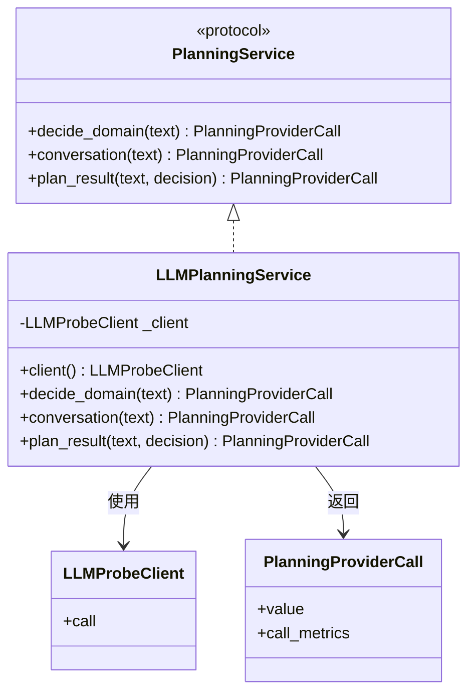
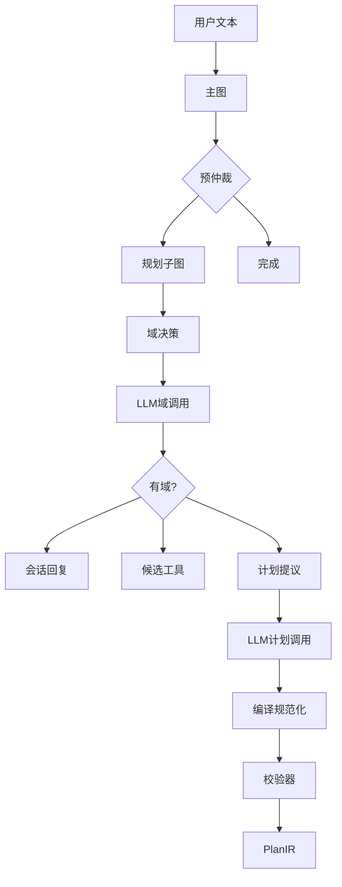
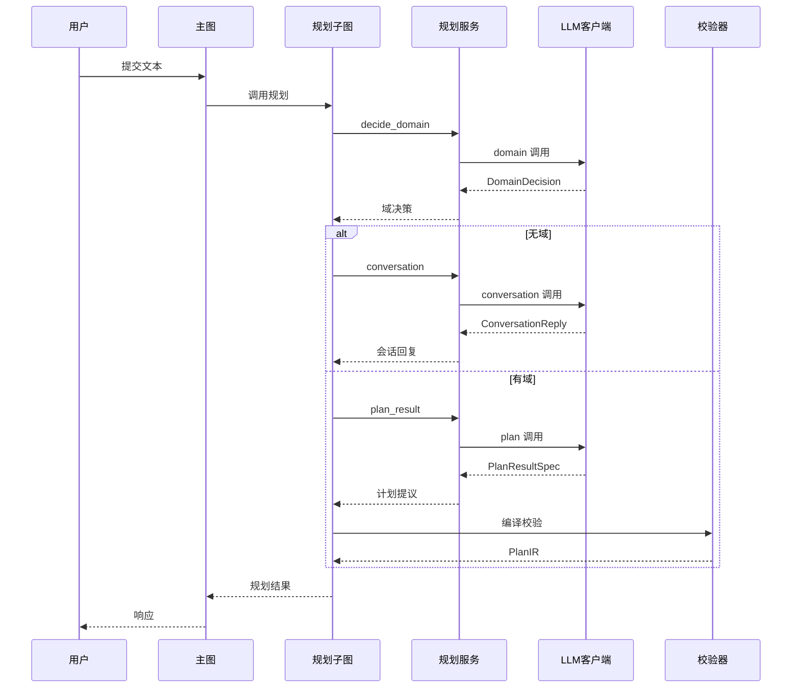

# LLM 规划与模型集成

<details>
<summary>Relevant source files</summary>

The following files were used as context for generating this wiki page:

- [src/aidv_agent/kernel/planning/prompt_rules.py](src/aidv_agent/kernel/planning/prompt_rules.py)
- [README.md](README.md)
- [.env.example](.env.example)
- [compose.yaml](compose.yaml)
- [tests/contract/test_wire_payload_shape.py](tests/contract/test_wire_payload_shape.py)
</details>

# LLM 规划与模型集成

AIDV Agent 的 LLM 规划链路负责把用户自然语言转成“域决策、会话回复或计划提议”，但 LLM 只承担提议职责，不直接执行工具、不直接写入工作流、不直接决定 Gate 生命周期。真实规划依赖 OpenAI 兼容端点，本地编译器、规范化器与校验器负责把 LLM 输出收敛为可执行的 `PlanIR` 或拒绝为结构化错误。该设计使系统在无 key、无网、无外部服务时仍可用 `ScriptedPlanningService` 与 `FakeToolDispatcher` 完成离线回归。

Sources: [src/aidv_agent/kernel/planning/service/__init__.py:1-64](), [src/aidv_agent/graph/planning.py:1-56](), [README.md:1-87](), [tests/e2e/test_minimal_kernel.py:1-69]()

## 组件边界

LLM 规划由四层组成：规划图、规划服务、LLM 传输层、契约与保护层。`PlanningService` 是结构化端口，`LLMPlanningService` 是生产实现，`ScriptedPlanningService` 与测试 stub 是离线或测试实现。`LLMProbeClient` 只做 OpenAI 兼容传输，不承担计划语义。



`PlanningProviderCall` 是每次 provider 调用的统一返回包，包含契约化 `value` 与 `call_metrics`。`call_metrics` 会进入 `state["llm_calls"]`，用于观测每次 LLM 调用。

Sources: [src/aidv_agent/kernel/planning/service/__init__.py:17-64](), [src/aidv_agent/providers/llm/__init__.py:1-36]()

## 规划图与节点

`build_planning_graph` 构造 LangGraph 规划子图。测试锁定的节点集合为：`__start__`、`domain_decision`、`conversation_result`、`candidate_retrieval`、`plan_result`、`compiler_normalizer`、`validator`、`__end__`。



| 节点 | 职责 | 关键输出 |
|---|---|---|
| `domain_decision` | 调用 `planning_service.decide_domain(text)`，解析为 `DomainDecision` | `domain_decision`、`llm_calls.domain`、`trace` |
| `conversation_result` | 无命中域时调用 `planning_service.conversation(text)` | `conversation_reply`、`llm_calls.conversation`、`node_result.kind=conversation_ready` |
| `candidate_retrieval` | 规划图导入 `candidate_tools`，状态包含 `candidate_tools`，测试中候选工具由工具注册表与域决策生成 | `candidate_tools` |
| `plan_result` | 调用 `planning_service.plan_result(text, decision)` 获取计划提议 | `plan_result`、`llm_calls` |
| `compiler_normalizer` | 使用 `compile_plan_result` 与 `normalize_plan_contract` 生成规范化计划 | `plan_ir` |
| `validator` | 使用 `validate_plan_contract` 校验计划契约 | `validation` |

Sources: [src/aidv_agent/graph/planning.py:1-56](), [tests/planning/test_planning_graph.py:20-51](), [src/aidv_agent/graph/state.py:51-80]()

`domain_decision` 节点要求 `text` 非空，否则抛出 `planning_text_required`。它把 `PlanningProviderCall.value` 用 `DomainDecision.model_validate` 解析，并把 `call_metrics` 写入 `llm_calls`。

```python
call = planning_service.decide_domain(text)
decision = DomainDecision.model_validate(call.value)
return {
    "domain_decision": decision.model_dump(mode="json"),
    "llm_calls": {"domain": call.call_metrics},
    "trace": [{"node": "domain_decision", "domains": decision.domains}],
}
```

Sources: [src/aidv_agent/graph/planning.py:31-43]()

`after_domain` 根据 `domain_decision.domains` 是否为空决定进入 `plan` 或 `conversation`。`conversation_result` 节点把会话调用指标合并进已有 `llm_calls`，并返回 `conversation_reply` 与 `node_result`。

Sources: [src/aidv_agent/graph/planning.py:45-56]()

## 状态与数据流

`PlanningGraphState` 是规划子图的状态通道。`trace` 使用 `Annotated[list[dict[str, Any]], add]`，表示节点返回的 trace 会追加到状态中。

| 字段 | 类型 | 说明 |
|---|---|---|
| `text` | `str` | 用户原话 |
| `plan_id` | `str` | 计划标识 |
| `domain_decision` | `dict[str, Any]` | `DomainDecision` 的 JSON 化结果 |
| `conversation_reply` | `dict[str, Any]` | 会话回复 |
| `candidate_tools` | `list[dict[str, Any]]` | 按域决策筛选出的候选工具 |
| `plan_result` | `dict[str, Any]` | LLM 计划提议的契约化结果 |
| `plan_ir` | `dict[str, Any]` | 编译后的计划 IR |
| `validation` | `dict[str, Any]` | 校验结果，包含 `valid` 与 `errors` |
| `llm_calls` | `dict[str, Any]` | 各阶段 LLM 调用指标 |
| `node_result` | `dict[str, Any]` | 节点结果标记 |
| `trace` | `Annotated[list[dict[str, Any]], add]` | 追加式追踪记录 |

Sources: [src/aidv_agent/graph/state.py:51-80]()

主图通过 `prepare_planning` 从事件中提取 `text` 与 `plan_id`，再通过 `run_planning_subgraph` 调用规划子图。`after_pre_arbitration` 在 `pre_arbitration_route_target == "planning"` 时进入规划子图，否则进入 `complete`。

```python
def run_planning_subgraph(state: PlanningSubgraphInput) -> dict[str, Any]:
    result = planning_graph.invoke({"text": state["text"], "plan_id": state["plan_id"]})
    output = {
        key: result[key]
        for key in (
            "domain_decision",
            "conversation_reply",
            "candidate_tools",
            "plan_result",
            "plan_ir",
            "validation",
            "llm_calls",
        )
    }
```

Sources: [src/aidv_agent/graph/main.py:90-121]()

## LLM 调用与提示词

`LLMPlanningService` 通过 `LLMProbeClient` 发起三类调用：`domain`、`conversation`、`plan`。客户端是懒加载的，缺失 key 不会阻塞启动，真实规划调用时才会暴露配置错误。



Sources: [src/aidv_agent/kernel/planning/service/__init__.py:1-113](), [src/aidv_agent/graph/planning.py:1-56](), [src/aidv_agent/providers/llm/__init__.py:1-36]()

### 域决策

`decide_domain` 使用 `DomainDecision` 作为结构化输出契约，最大 token 为 `min(self.client.max_output_tokens, 2048)`。返回前会调用 `ensure_explicit_domain_coverage` 做显式域覆盖保护，并把 `result.value.model_dump(mode="json")` 与 `_call_metrics(result)` 打包为 `PlanningProviderCall`。

Sources: [src/aidv_agent/kernel/planning/service/__init__.py:78-85](), [src/aidv_agent/contracts/__init__.py:1-40]()

### 会话回复

`conversation` 使用 `build_conversation_prompt(text)` 构造提示词，并以 `ConversationReply` 作为结构化输出契约。最大 token 由环境变量 `AIDV_LLM_CONVERSATION_MAX_OUTPUT_TOKENS` 控制，默认 `1024`，上限 `4096`。

```python
result = self.client.call(
    "conversation",
    envelope.user,
    ConversationReply,
    max_tokens=min(int(os.getenv("AIDV_LLM_CONVERSATION_MAX_OUTPUT_TOKENS", "1024")), 4096),
    system_prompt=envelope.system,
)
```

Sources: [src/aidv_agent/kernel/planning/service/__init__.py:87-101](), [src/aidv_agent/contracts/__init__.py:1-40]()

### 计划提议

`plan_result` 使用 `build_plan_prompt(text, decision, full_tools=full_tools())` 构造提示词，并返回自适应输出预算 `adaptive_budget`。计划提议的契约是 `PlanResultSpec`，其 `steps` 数组混合 `tool` 步与 `ui` 步。

```python
envelope, adaptive_budget = build_plan_prompt(text, decision, full_tools=full_tools())
result = self.client.call(
    "plan",
    envelope.user,
    ...
)
```

Sources: [src/aidv_agent/kernel/planning/service/__init__.py:103-113](), [src/aidv_agent/kernel/planning/plan_prompt.py:76-103](), [tests/planning/test_planning_graph.py:31-51]()

`build_plan_prompt` 的 system 半部保持字节级稳定，以适配服务端前缀缓存；user 半部只携带每次请求的 `D` 与 `Q`。

```python
system = (
    _PLAN_COGNITION
    + "\n"
    + tool_section(tool_rows)
    + "\n"
    + gate_ui_section()
    + placeholder_section()
    + _render_domain_sections()
    + _render_output_format()
)
user = f"D={decision.domains};Q={text}"
```

Sources: [src/aidv_agent/kernel/planning/plan_prompt.py:76-103]()

| 提示词部分 | 作用 |
|---|---|
| `_PLAN_COGNITION` | 声明车载座舱任务编排器角色、符号约定、只提议不执行、宁少勿造 |
| `tool_section(tool_rows)` | 渲染全量工具表 T 与首查工具表 R |
| `gate_ui_section()` | 渲染确认门 UI 清单 U |
| `placeholder_section()` | 渲染门店占位标记清单 M |
| `_render_domain_sections()` | 渲染各域合同清单 |
| `_render_output_format()` | 渲染 JSON 输出格式与 steps 规则 |

Sources: [src/aidv_agent/kernel/planning/plan_prompt.py:1-103]()

计划输出格式要求只输出一个 JSON，顶层只有 `steps`。每个 step 必须恰好带 `tool` 或 `ui` 两键之一；`args` 键必须来自工具表或门 UI 表，参数无值写 `null`，禁止编造值或写表外键。

```json
{"steps":[{"id":"t1","tool":"工具名","args":{"参数名":"值或null"}},{"id":"g1","ui":"门名","after":["t1"],"args":{"参数名":"值或null"}}]}
```

Sources: [src/aidv_agent/kernel/planning/plan_prompt.py:40-55]()

## 模型供应商与配置

`aidv_agent.providers.llm` 提供 OpenAI 兼容传输面。稳定导出包括 `LLMProbeClient`、`LLMResult`、`ProviderProfile`、`profile_for`、`PROVIDER_PROFILES`、`normalize_content`、`parse_json_content`、`ContentRule` 与 `resolve_response_format`。供应商差异被归档到 profiles，内容规范化引擎只处理 schema 与流程，不携带具体供应商知识。

Sources: [src/aidv_agent/providers/llm/__init__.py:1-36]()

README 将 LLM 配置列为任务规划最关键的一组变量。支持 DeepSeek 官方、MiniMax 官方、千问官方和本地自部署 OpenAI 兼容端点。

| 变量 | 说明 | 备注 |
|---|---|---|
| `AIDV_LLM_API_KEY` | 必填，真实任务规划缺失时显式报错 | 支持官方与本地自部署 |
| `AIDV_LLM_API_BASE_URL` | OpenAI 兼容端点地址 | 由部署环境提供；公开文档不记录实际地址 |
| `AIDV_LLM_MODEL` | 模型名或模型 ID | 按端点要求填写 |
| `AIDV_LLM_CONVERSATION_MAX_OUTPUT_TOKENS` | 会话最大输出 token | 代码默认 `1024`，上限 `4096` |

Sources: [README.md:95-104](), [src/aidv_agent/kernel/planning/service/__init__.py:87-101]()

不配置 LLM 时，栈仍可启动，离线回归可跑，但真实任务规划会失败。`LLMPlanningService.client` 懒加载 `LLMProbeClient`，因此构造阶段不会因缺失 key 阻塞。

```python
@property
def client(self) -> LLMProbeClient:
    if self._client is None:
        self._client = LLMProbeClient()
    return self._client
```

Sources: [src/aidv_agent/kernel/planning/service/__init__.py:55-61](), [README.md:104](), [tests/gateway/test_structured_errors.py:65-78]()

## 编译、规范化与校验

规划图导入 `compile_plan_result`、`normalize_plan_contract`、`validate_plan_contract`、`ui_contracts` 与 `candidate_tools`。测试中的编译链路示例显示：先由 `candidate_tools(default_tool_registry(), decision)` 生成候选工具，再用 `PlanResultSpec.model_validate` 解析 LLM 提议，最后调用 `compile_plan_result` 生成 `PlanIR`。

```python
decision = DomainDecision(domains=["navigation"], primary_domain="navigation")
candidates = candidate_tools(default_tool_registry(), decision)
compact = PlanResultSpec.model_validate(
    {
        "steps": [
            {
                "id": "t1",
                "tool": "navigation_plan_request",
                "args": {"destination_text": "广州塔"},
            },
            {"id": "g1", "ui": "navigationPreview", "after": ["t1"]},
        ]
    }
)
plan = compile_plan_result(
    compact,
    decision,
    candidates,
    plan_id="plan_contract",
    ui_contracts=ui_contracts(),
)
```

Sources: [src/aidv_agent/graph/planning.py:1-23](), [tests/planning/test_planning_graph.py:31-51](), [src/aidv_agent/contracts/__init__.py:1-40]()

`normalize_plan` 在 LLM 规划后绑定顺序相关字段。路线槽位仍是模型输出，`navigation_fallback` 只做形状修复，例如关键词到标记、Gate 绑定、端点去重、候选策略。Gate 顺序不在此处重写，调度器按命令推进，导航绑定到其路由经过的 Gate。

```python
def normalize_plan(plan: PlanIR) -> None:
    nav_task, nav_gate = _single_navigation_anchors(plan)
    if nav_task:
        apply_navigation_fallback(nav_task, plan)
    if nav_task and nav_gate:
        nav_gate.depends_on = [nav_task.task_id]
```

Sources: [src/aidv_agent/kernel/planning/plan_protect.py:369-382]()

`_single_navigation_anchors` 将导航收敛为单一锚点对：声明的路线工具任务与声明的预览 Gate，后续重复项被丢弃。这样可以避免第二个路线请求覆盖用户刚确认的路线。

Sources: [src/aidv_agent/kernel/planning/plan_protect.py:384-402]()

`plan_protect` 片段还显示 required-stage 注入会为相关任务插入 `get_vehicle_context` 上下文任务，并把 `context_id` 插入依赖列表。

```python
tool="get_vehicle_context",
plan.tasks.insert(0, context_task)
for task in required_by:
    if context_id not in task.depends_on:
        task.depends_on.insert(0, context_id)
```

Sources: [src/aidv_agent/kernel/planning/plan_protect.py:361-366]()

坏计划防御由编译层确定性拒绝。测试中 `HallucinatingPlanningService` 触发网关返回 `422`，响应体 `ok=false`，错误消息包含 `plan_result_ui_domain_not_planned:mcdonaldModal`。

```python
assert response.status_code == 422
body = response.json()
assert body["ok"] is False
assert "plan_result_ui_domain_not_planned:mcdonaldModal" in body["error"]["message"]
```

Sources: [tests/gateway/test_structured_errors.py:38-63](), [README.md:176-258]()

## 离线与真实探针

离线 E2E 使用 `ScriptedPlanningService` 与 `FakeToolDispatcher`，不依赖 LLM key、微服务栈或网络。测试 fixture 会删除 `AIDV_LLM_API_KEY`，证明内核无需 provider 配置即可运行。

```python
monkeypatch.delenv("AIDV_LLM_API_KEY", raising=False)
dispatcher = FakeToolDispatcher()
planning = build_planning_graph(service=ScriptedPlanningService())
main_graph = build_main_graph(
    ingestor=EventIngestor(EventRepository(SQLiteDatabase(tmp_path / "events.db"))),
    planning_subgraph=planning,
)
```

Sources: [tests/e2e/test_minimal_kernel.py:28-46](), [src/aidv_agent/kernel/planning/service/__init__.py:22-41]()

离线会话路径不会触达工具：输入“你好”返回 `conversation`，且 `dispatcher.calls == []`。导航路径会创建 workflow，状态为 `waiting_user`，首个 Gate 为 `navigation.select_destination`，UI surface 为 `route_list`。

Sources: [tests/e2e/test_minimal_kernel.py:48-69]()

真实探针脚本用于命中真实 provider。`probe_planning_golden_real.py` 调用 `build_planning_graph()`，输出 `ok`、`trace`、`llm_calls` 与 `plan`，并在 `validation.valid` 不为 `True` 时抛出 `real_planning_invalid`。

```python
planning_graph = build_planning_graph()
result = planning_graph.invoke({"text": TEXT, "plan_id": "probe_real"})
output = {
    "ok": (result.get("validation") or {}).get("valid") is True,
    "text": TEXT,
    "trace": trace,
    "llm_calls": result.get("llm_calls"),
    "plan": result.get("plan_ir"),
}
```

Sources: [scripts/probe_real/probe_planning_golden_real.py:1-42]()

`probe_planning_graph_real.py` 固定打印 `provider_calls: 2`、`tool_calls: 0`、`workflow_writes: 0`，体现规划图只做 LLM 提议与本地编译校验，不执行工具、不写工作流。

Sources: [scripts/probe_real/probe_planning_graph_real.py:1-37]()

`probe_main_planning_graph_real.py` 从主图入口验证事件进入 planning 路由，并检查 `pre_arbitration_route_target == "planning"` 与 `validation.valid is True`。

Sources: [scripts/probe_real/probe_main_planning_graph_real.py:1-37](), [src/aidv_agent/graph/main.py:90-121]()

## 线上载荷与契约

`tests/contract/test_wire_payload_shape.py` 锁定前端消费面的键集。规划会话路径的 `result` 键包括 `conversation_id`、`answer_chars`、`chat_only`、`llm_calls` 等。`patch` 是唯一裸 payload，离线不可驱动，需要云端提议。

```python
RESULT_KEYS = {
    ...
    "conversation_id",
    "answer_chars",
    "chat_only",
    "llm_calls",
    ...
}
PATCH_KEYS = {"ok", "patch", "affected_task_ids", "outcome", "workflow", "answer"}
```

Sources: [tests/contract/test_wire_payload_shape.py:55-75]()

## 总结

LLM 规划与模型集成是 AIDV Agent 的真实任务入口：LLM 负责域决策、会话回复和计划提议，本地规划图负责候选工具、编译、规范化、校验与状态追踪。该模块通过 `PlanningService` 端口隔离生产 LLM、离线脚本与测试 stub，通过 `LLMProbeClient` 与 provider profiles 隔离 OpenAI 兼容传输差异，通过 `PlanResultSpec`、`PlanIR`、`DomainDecision`、`ConversationReply` 等契约锁定数据形状。其核心工程价值是：真实模型输出可以被严格校验，坏计划被结构化拒绝，离线链路可完整回归，真实探针可端到端验证。

---

**关联源文件:** `src/aidv_agent/kernel/planning/prompt_rules.py`, `README.md`, `.env.example`, `compose.yaml`, `tests/contract/test_wire_payload_shape.py`
