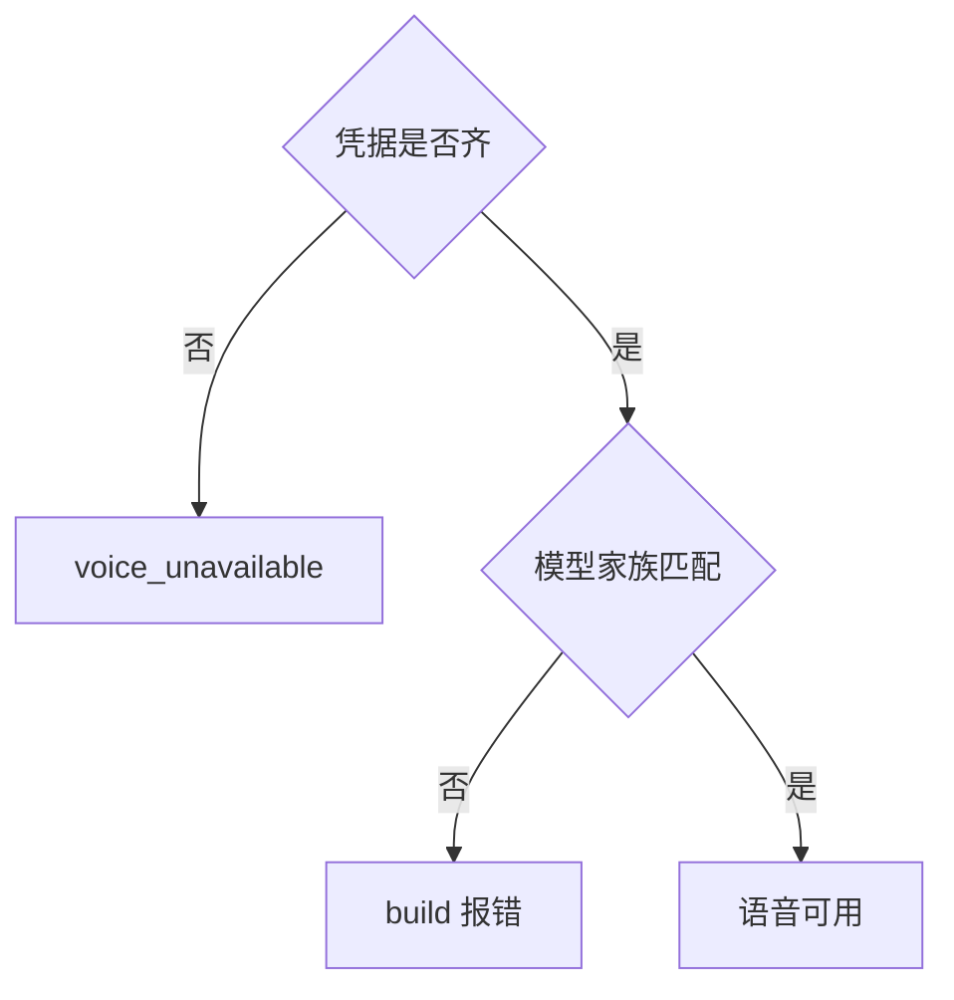
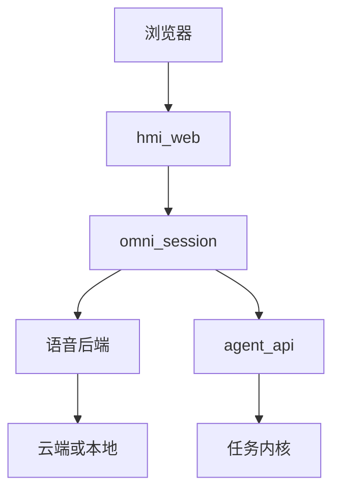
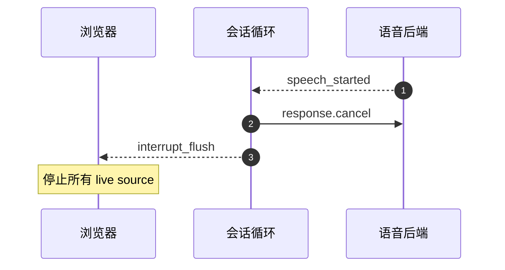
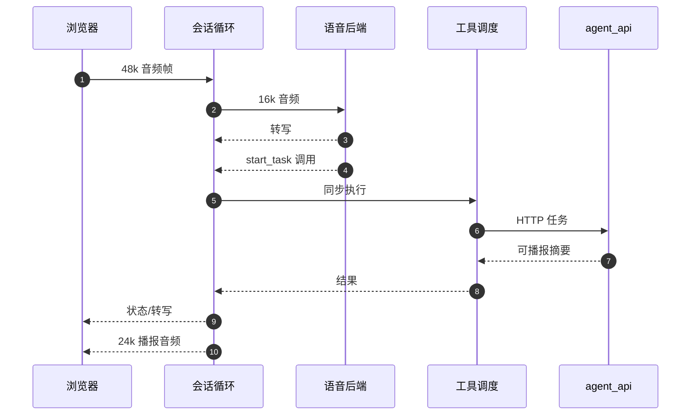
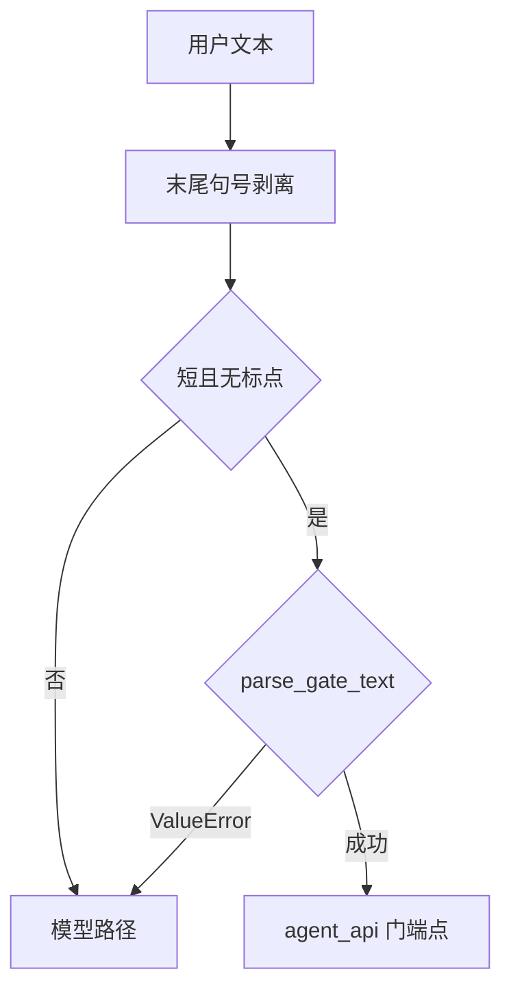
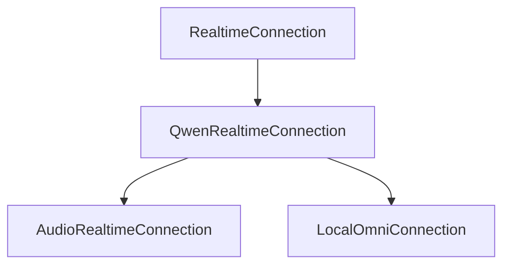

# 语音会话服务

<details>
<summary>Relevant source files</summary>

The following files were used as context for generating this wiki page:

- [services/omni_session/__init__.py](services/omni_session/__init__.py)
- [README.md](README.md)
- [compose.yaml](compose.yaml)
- [services/agent_api/app.py](services/agent_api/app.py)
</details>

# 语音会话服务

`omni_session` 是 AIDV Agent 的 API 面语音会话服务，负责把浏览器 WebSocket 会话转换为一次实时语音后端会话，并通过 `agent_api` 执行任务工具。服务入口为 `services/omni_session/app.py`，核心事件循环为 `services/omni_session/run.py`，语音后端适配位于 `services/omni_session/providers/`，通用协作件位于 `services/omni_session/shared/`。

该服务的设计边界是：每个浏览器连接拥有独立的实时语音会话和任务工具调度器；`omni_session` 不在进程内装配 `LangGraphAgent` 内核执行面，而是通过 HTTP 调用 `agent_api` 完成任务执行。语音不可用时，服务会显式拒绝语音会话并返回 `voice_unavailable`，但文本路径仍可通过 `hmi_web/agent_api` 正常工作。

Sources: [services/omni_session/__init__.py:1-7](), [services/omni_session/app.py:1-105](), [services/omni_session/run.py:1-137](), [README.md:1-147]()

## 模块布局

`omni_session` 的目录职责与 `vllm_omni_deploy` 示例的变体目录保持一致：`app.py` 是服务入口，`run.py` 是会话事件循环，`providers/` 中每个语音后端一个模块，`shared/` 存放工具面、执行器、播报和重采样等通用件。

| 路径 | 职责 |
|---|---|
| `services/omni_session/app.py` | FastAPI 服务入口、`/healthz`、`/ws/omni`、连接与调度器工厂注入点 |
| `services/omni_session/run.py` | `OmniSession` 事件循环、`BrowserChannel` 协议、状态机、门话术预仲裁 |
| `services/omni_session/providers/` | 语音后端 client 边界、事件词表归一化、方言差异处理 |
| `services/omni_session/shared/` | 工具面、执行器、播报、重采样等会话通用件 |

Sources: [services/omni_session/__init__.py:1-7](), [services/omni_session/shared/__init__.py:1-6](), [services/omni_session/app.py:1-105](), [services/omni_session/run.py:1-137]()

## 服务边界与可用性降级

`omni_session` 属于 API 面服务，本地端口为 `18013`，Docker 宿主默认端口为 `18113`。它不直接装配内核执行面；`run.py` 仅导入内核的纯函数解析器 `parse_gate_text` 用于门话术预仲裁，但仍禁止在 `omni_session` 内装配内核执行面。

语音可用性遵循 S08 降级策略：当所选 provider 的必要环境变量缺失时，`/ws/omni` 会发送 `voice_unavailable` 错误帧并关闭连接，`/healthz` 会报告 `voice.available=false`。文本路径不受影响。



Sources: [services/omni_session/app.py:1-105](), [services/omni_session/run.py:37-137](), [README.md:73-147](), [tests/contract/test_voice_providers.py:50-118]()

## 入口、代理与端点

浏览器不直接连接 `omni_session`，而是连接同源 `hmi_web` 的 `/ws/omni`。`hmi_web` 作为透明中继，将 JSON 控制帧和二进制 PCM16 音频帧原样转发到 `omni_session`。该代理会原样转发浏览器 query string，其中 `session_id` 用于让语音任务和触摸任务共享同一个 HMI cockpit 会话。

`omni_session` 暴露两个主要端点：

| 端点 | 方法 | 作用 |
|---|---|---|
| `/healthz` | GET | 返回服务状态、端口、语音 provider 可用性和 `agent_api` 地址 |
| `/ws/omni` | WebSocket | 浏览器语音会话入口，接收 `session_id` query 参数 |

```python
@app.websocket("/ws/omni")
async def ws_omni(ws: WebSocket, session_id: str | None = None) -> None:
    await ws.accept()
    try:
        conn = connection_factory()
    except RuntimeError as exc:
        # S08: refuse the voice session loudly; the text path stays fully usable.
        await ws.send_json({"type": "error", "code": "voice_unavailable", "message": str(exc)})
        await ws.close(code=1011)
        return
```

Sources: [services/hmi_web/app.py:211-251](), [services/omni_session/app.py:68-105](), [README.md:73-147]()

### 整体链路



`hmi_web` 是唯一对外 HTTPS 入口，TLS 在边缘终结；内部服务之间使用明文 HTTP。当 `omni_session` 不可用时，`hmi_web` 会向浏览器发送与 `omni_session` 相同的 `voice_unavailable` 错误帧，使语音 UI 降级一次，同时 `/api/agent` 文本直连路径保持可用。

Sources: [services/hmi_web/app.py:211-251](), [services/omni_session/app.py:1-105](), [services/hmi_web/static/voice.js:1-43](), [README.md:73-147]()

## 浏览器协议与音频管道

`voice.js` 是浏览器侧语音客户端，与 `omni_session/run.py` 中的 `BrowserChannel` 对应。协议分为二进制音频帧和 JSON 控制帧。

| 方向 | 帧类型 | 内容 |
|---|---|---|
| 上行 | binary | 48 kHz PCM16 麦克风帧，20 ms 一帧 |
| 上行 | text | `{"type":"text_input","text":...}` 或 `{"type":"interrupt"}` |
| 下行 | binary | 24 kHz PCM16 模型语音，直接转发播放 |
| 下行 | text | `state` / `transcript` / `interrupt_flush` / `error` |

```js
const MIC_FRAME_SAMPLES = 960; // 20 ms @ 48 kHz
const INPUT_RATE = 48000;
const OUTPUT_RATE = 24000;
```

浏览器使用一个 `AudioContext({sampleRate:48000})` 驱动双向音频。麦克风 `AudioWorklet` 始终看到 48 kHz；服务端在 `omni_session/shared/audio.py` 的 `resample_pcm16` 处把 48 kHz 重采样为 16 kHz。下行 24 kHz `AudioBuffer` 由 WebAudio 在 48 kHz context 上调度时自动重采样。

播放采用 scheduled-buffer jitter queue。收到 `interrupt_flush` 时，浏览器立即停止所有 live source，实现 barge-in 时旧音频在一帧内消失，而不是等 buffer 播完。

Sources: [services/hmi_web/static/voice.js:1-43](), [services/omni_session/run.py:1-137](), [services/omni_session/shared/__init__.py:1-6]()

### D5：文本框加入同一语音会话

聊天文本框不是独立 HTTP 会话，而是加入同一个 omni session。`agent_bridge.js` 检查 `window.aidvVoice.ready`，并通过 `voice.js` 的 `sendText()` 发送文本。当语音会话不可用时，bridge 透明回落到文本直连 HTTP 路径，该路径完整可用。

Sources: [services/hmi_web/static/voice.js:1-43](), [services/omni_session/app.py:1-105]()

## 会话事件循环

`OmniSession` 是 provider-neutral 的实时事件循环，每个浏览器 WebSocket 对应一个实例。它驱动任意 `RealtimeConnection`，而 Qwen 协议细节、采样率和方言差异留在 `providers/` 中。

每个浏览器会话的数据流如下：

```text
browser WS  <──binary 48k──>  OmniSession  ──16k b64──>  realtime conn
            <──binary 24k──/             <──24k────── (forwarded as-is)
            <──JSON state/transcript/interrupt_flush/error
```

Sources: [services/omni_session/run.py:1-137](), [services/omni_session/app.py:68-105]()

### 会话状态

`run.py` 定义了面向浏览器的会话状态，用于 HMI 状态展示。

| 状态 | 含义 |
|---|---|
| `listening` | 聆听中 |
| `hearing` | 听到用户说话 |
| `transcribing` | 识别中 |
| `thinking` | 思考中 |
| `running_tools` | 执行任务中 |
| `speaking` | 播报中 |

`voice.js` 将这些状态映射为中文 UI 标签：`聆听中`、`听到你说…`、`识别中`、`思考中`、`执行任务中`、`播报中`。

Sources: [services/omni_session/run.py:1-137](), [services/hmi_web/static/voice.js:1-43]()

### 响应创建与播报策略

在启用 `semantic_vad` 的后端上，服务端会在语句结束时自动创建响应，因此事件循环通常只在问候和文本输入后显式调用 `create_response()`。工具结果不由模型 follow-up turn 播报，而是由 `Announcer` 做零生成逐字播报。

Sources: [services/omni_session/run.py:1-137](), [services/omni_session/shared/__init__.py:1-6]()

### Barge-in 与中断

当服务端检测到 `speech_started` 时，事件循环会：

1. 向浏览器发送 `interrupt_flush`，清空浏览器播放缓冲。
2. 取消在途服务端响应。
3. 如果 `Announcer` 正在播报，也按同样方式取消，其 ghost item 仍会被焚烧。



Sources: [services/omni_session/run.py:1-137](), [services/hmi_web/static/voice.js:1-43]()

### 工具执行模型

工具执行遵循 D9：同步阻塞。事件循环持有当前 turn，直到 dispatcher 返回，然后由 `Announcer` 逐字播报结果。没有可用 `call_id` 的畸形工具调用会被记录并跳过，避免污染工具循环。

Sources: [services/omni_session/run.py:1-137](), [services/omni_session/app.py:1-105]()

### 语音任务轮次



Sources: [services/omni_session/run.py:1-137](), [services/omni_session/app.py:1-105](), [tests/e2e/test_omni_session_e2e.py:1-70]()

## 门话术预仲裁

`run.py` 导入内核纯函数解析器 `parse_gate_text`，用于在门挂起时判断用户短话是否可以直接交给内核裁决。这里只导入解析器，不在 `omni_session` 内执行内核动作。

`_gate_speech_value` 会去掉末尾句号，因为 ASR/omni 可能把“第一个”转写成“第一个。”，而句号不承载门操作语义。

`_gate_prearbitrable` 的判定规则是：

- 文本为空：不可预仲裁。
- 长度超过 16：不可预仲裁。
- 包含 `。`、`，`、`,`、`；`、`;` 或空白：不可预仲裁。
- `parse_gate_text` 抛 `ValueError`：回落模型路径。
- 解析成功：把原话交给 `agent_api` 门端点，由内核 canonical 解析唯一裁定动作语义。

```python
def _gate_prearbitrable(text: str) -> bool:
    value = _gate_speech_value(text)
    if not value or len(value) > 16 or re.search(r"[。，,；;\s]", value):
        return False  # 门操作不会是长句/复合句——那是任务/闲聊，归模型
    try:
        parse_gate_text(value)
    except ValueError:
        return False
    return True
```



Sources: [services/omni_session/run.py:37-137](), [services/omni_session/app.py:1-105]()

## Provider 抽象与后端方言

`providers/` 提供 `RealtimeConnection` 抽象和 `resolve_provider()` 工厂。Qwen 的 WS 协议接近 OpenAI Realtime，事件名族作为 canonical vocabulary，因此 `dashscope_omni` 不做事件翻译。`QwenRealtimeConnection` 构造阶段不做 I/O，socket 在 `__aenter__` 中打开，便于每个浏览器会话构建一个连接。



Sources: [services/omni_session/providers/dashscope_omni.py:1-62](), [services/omni_session/providers/dashscope_audio.py:1-97](), [services/omni_session/providers/local_omni.py:1-91]()

### Provider 对比

| Provider | 后端 | 关键差异 | 凭据要求 |
|---|---|---|---|
| `dashscope_omni` | 官方 Qwen-Omni-Realtime | canonical 事件词表，`semantic_vad` 家族 | `AIDV_VOICE_API_KEY` + `AIDV_VOICE_WS_URL` |
| `dashscope_audio` | 官方 Qwen-Audio-Realtime | 扁平音频格式、`server_vad`、默认音色 `longanqian`、create 前等待 ack | `AIDV_VOICE_API_KEY` + `AIDV_VOICE_WS_URL` |
| `local_omni` | 自部署 omni realtime | 出向不翻译、入向事件别名归一、连接后就绪窗口、cancel 软掐 | `AIDV_VOICE_WS_URL` 必填，API key 可选 |

Sources: [services/omni_session/providers/dashscope_omni.py:1-62](), [services/omni_session/providers/dashscope_audio.py:1-97](), [services/omni_session/providers/local_omni.py:1-91](), [tests/contract/test_voice_providers.py:50-118]()

### dashscope_omni

`dashscope_omni` 是官方 Qwen-Omni-Realtime provider。它从 voice-demo 参考项目移植而来，事件名族即 canonical vocabulary，因此不需要事件翻译。服务端事件会被递归转换为属性访问 namespace。已知会话上限为 120 分钟，自动重连属于后续阶段。

Sources: [services/omni_session/providers/dashscope_omni.py:1-62]()

### dashscope_audio

`dashscope_audio` 的连接层与 `dashscope_omni` 相同，但 `session.update` 方言不同：

- 音频配置是两个扁平字符串：`input_audio_format` 和 `output_audio_format`，采样率固定 16k 进 / 24k 出。
- 音色家族不同，默认 `longanqian`，可用 `AIDV_VOICE_TIMBRE` 覆盖。
- `turn_detection` 是裸 `server_vad`，没有 `semantic_vad`；VAD 只看推送音频。
- 空会话会拒绝 `response.create`，因此首次 create 会预填一条 user message。
- 过早的 `response.create` 可能被静默丢弃，因此 create 前会等待 `session.updated` 和 item ack，超时分别为 3.0s 和 1.5s。

```python
dialect["input_audio_format"] = "pcm"
dialect["output_audio_format"] = "pcm"
dialect["voice"] = os.getenv("AIDV_VOICE_TIMBRE", DEFAULT_VOICE)
dialect["turn_detection"] = {"type": "server_vad"}
```

Sources: [services/omni_session/providers/dashscope_audio.py:1-97](), [tests/contract/test_voice_providers.py:50-98]()

### local_omni

`local_omni` 面向自部署 omni realtime 服务。其方言行为包括：

- 出向不翻译：`session.update` 全量接受 canonical 配置。
- 入向翻译：音频输出事件名带 `output_` 前缀，通过 `_EVENT_ALIASES` 归一到 canonical。
- 就绪窗口：连接建立后固定让出 `AIDV_VOICE_READY_S`，默认 3 秒。
- `response.cancel` 是软掐：在途生成可能继续到自然结束；麦克风插话打断由服务端承担，文字路径掐轮语义弱于云端。
- cancel 后可能完全不回 `response.done`，provider 会在 2.0 秒有界窗口后合成一个 `cancelled` done，避免会话通道永久卡住。
- 被取消 turn 的残帧事件会被丢弃，直到客户端开始新 turn。

Sources: [services/omni_session/providers/local_omni.py:1-91](), [services/omni_session/README.md:1-87]()

### 模型家族守卫

`resolve_provider().build()` 会检查 provider 方言家族与模型家族是否匹配。若拧着配置，会显式报错并指出正确开关，而不是静默失败。

Sources: [tests/contract/test_voice_providers.py:80-118](), [services/omni_session/providers/dashscope_audio.py:1-97](), [services/omni_session/providers/local_omni.py:1-91]()

## 工具面与 agent_api 执行

`omni_session` 通过 `AgentApiTaskToolDispatcher` 以 HTTP 调用 `agent_api`。`dispatcher_factory` 接收 WebSocket 的 `session_id` query 参数，使语音任务和触摸任务共享同一个 HMI cockpit 会话，HMI 轮询循环可以看到语音创建的 workflow。

`app.py` 中的工厂是模块级注入点，离线测试可以替换为 `FakeOmniConnection` 和 `StubTaskToolDispatcher`，而不触碰事件循环。

| 机制 | 说明 |
|---|---|
| `AgentApiTaskToolDispatcher` | 将 omni 会话中的任务工具调用转发到 `agent_api` |
| `session_id` | 来自浏览器 WS query，用于语音与触摸共享 cockpit 会话 |
| `start_task` | 系统提示词要求可执行需求必须调用该工具，并逐字透传用户原话 |
| D9 同步阻塞 | 事件循环等待 dispatcher 返回后再播报 |
| D4 fallback | 闲聊误入 `start_task` 时落到内核 conversation path |
| D3 fast path | 如“空调调到二十三度”走内核 fast-action path，不创建 workflow/gate |
| workflow_id fallback | 模型漏掉 `workflow_id` 时，解析到会话最后活跃 workflow |

Sources: [services/omni_session/app.py:1-105](), [services/omni_session/run.py:1-137](), [tests/integration/test_omni_task_pipeline.py:1-75]()

### 系统提示词约束

`run.py` 中的 `SYSTEM_PROMPT` 要求语音助手对任何可执行需求立即调用 `start_task`，`text` 逐字放用户原话，不改写、不总结。多域复合需求也只调用一次 `start_task`，由任务系统拆解编排。纯闲聊、常识问答或输入含糊时才直接回答或澄清。

Sources: [services/omni_session/run.py:1-137]()

## 配置与端口

### 端口

下表仅列出源码中的本地开发与 Docker 默认端口，不代表实际部署的监听地址或端口映射。

| 服务 | 平面 | 本地端口 | Docker 宿主端口 |
|---|---|---:|---:|
| `hmi_web` | 浏览器面，唯一对外 HTTPS | 8081 | 8181 |
| `agent_api` | API 面 | 18012 | 18112 |
| `omni_session` | API 面，语音 WS | 18013 | 18113 |

Sources: [README.md:73-147](), [tests/e2e/test_omni_session_e2e.py:230-276]()

### 语音环境变量

| 变量 | 说明 |
|---|---|
| `AIDV_VOICE_PROVIDER` | `local_omni` / `dashscope_omni` / `dashscope_audio` |
| `AIDV_VOICE_WS_URL` | 语音服务 WS 地址；缺失时语音入口不可用 |
| `AIDV_VOICE_API_KEY` | 云端 provider 必配；`local_omni` 可选 |
| `AIDV_VOICE_MODEL` | 模型名，各 provider 有默认值 |
| `AIDV_VOICE_TIMBRE` | 音色，仅 audio 家族生效 |
| `AIDV_VOICE_TLS_VERIFY` | `local_omni` 自签证书默认关验证，设为 `1` 开启系统信任链 |
| `AIDV_VOICE_READY_S` | `local_omni` 连接后就绪等待窗，默认 3 秒 |
| `AIDV_AGENT_API_URL` | `omni_session` 调用 `agent_api` 的 URL，默认按 `AGENT_API_PORT` 推导 |

Sources: [README.md:73-147](), [services/omni_session/app.py:1-105](), [services/omni_session/providers/local_omni.py:1-91](), [services/omni_session/providers/dashscope_audio.py:1-97]()

### TLS 配置边界

HMI 的 TLS 证书与私钥通过 `AIDV_HMI_TLS_CERT`、`AIDV_HMI_TLS_KEY` 指定；本地自动生成的资产位于项目相对目录 `.aidv/tls/`。公开文档仅保留配置项名称和相对默认目录，不记录实际部署的证书绝对路径、证书内容或私钥。

`AIDV_VOICE_TLS_VERIFY` 控制自部署语音后端的证书验证。默认关闭验证是本地自签场景的兼容行为，不是生产安全建议；对外部署应配置可信证书并启用验证。

### local_omni 凭据行为

`local_omni` 不校验 API key：只要 `AIDV_VOICE_WS_URL` 配置存在，`availability()` 返回可用，`build()` 使用占位 Bearer。若 URL 缺失，`availability()` 返回不可用，`build()` 抛出包含 `AIDV_VOICE_WS_URL` 的 `RuntimeError`。

下例为脱敏后的契约测试片段，`<internal-svc>` 与 `<port>` 仅为占位符，不是可直接连接的地址；实际值只在本地配置中提供。

```python
monkeypatch.delenv("AIDV_VOICE_API_KEY", raising=False)
monkeypatch.setenv("AIDV_VOICE_WS_URL", "wss://<internal-svc>:<port>/v1/realtime")
assert local_omni.availability() == {"available": True, "model": "livekit"}
conn = local_omni.build()
assert conn._url.endswith("v1/realtime?model=livekit")
```

Sources: [tests/contract/test_voice_providers.py:80-118](), [services/omni_session/providers/local_omni.py:1-91]()

## 测试与可观测性

### 测试分层

| 测试 | 层级 | 覆盖重点 |
|---|---|---|
| `tests/e2e/test_omni_session_e2e.py` | 离线 E2E | `FakeOmni` + stub dispatcher，驱动真实 `/ws/omni` 和生产事件循环 |
| `tests/integration/test_omni_task_pipeline.py` | 离线集成 | `FakeOmni` -> 真实 dispatcher -> 真实 `agent_api` -> 离线内核 |
| `tests/contract/test_voice_providers.py` | 契约 | provider 可用性、模型家族守卫、audio 方言翻译 |

Sources: [tests/e2e/test_omni_session_e2e.py:1-70](), [tests/integration/test_omni_task_pipeline.py:1-75](), [tests/contract/test_voice_providers.py:50-118]()

### E2E 覆盖

`tests/e2e/test_omni_session_e2e.py` 使用 FastAPI `TestClient` 驱动真实 WebSocket 端点，只替换两个 seam：实时连接和任务工具执行器。它覆盖语音任务轮次、`voice_unavailable` 降级、`/healthz` 可用性、`session.update` 携带 tools/VAD/采样率等场景。

Sources: [tests/e2e/test_omni_session_e2e.py:1-70](), [tests/e2e/test_omni_session_e2e.py:230-276]()

### 集成覆盖

`tests/integration/test_omni_task_pipeline.py` 是语音到任务脑的完整离线管道。它固定了 dispatch pipeline、参数映射、D4 fallback、D3 fast path 和 workflow_id fallback。该层不测试模型决策质量，模型“会调用什么”由 `FakeOmni` 脚本决定。

Sources: [tests/integration/test_omni_task_pipeline.py:1-75]()

### 日志

`app.py` 配置 `logging.basicConfig` 输出到 stderr，格式为 `%(asctime)s %(levelname)s %(name)s: %(message)s`。注释说明此前 `aidv.*` logger 无 handler，导致 session 内 tool call / response 诊断行丢失，不利于有声/无声问题排查。

Sources: [services/omni_session/app.py:1-105]()

## 已知行为与防御性修复备忘

`services/omni_session/README.md` 记录了 2026-10-19 官方模型实测后未迁入代码的防御性修复。这些修复来自 `origin/feat/qwen-omni-bug-fix`，但在 `qwen-audio-3.0-realtime-plus` 和 `qwen3.5-omni-flash-realtime` 上均未复现，因此不预先迁移。

| 主题 | 记录结论 |
|---|---|
| 播报复读治理 | 官方端点未复现跨门逐字复读；若后端复现，再移植清场与替换逻辑 |
| 播报送达仲裁 | 官方端点未出现外来/陈旧 done 抢槽；若漏播或念错轮次再启用 |
| 取消宽限窗 | 官方端点 cancel 后无残帧；若某后端 cancel 后仍持续流 delta 再启用 |
| 26 字名单预算裁剪 | 官方端点长名单未跑字；若某后端长名单概括/漏念再裁剪 |
| 预仲裁消费口令 spoken item | 官方端点未出现口令带偏；若用户已选但模型复述上一门再启用 |
| 逐字播报 SYSTEM_PROMPT 段 | 官方模型不必要；本地弱模型可能仍有效，提示词改动需人工主导 |
| fake_omni 复读建模 | 官方不复现，暂不引入；若启用播报复读治理，应同步补 fake 场景 |

迁移纪律要求：provider 能力住在 `providers/dashscope_*.py`，会话层不得按模型名分支；共通防御只有在某个后端实测复现后才迁入，并附复现步骤与重复次数。

Sources: [services/omni_session/README.md:1-87](), [services/omni_session/providers/dashscope_audio.py:1-97](), [services/omni_session/providers/local_omni.py:1-91]()

## 总结

`omni_session` 是 AIDV Agent 的语音会话服务，负责浏览器 WebSocket、实时语音后端和 `agent_api` 任务执行之间的桥接。它通过 provider 抽象隔离 Qwen-Omni、Qwen-Audio 和自部署 local omni 的方言差异，通过 `BrowserChannel` 定义 48 kHz 上行、24 kHz 下行和 JSON 控制帧协议，并通过 `OmniSession` 事件循环处理状态、转写、barge-in、工具调用和逐字播报。服务在语音不可用时显式降级，同时保持文本路径可用；测试层通过离线 E2E、真实 `agent_api` 集成和 provider 契约测试覆盖核心链路。

---

**关联源文件:** `services/omni_session/__init__.py`, `README.md`, `compose.yaml`, `services/agent_api/app.py`
