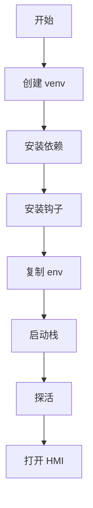
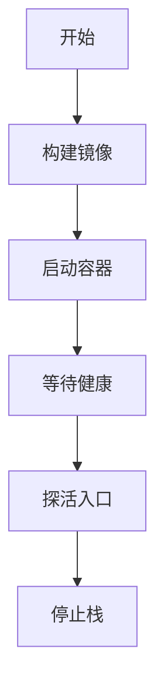
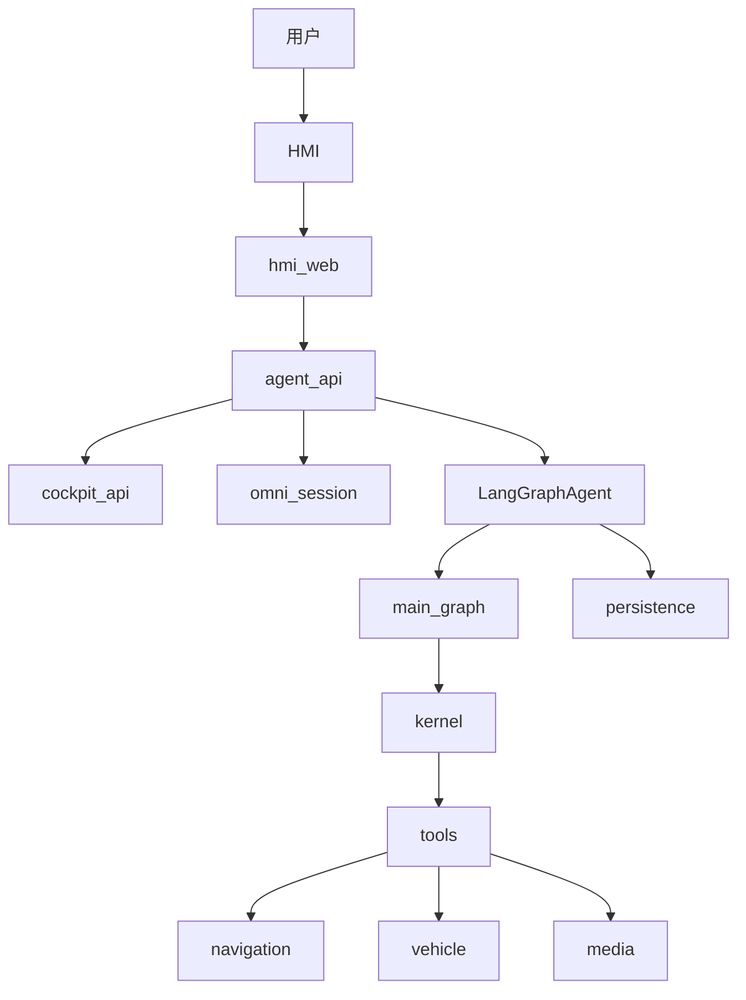
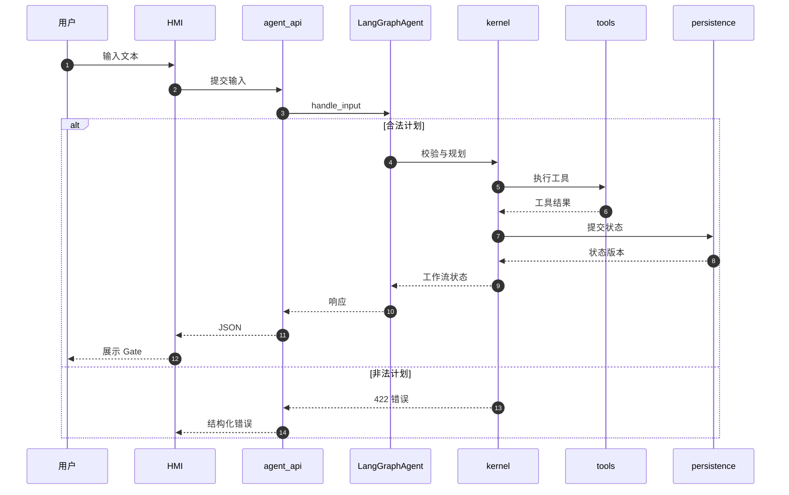
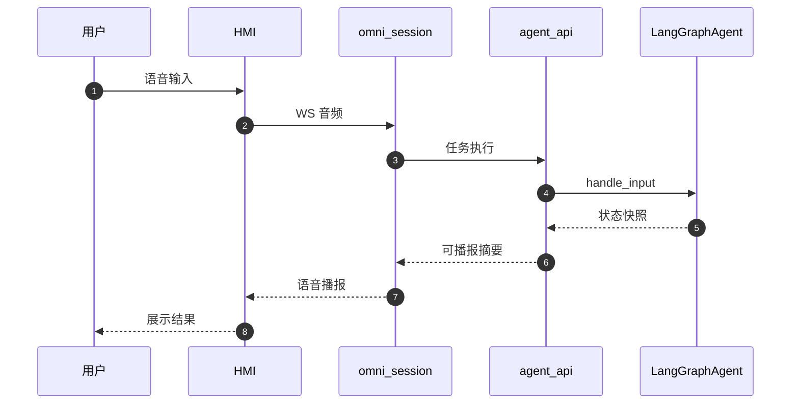

# 项目概览与快速开始

<details>
<summary>Relevant source files</summary>

The following files were used as context for generating this wiki page:

- [README.md](README.md)
- [AGENTS.md](AGENTS.md)
- [src/aidv_agent/__init__.py](src/aidv_agent/__init__.py)
- [compose.yaml](compose.yaml)
</details>

# 项目概览与快速开始

AIDV Agent 是一个基于 LangGraph 编排的确定性工作流车载智能体，覆盖车控、导航和生活服务（咖啡、麦当劳、电影票）等多领域任务。它的核心设计目标是让控制流、状态归约、Gate 生命周期和参数校验尽量由本地代码确定性地完成，而规划 LLM 只负责“提议” Plan 或 Patch，最终是否应用由本地 compiler、validator 和 reducer 决定。项目当前状态是：离线部署语音已上线，全仓代码重构已完成，简单端到端链路已打通，但全仓详细测试尚未完成，因此仓库当前更适合作为整体逻辑查看，不作为生产保证。

Sources: [README.md:1-15](), [src/aidv_agent/__init__.py:1-4]()

从工程形态看，AIDV Agent 由浏览器面 HMI、API 面服务、资源面服务、内核包、持久化层、工具层、测试契约和 Docker 部署共同组成。本地开发栈与 Docker 栈都围绕同一组端口、同一组 `.env` 配置和同一组健康检查展开。开发者可以先通过本地 Python 3.12 环境快速启动全栈，也可以通过 `docker compose` 启动 11 个服务组成的完整容器栈。

Sources: [README.md:17-90](), [compose.yaml:1-73]()

## 1. 项目定位与核心特性

AIDV Agent 的定位不是简单调用 LLM 的聊天机器人，而是一个“确定性内核 + 模型提议”的车载任务编排系统。README 中明确强调：控制流、状态归约、Gate 生命周期、参数校验全部由本地代码完成；规划 LLM 只能提议 Plan/Patch，本地 compiler、validator、reducer 决定是否应用。

Sources: [README.md:1-15]()

项目的主要特性包括：

| 特性 | 说明 | 来源 |
|---|---|---|
| 确定性内核 | 控制流、状态归约、Gate 生命周期、参数校验由本地代码完成 | `README.md` |
| 多域编排 | 导航、车控、生活服务通过 Gate、Handoff、Patch 组合 | `README.md` |
| 离线可验证 | 测试与契约在无 key、无网、无外部服务下可端到端跑通 | `README.md` |
| 弱规则重模型 | 清理复杂规则兜底，主要靠契约校验把关，避免复杂正则屎山 | `README.md` |
| 可观察 | 提供 `agent_api` 调试台和只读 workflow inspector | `README.md`, `services/agent_api/app.py` |
| 可修改 | 支持 Patch 修改工作流，例如取消某分支或替换终点 | `README.md` |
| 可恢复 | 通过持久化状态库保存 workflow、event 和快照 | `src/aidv_agent/orchestrator/agent.py` |

Sources: [README.md:1-15](), [README.md:176-258](), [src/aidv_agent/orchestrator/agent.py:1-65]()

架构上，`src/aidv_agent` 采用单向 DAG 的 9 包依赖结构，`orchestrator` 位于依赖链顶部，负责组装 LangGraph 拓扑、注入应用服务、驱动执行并协调 repository 提交。`services/agent_api` 是 API 面核心服务，负责承载 `/api/agent/*` 和调试台；`services/omni_session` 是语音会话服务，通过 agent_api 执行任务。

Sources: [src/aidv_agent/orchestrator/__init__.py:1-34](), [services/agent_api/__init__.py:1-2](), [services/omni_session/__init__.py:1-7]()

## 2. 快速开始

### 2.1 本地运行（Python 3.12）

本地运行要求 Python 3.12，推荐默认使用 `uv`。首次启动前需要创建虚拟环境、安装依赖、注册 pre-commit 钩子、复制 `.env` 示例文件，然后启动服务栈。

```bash
cd <仓库根目录>

# 1. 环境（仅首次；默认用 uv，工程要求 python >=3.12,<3.13）
uv venv --python=3.12
uv pip install -e '.[test,dev]'

# （无 uv 时等价替代：python3.12 -m venv .venv && .venv/bin/pip install -e '.[test,dev]'）

# 2. 质量门禁（仅首次；注册 git 钩子，commit 前自动跑 lint/format + 提交信息格式检查）
.venv/bin/pre-commit install
.venv/bin/pre-commit install --hook-type commit-msg

# 3. 凭据（.env 不进 Git；离线功能无需任何凭据即可跑）
cp .env.example .env

# 4. 起栈（自动加载根目录 .env；幂等，已健康的端口跳过）
./scripts/start_stack.sh
```

Sources: [README.md:17-45]()

本地启动后的关键入口如下：

| 入口 | 地址 | 说明 |
|---|---|---|
| HMI 入口 | `https://127.0.0.1:8081/` | 浏览器面 `hmi_web`，唯一对外 HTTPS 入口，自签证书首次访问需确认 |
| Pad 页面 | `https://127.0.0.1:8081/pad/` | HMI 的 Pad 页面 |
| 调试台 | `http://127.0.0.1:18012/debug/` | `agent_api` 的只读 workflow inspector |
| 健康检查 | `http://127.0.0.1:18012/healthz` | 探活 `agent_api` |
| 停止栈 | `./scripts/stop_stack.sh` | 按 `.aidv/pids/` 的 PID 停服务并确认端口释放 |

Sources: [README.md:46-56](), [services/agent_api/app.py:69-78]()

如果需要使用真实网易云音乐 Provider，需要额外进入 `services/online/media/netease` 执行 `npm ci --no-audit --no-fund`。该步骤是可选的，`node_modules` 不进入 Git。

Sources: [README.md:46-56]()

本地启动流程可以概括为：



Sources: [README.md:17-56]()

### 2.2 Docker（compose）

Docker 方式通过 `docker compose --profile core` 构建并启动全栈。容器内包含自监督与 60 秒崩溃自愈机制，默认启动 11 个服务。

```bash
# 1. 构建并启动全栈（11 服务，容器内自监督 + 60s 崩溃自愈）
docker compose --profile core up -d --build aidv-agent

# 2. 探活
curl -fsS --noproxy 127.0.0.1 http://127.0.0.1:18112/healthz
```

Sources: [README.md:58-68](), [.github/workflows/ci.yml:102-120]()

Docker 栈的关键入口：

| 入口 | 地址 | 说明 |
|---|---|---|
| HMI 入口 | `https://127.0.0.1:8181/` | 自签证书，首次访问需确认 |
| 调试台 | `http://127.0.0.1:18112/debug/` | `agent_api` 只读 inspector |
| 停止栈 | `docker compose --profile core down` | 停止容器栈 |
| 清空数据 | `docker compose --profile core down -v` | 删除 named volume 数据 |

Sources: [README.md:58-80]()

Docker 部署有几个重要约束：

1. 镜像按 `requirements.lock` 精确安装依赖。修改 `pyproject.toml` 后必须同步刷新锁文件，CI 会校验双锁一致。
2. 依赖层与源码层分离，改代码重建不重装依赖。
3. 网络受限时可通过 `PIP_INDEX_URL` 指定 PyPI 镜像，但所有下载仍按锁文件 hash 校验。
4. 状态库、日志、TLS 分别落在 named volume `aidv-state`、`aidv-logs`、`aidv-tls`。
5. compose 自动读取根目录 `.env` 注入容器环境，凭据不写进镜像。
6. 开发容器 `aidv-dev` 使用仓库 bind-mount，状态库落在仓库内 `.aidv/state/`。

Sources: [README.md:58-80](), [compose.yaml:55-90]()

Docker 启动流程：



Sources: [README.md:58-80](), [.github/workflows/ci.yml:102-120]()

## 3. 服务拓扑与端口

AIDV Agent 的服务端口由 `src/aidv_agent/ports.py` 作为单一事实源管理，并通过 contract test 进行四重锁定：源码零硬编码、`start_stack` 对齐、compose 覆盖、Dockerfile EXPOSE 覆盖。端口按平面划分：浏览器面 `8081`，API 面 `1801x`，资源面 `1810x`。内部服务之间永远使用明文 HTTP，TLS 只在 `hmi_web` 边缘终结。

Sources: [README.md:73-90](), [compose.yaml:55-73]()

本地与 Docker 宿主端口映射如下：

| 服务 | 平面 | 本地端口 | Docker 宿主端口（默认） |
|---|---|---:|---:|
| `hmi_web`（HTTPS，唯一对外） | 浏览器面 | 8081 | 8181 |
| `cockpit_api` | API 面 | 18011 | 18111 |
| `agent_api`（含调试台） | API 面 | 18012 | 18112 |
| `omni_session`（语音 WS） | API 面 | 18013 | 18113 |
| `online/navigation` | 资源面 | 18101 | 18201 |
| `tool_gateway` | 资源面 | 18102 | 18202 |
| `vehicle/context` | 资源面 | 18103 | 18203 |
| `vehicle/climate` | 资源面 | 18104 | 18204 |
| `vehicle/window` | 资源面 | 18105 | 18205 |
| `vehicle/seat` | 资源面 | 18106 | 18206 |
| `online/media` | 资源面 | 18107 | 18207 |

Sources: [README.md:73-90](), [compose.yaml:55-73]()

Docker 宿主侧默认映射到 `+100` 号段，容器内部端口与本地完全一致。这样 Docker 栈、本地开发栈和隔离验收栈可以互不抢位地同时运行。端口可以通过 `AIDV_HOST_*` 环境变量覆盖。

Sources: [README.md:73-90](), [compose.yaml:55-73]()

服务拓扑可以表示为：



Sources: [README.md:73-90](), [services/agent_api/app.py:194-239](), [services/omni_session/__init__.py:1-7](), [src/aidv_agent/orchestrator/agent.py:1-65]()

`agent_api` 中还存在一个 `/api/cockpit/{path}` 代理，用于保留 HMI shell 的状态卡片、高德 JS 配置和直接车控/媒体控制。该代理的目的是避免客户端在挂载到 `18012` 端口时静默退化为伪造显示。

Sources: [services/agent_api/app.py:194-239]()

## 4. 配置与凭据

`.env` 是本地栈和 Docker 栈共享的配置文件。`cp .env.example .env` 后按需填写，`.env` 不进入 Git。README 将常用配置分为三组：LLM、语音、生活服务 token。

Sources: [README.md:94-127]()

### 4.1 LLM 配置

LLM 用于任务规划，是最关键的配置项。支持本地部署（如 vLLM 等 OpenAI 兼容端点）或云厂商 API。

| 变量 | 说明 | 备注 |
|---|---|---|
| `AIDV_LLM_API_KEY` | 必填。缺失时真实任务规划显式报错 | 支持 deepseek、minimax、千问官方和本地自部署 |
| `AIDV_LLM_API_BASE_URL` | OpenAI 兼容模式地址 | 目前只支持 OpenAI 兼容 |
| `AIDV_LLM_MODEL` | 模型名或模型 ID | 按部署端点填写 |

不配置 LLM 时，栈照常启动，离线回归全部可跑，但真实任务规划会失败。

Sources: [README.md:94-106]()

### 4.2 语音配置

语音支持本地部署或云厂商。不配置语音时，系统退化为纯文本交互。

| 变量 | 说明 |
|---|---|
| `AIDV_VOICE_PROVIDER` | `local_omni`、`dashscope_omni`、`dashscope_audio` |
| `AIDV_VOICE_WS_URL` | 语音服务 WS 地址；缺失时语音入口置灰 |
| `AIDV_VOICE_API_KEY` | 云端 provider 必配；`local_omni` 可选 |
| `AIDV_VOICE_MODEL` | 模型名，各 provider 有默认 |
| `AIDV_VOICE_TIMBRE` | 音色，仅 audio 家族生效 |
| `AIDV_VOICE_TLS_VERIFY` | 本地自部署通常关证书验证，设为 `1` 走系统信任链 |

Sources: [README.md:108-120]()

### 4.3 生活服务 token

生活服务 token 不配置时对应域不可用，但互不影响。

| 服务 | 变量 | 说明 |
|---|---|---|
| 高德（导航/地图） | `AMAP_WEB_SERVICE_KEY`、`AMAP_JS_API_KEY`、`AMAP_JS_SECURITY_CODE` | 前一个管路线规划/地点检索，后两个管壳页地图 |
| 瑞幸 | `LUCKIN_MCP_TOKEN` | 运营侧提供，生命周期短 |
| 麦当劳 | `MCD_TOKEN` | 运营侧提供 |
| 猫眼 | 不走 `.env` | authkey 保存在本机用户配置目录；具体凭据文件位置不公开 |

网易云真实 Provider 是可选安装，不占 `.env` 变量。

Sources: [README.md:122-127]()

### 4.4 compose 环境注入

`compose.yaml` 将根目录 `.env` 中的变量注入容器环境。关键变量包括：

| 变量 | 作用 |
|---|---|
| `AIDV_CONTAINER` | 标记容器运行环境 |
| `AIDV_PORT_OFFSET` | 容器内端口偏移，默认 `0` |
| `AIDV_SUPERVISE_INTERVAL` | 自监督间隔，默认 60 秒 |
| `AIDV_AGENT_API_BIND_HOST` | `agent_api` 绑定地址 |
| `AIDV_INTERNAL_BIND_HOST` | 内部服务绑定地址 |
| `AIDV_HMI_TLS_CERT` / `AIDV_HMI_TLS_KEY` | 真实 TLS 证书；为空时首次启动自动生成自签证书 |
| `AIDV_LLM_API_KEY` / `AIDV_LLM_MODEL` / `AIDV_LLM_API_BASE_URL` | LLM 规划配置 |
| `AIDV_VOICE_*` | 语音 provider、WS、key、model、timbre 等 |
| `AMAP_*`、`LUCKIN_MCP_TOKEN`、`MCD_TOKEN`、`MCD_MCP_URL` | 生活服务凭据 |
| `AIDV_AGENT_STATE_DB` | 容器内状态库路径，默认 `/var/lib/aidv/agent.sqlite3` |

Sources: [compose.yaml:1-35]()

修改 `.env` 后的生效方式：

- 本地栈：重启对应服务或整栈重启。
- Docker：需要 `docker compose --profile core up -d` 重建容器。

Sources: [README.md:128-130]()

## 5. 核心运行时入口

### 5.1 `agent_api`：API 面核心服务

`services/agent_api` 是 API 面核心服务，也是唯一 ASGI 入口之一，负责服务 `/api/agent/*`。它使用 FastAPI 构建，定义了 `InputRequest`、`GateActionRequest`、`PatchRequest` 等请求模型，用于文本输入、Gate 动作和 Patch 修改。

Sources: [services/agent_api/__init__.py:1-2](), [services/agent_api/app.py:1-78]()

`agent_api` 的关键行为包括：

| 能力 | 说明 |
|---|---|
| `/healthz` | 返回健康状态，用于本地和 Docker 探活 |
| 调试台 | 提供只读 workflow inspector，静态文件为 `static/debug.html` |
| `/api/agent/debug/state` | 返回指定 session 的 active 或 latest terminal workflow 状态 |
| `/api/cockpit/{path}` | 代理 cockpit_api 的 GET/POST/PUT/PATCH/DELETE 请求 |
| 异常处理 | `ValueError` 返回结构化 422；`RuntimeError` 返回结构化 500 |

Sources: [services/agent_api/app.py:1-78](), [services/agent_api/app.py:194-239](), [README.md:46-56]()

`agent_api` 的异常处理体现了“坏输入诚实失败”的原则：非法输入或被拒绝的计划不会变成空 500，而是返回结构化 JSON 错误。

```python
@app.exception_handler(ValueError)
async def value_error_handler(request: Request, exc: ValueError) -> JSONResponse:
    """Invalid input or rejected plan: structured JSON, never an empty 500."""
    return JSONResponse(
        status_code=422,
        content={"ok": False, "error": {"type": "invalid_request_or_plan", "message": str(exc)}},
    )
```

Sources: [services/agent_api/app.py:21-28]()

### 5.2 `LangGraphAgent`：组合根与门面

`LangGraphAgent` 是内核的单一入口，也是 composition root。它负责组装服务、拥有 stores、提供公开 API surface，并作为事务边界驱动工作流推进到下一个 phase boundary。

Sources: [src/aidv_agent/orchestrator/agent.py:1-65](), [src/aidv_agent/orchestrator/__init__.py:1-34]()

`LangGraphAgent` 的公开 API 包括：

| 方法/能力 | 说明 |
|---|---|
| `handle_input` | 处理文本或语音输入 |
| `state` | 返回 session/workflow 状态 |
| `resolve_gate` | 处理 Gate 选择或动作 |
| `patch_workflow` | 应用 Patch 修改工作流 |
| `cancel_workflow` | 取消工作流 |
| `advance_to_boundary` | 驱动工作流到 gate activation、completion 或 failure |

Sources: [src/aidv_agent/orchestrator/agent.py:1-65]()

初始化时，`LangGraphAgent` 会读取 `AIDV_PROJECT_ROOT` 和 `AIDV_AGENT_STATE_DB`，创建 `RepositoryStore`，并持有 `workflow_snapshots`、`events` 和 `main_graph`。

```python
root = Path(os.getenv("AIDV_PROJECT_ROOT", Path.cwd()))
state_db = Path(
    state_path or os.getenv("AIDV_AGENT_STATE_DB", root / ".aidv/state/aidv_agent.sqlite3")
)
store = RepositoryStore(state_db)
self.workflow_snapshots = store.workflows
self.events = store.events
self.main_graph = main_graph or build_main_graph(ingestor=EventIngestor(self.events))
```

Sources: [src/aidv_agent/orchestrator/agent.py:52-65]()

### 5.3 `omni_session`：语音会话服务

`services/omni_session` 是 API 面的语音会话服务，每个 session 使用 WS pair，并通过 `agent_api` 执行任务。它的目录结构包含 `app.py` 服务入口、`run.py` 会话事件循环、`providers/` 语音后端模块和 `shared/` 通用件。语音后端通过 `AIDV_VOICE_PROVIDER` 切换。

Sources: [services/omni_session/__init__.py:1-7]()

离线集成测试 `tests/integration/test_omni_task_pipeline.py` 验证了语音到任务内核的完整链路：`FakeOmni` 驱动真实 dispatcher，通过真实 HTTP socket 访问真实 `agent_api`，而 `agent_api` 内部的 `LangGraphAgent` 被替换为离线内核（`FakeToolDispatcher + ScriptedPlanningService`）。该测试固定了 dispatch pipeline、参数映射、闲聊 fallback、fast-action 快速路径和 `workflow_id` fallback 等行为。

Sources: [tests/integration/test_omni_task_pipeline.py:1-75]()

## 6. 请求与验收链路

### 6.1 文本输入链路

文本输入从 HMI 进入 `agent_api`，再由 `LangGraphAgent` 驱动内核。合法计划会进入规划、工具执行、状态提交和响应返回；非法计划会被确定性拒绝，返回结构化 422。



Sources: [services/agent_api/app.py:1-78](), [src/aidv_agent/orchestrator/agent.py:1-65](), [README.md:176-258]()

### 6.2 语音输入链路

语音输入通过 `omni_session` 的 WS 会话进入系统。`omni_session` 不直接完成全部业务执行，而是通过 `agent_api` 执行任务，并将可播报摘要返回到语音会话。



Sources: [services/omni_session/__init__.py:1-7](), [tests/integration/test_omni_task_pipeline.py:1-75](), [services/agent_api/app.py:1-78]()

### 6.3 HMI 快速测试 Prompt

README 提供了一组可直接粘贴的 HMI 测试 Prompt，用于验证导航、生活服务、跨域组合、Gate 侧向车控和 Patch 修改。每条 Prompt 建议使用新会话，并等待当前 Gate 处理完再运行下一条。

| 类型 | Prompt | 预期主链路 |
|---|---|---|
| 单目的地导航 | `规划从当前位置去广州塔的路线，只预览，不开始导航。` | Navigation 路线预览 → 地图显示 → 确认 Gate |
| 多途经点 | `从当前位置出发，先经过广州塔，再经过广东省博物馆，最后到广州南站，只规划并预览路线。` | 起点 → 两个途经点 → 终点 → 路线预览 |
| 瑞幸商品约束 | `查询附近瑞幸的生椰拿铁，只查看门店和商品，不创建订单。` | 附近门店 Gate → 生椰拿铁候选 Gate → 订单预览 |
| 麦当劳商品约束 | `查询附近麦当劳的麦旋风，只查看门店、商品和价格，不创建订单。` | 附近门店 Gate → 麦旋风候选 Gate → 价格预览 |
| 电影与影院 | `查询广州最近上映的电影和影院，然后规划去选中影院的路线；只查询场次和路线，不购票。` | 电影 → 影院 → 场次 Gate → 影院 Handoff → 导航预览 |
| 三域组合 | `先查附近瑞幸的生椰拿铁，再查附近麦当劳的麦旋风，最后规划去广州塔的路线；只查询商品、价格和路线预览，不创建订单、不支付。` | Luckin Gates → McDonald Gates → Navigation Preview |
| 四域复杂编排 | `我想去机场，顺便买个汉堡，再买个咖啡，再看个电影；全部只做候选和预览，不下单、不购票、不支付。` | McDonald → Luckin → Maoyan 多级 Gates → Navigation Preview |
| Gate 期间侧向车控 | 在任意选择 Gate 弹出时说：`空调调到23度` | 本地车控执行；原 Active Gate 保留并可继续选择 |
| 局部 Patch | 在三域/四域流程中说：`麦当劳不要了，咖啡保留，继续去机场` | 取消麦当劳分支；保留未受影响状态；重算受影响后继任务 |
| 终点 Patch | 在路线预览前说：`不去机场了，改去广州南站` | 替换导航终点；失效旧路线 Artifact；重新预览 |

Sources: [README.md:128-199]()

所有生活服务测试只到查询、候选、详情和预览，不创建订单、不取消订单、不支付、不调用支付链接、不开始导航。

Sources: [README.md:245-258]()

## 7. 测试、验收与 CI

### 7.1 离线回归

完整离线回归不依赖 key、网络或运行栈，约 10 秒完成。这是每次改动后必须通过的基础验证。

```bash
.venv/bin/python -m pytest -m "not real_service" -q
```

Sources: [README.md:245-258](), [AGENTS.md:36-43]()

### 7.2 真实验收

真实验收使用隔离的 `+100` 端口栈，即 `8181 / 1811x / 1820x`，并配合独立业务状态库，避免共享 Workflow 数据。

```bash
scripts/real_acceptance.sh              # 离线层
WITH_LLM=1 scripts/real_acceptance.sh   # + 真实 LLM planning 探针
WITH_EXTERNAL=1 scripts/real_acceptance.sh  # + 外部 Provider（需有效凭据）
```

Sources: [README.md:245-258]()

隔离验收栈示例：

```bash
AIDV_PORT_OFFSET=100 \
AIDV_AGENT_STATE_DB=.aidv/state/acceptance_18112.sqlite3 \
./scripts/start_stack.sh
```

Sources: [README.md:230-240]()

### 7.3 测试分层

项目测试按层次组织：`contract`（架构不变式）→ `integration` → `e2e` → `hmi` → `golden` → `provider`。契约测试负责执法架构不变式，而不是普通行为测试。

Sources: [README.md:245-258](), [AGENTS.md:36-43]()

`tests/contract/test_wire_payload_shape.py` 专门锁定线上载荷键集，防止手工拼装 dict 时发生键漂移。它锁定了：

| 契约对象 | 说明 |
|---|---|
| `STATE_KEYS` | `agent.state()` 返回的 state 载荷键集，严格相等 |
| `ENVELOPE_KEYS` | envelope 路由响应键集，等于 state + `accepted_event` + `result` |
| `RESULT_KEYS` | 跨 route 的 result 键并集，新增键必须显式扩展 |
| `PATCH_KEYS` | Patch 裸 payload 键集，离线不可驱动，按字面量登记 |

Sources: [tests/contract/test_wire_payload_shape.py:1-92]()

### 7.4 CI 检查

CI 会执行依赖锁检查、构建 runtime image、启动完整栈、等待健康检查、探测外部入口，并在失败时输出服务日志，最后清理容器栈。

| CI 步骤 | 命令/行为 |
|---|---|
| 依赖锁检查 | `uv lock --check`、导出 `requirements.lock`、`git diff --exit-code` |
| 构建镜像 | `docker compose --profile core build aidv-agent` |
| 启动全栈 | `docker compose --profile core up -d --wait --wait-timeout 180 aidv-agent` |
| 探测入口 | `curl -kfsS https://127.0.0.1:8181/healthz`、`curl -fsS http://127.0.0.1:18112/healthz` |
| 失败日志 | `docker compose --profile core logs --tail 100` |
| 清理 | `docker compose --profile core down -v` |

Sources: [.github/workflows/ci.yml:102-120]()

## 8. 开发守则与验证闭环

`AGENTS.md` 要求开发者或 coding agent 在动手写代码前按顺序阅读：

1. `README.md`：项目是什么、怎么跑、怎么测、环境坑。
2. `docs/PRD.md`：做什么、验收什么，功能争议以它为准。
3. `docs/ARCHITECTURE.md`：怎么建，设计争议以它为准。
4. `docs/CONVENTIONS.md`：项目开发规范、commit message 格式、代码格式。
5. `CONTRIBUTING.md`：贡献代码、推送远程和 PR 规范。

Sources: [AGENTS.md:1-43]()

架构铁律包括：

| 规则 | 说明 |
|---|---|
| 以 `docs/ARCHITECTURE.md` 为准 | 架构层变更必须先修改架构文档并提交 git 历史 |
| 单向 DAG | `src/aidv_agent` 9 包单向依赖，禁止反向引用 |
| 离线优先 | 新功能必须在 `FakeToolDispatcher + ScriptedPlanningService` 下端到端跑通 |
| 命名无代号 | 不复辟 V1/V7/V9 等代号，服务名语义化 |
| 确定性规则人工审核 | 禁止随意生成复杂正则兜底，短期特例可用简单全量字符串匹配 |
| 关键提示词人工审核 | 禁止 AI 直接提交不可读大段提示词 |
| 坏输入诚实失败 | 非法计划/参数返回结构化 422，不静默修正 |
| 禁止静默修改守则 | 修改 `AGENTS.md` 必须提醒用户确认 |
| 禁止提交非长期文档 | `docs/` 下只提交长期维护文档 |

Sources: [AGENTS.md:1-43]()

每次改动后的验证闭环：

```bash
# 1. 离线全量（~10s，必须全绿；无 key/无网/无栈）
.venv/bin/python -m pytest tests -m "not real_service" -q

# 2. 门禁全量（与 CI lint job 完全一致）
.venv/bin/pre-commit run --all-files
```

Sources: [AGENTS.md:36-43]()

## 9. 总结

AIDV Agent 是一个以确定性内核为核心、以 LangGraph 为编排基础、以多服务端口平面为运行形态的车载智能体项目。它通过 `hmi_web` 提供唯一 HTTPS 对外入口，通过 `agent_api` 提供任务 API 和调试台，通过 `omni_session` 提供语音会话，通过 `cockpit_api` 和资源面服务提供车控、导航、媒体等真实能力。项目强调离线可验证、契约锁执法、坏输入诚实失败、弱规则重模型，以及本地栈与 Docker 栈的一致运行体验。

Sources: [README.md:1-90](), [compose.yaml:1-73](), [services/agent_api/app.py:1-78](), [src/aidv_agent/orchestrator/agent.py:1-65](), [AGENTS.md:1-43]()

---

**关联源文件:** `README.md`, `AGENTS.md`, `src/aidv_agent/__init__.py`, `compose.yaml`
