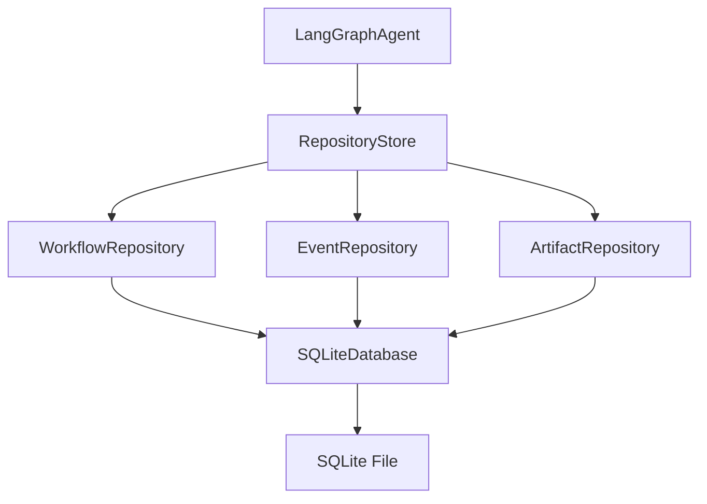
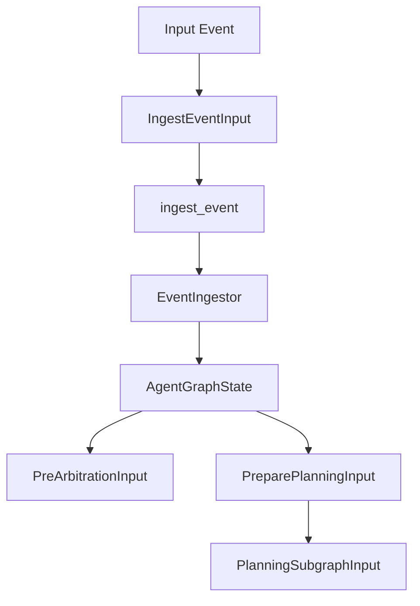
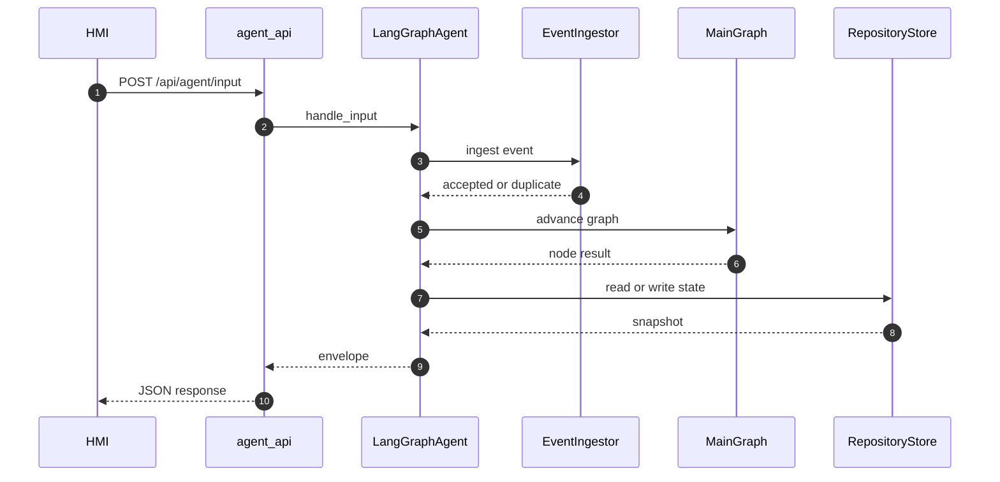
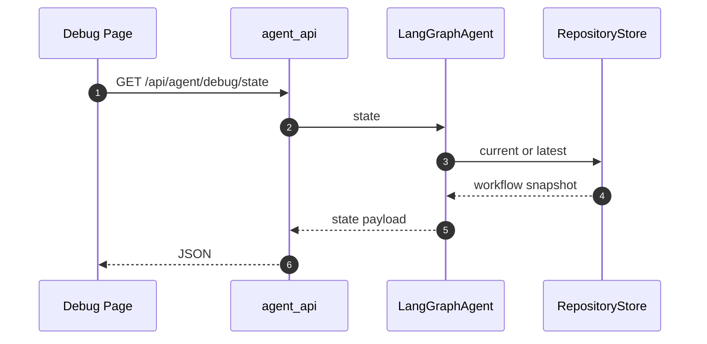

# 状态存储与数据流

<details>
<summary>Relevant source files</summary>

The following files were used as context for generating this wiki page:

- [src/aidv_agent/orchestrator/agent.py](src/aidv_agent/orchestrator/agent.py)
- [src/aidv_agent/persistence/__init__.py](src/aidv_agent/persistence/__init__.py)
- [tests/contract/test_wire_payload_shape.py](tests/contract/test_wire_payload_shape.py)
- [compose.yaml](compose.yaml)
- [README.md](README.md)
</details>

# 状态存储与数据流

AIDV Agent 的状态体系由“可持久化业务状态”和“LangGraph 执行状态”两层组成。持久化层以 SQLite 业务库为核心，通过 `RepositoryStore` 提供 workflow、event、artifact 三类仓储；`LangGraphAgent` 作为组合根与门面，持有这些仓储并驱动主图执行。`AgentGraphState` 只承载图执行过程中的临时通道，真正的 Workflow Aggregate 保留在 SQLite 中，形成“图状态轻、业务状态重”的数据流模型。  
Sources: [src/aidv_agent/persistence/__init__.py:1-26](), [src/aidv_agent/orchestrator/agent.py:1-65](), [src/aidv_agent/graph/state.py:1-77](), [services/agent_api/app.py:1-78](), [README.md:1-87]()

## 持久化层

### RepositoryStore 与 SQLite 业务库

`RepositoryStore` 是业务数据库的统一入口。它只打开一次数据库，并对外提供 `workflows`、`events`、`artifacts` 三个仓储对象。默认状态库路径优先取构造参数 `state_path`，否则读取环境变量 `AIDV_AGENT_STATE_DB`，最终回落到 `.aidv/state/aidv_agent.sqlite3`。

```python
class RepositoryStore:
    """Open the business database once; hand out its three repositories."""

    def __init__(self, path: str | Path | None = None) -> None:
        self.path = Path(path or os.getenv("AIDV_AGENT_STATE_DB", ".aidv/state/aidv_agent.sqlite3"))
        self.database = SQLiteDatabase(self.path)
        self.workflows = WorkflowRepository(self.database)
        self.events = EventRepository(self.database)
        self.artifacts = ArtifactRepository(self.database)
```

Sources: [src/aidv_agent/persistence/repositories.py:282-310](), [src/aidv_agent/persistence/__init__.py:1-26]()

`LangGraphAgent` 在初始化时构造 `RepositoryStore`，并把 `store.workflows` 与 `store.events` 暴露为自身属性；主图默认使用 `EventIngestor(self.events)` 接入事件仓储。

```python
store = RepositoryStore(state_db)
self.workflow_snapshots = store.workflows
self.events = store.events
self.main_graph = main_graph or build_main_graph(ingestor=EventIngestor(self.events))
```

Sources: [src/aidv_agent/orchestrator/agent.py:45-58]()

`build_main_graph` 的默认 ingestor 也使用同一环境变量路径，保证图节点与 agent 门面在缺省配置下指向同一业务库。

```python
def _default_ingestor() -> EventIngestor:
    path = Path(os.getenv("AIDV_AGENT_STATE_DB", ".aidv/state/aidv_agent.sqlite3"))
    return EventIngestor(EventRepository(SQLiteDatabase(path)))
```

Sources: [src/aidv_agent/graph/main.py:27-30]()

| 组件 | 职责 | 关键属性或方法 |
|---|---|---|
| `RepositoryStore` | 打开业务库并分发仓储 | `workflows`、`events`、`artifacts`、`database` |
| `WorkflowRepository` | 保存与读取 workflow 快照 | 被 `LangGraphAgent.workflow_snapshots` 使用 |
| `EventRepository` | 保存事件，支持幂等去重 | 被 `EventIngestor` 与 `LangGraphAgent.events` 使用 |
| `ArtifactRepository` | 保存工件 | `list(workflow_id)` 返回按创建时间排序的工件对象 |
| `SQLiteDatabase` | 提供连接与锁 | 被三个仓储共享 |

Sources: [src/aidv_agent/persistence/repositories.py:282-310](), [src/aidv_agent/persistence/__init__.py:1-26](), [src/aidv_agent/orchestrator/agent.py:45-58]()



该图表示持久化对象的组合关系：agent 门面不直接拼 SQL，而是通过 `RepositoryStore` 获取仓储；所有仓储共享同一个 `SQLiteDatabase`。  
Sources: [src/aidv_agent/orchestrator/agent.py:45-58](), [src/aidv_agent/persistence/repositories.py:282-310]()

### Workflow、Event、Artifact 数据对象

持久化模块文档明确：workflow snapshots 是唯一持久化任务状态，gate 的等待与恢复是建立在这些快照上的两请求状态机。集成测试中的 workflow 样例包含 `active_gate`、`artifacts`、`handoffs`、`tool_trace`、`updated_at` 等字段，并通过 `WorkflowRepository(SQLiteDatabase(...))` 保存。

```python
workflow = {
    "active_gate": None,
    "artifacts": [
        {
            "artifact_id": "route_artifact",
            "artifact_type": "navigation.route",
            "source_task_id": "route",
            "status": "ready",
            "data": {"route_id": "r1", "distance_meters": 1200},
        }
    ],
    "handoffs": [],
    "tool_trace": [],
    "updated_at": "2026-08-18T00:00:00+00:00",
}
```

Sources: [src/aidv_agent/persistence/__init__.py:1-26](), [tests/integration/test_gate_flow.py:61-106]()

`ArtifactRepository.list` 按工作流标识读取工件，按创建时间排序，并反序列化为 Python 对象。公开文档不展示底层 SQL、物理表名或列名；本页保留的字段仅用于说明应用对象和接口载荷，不作为数据库表结构说明。

Sources: [src/aidv_agent/persistence/repositories.py:282-310]()

| 数据对象 | 仓储接口 | 应用对象字段或行为（非物理表结构） |
|---|---|---|
| Workflow | `WorkflowRepository` | `active_gate`、`artifacts`、`handoffs`、`tool_trace`、`updated_at`、`status`、`workflow_id`、`state_version` |
| Event | `EventRepository` | 支持 `append`，重复事件返回未插入；`EventIngestor` 返回 `accepted` 与 `existing` |
| Artifact | `ArtifactRepository` | 工件标识、类型、来源任务、状态与数据；按创建时间有序返回 |

Sources: [tests/integration/test_gate_flow.py:61-106](), [src/aidv_agent/persistence/repositories.py:282-310](), [src/aidv_agent/graph/main.py:44-59]()

## LangGraph 状态模型

### AgentGraphState

`AgentGraphState` 是主图的执行状态。文档字符串明确说明：图执行状态在这里，而 durable Workflow Aggregate 保留在 SQLite 中。该状态使用 `TypedDict(total=False)`，所有字段都是可选通道。

```python
class AgentGraphState(TypedDict, total=False):
    """Graph execution state; the durable Workflow Aggregate stays in SQLite."""

    event: dict[str, Any]
    event_accepted: bool
    duplicate_event: dict[str, Any] | None
    workflow_id: str | None
    node_result: dict[str, Any]
    trace: Annotated[list[dict[str, Any]], add]

    workflow_snapshot: dict[str, Any] | None
    pre_arbitration_decision: dict[str, Any]
    pre_arbitration_route_target: str

    plan_id: str
    text: str

    domain_decision: dict[str, Any]
    conversation_reply: dict[str, Any]
    candidate_tools: list[dict[str, Any]]
    plan_result: dict[str, Any]
    plan_ir: dict[str, Any]
    validation: dict[str, Any]
    llm_calls: dict[str, Any]
```

Sources: [src/aidv_agent/graph/state.py:8-31]()

| 字段 | 类型 | 作用 |
|---|---|---|
| `event` | `dict[str, Any]` | 当前输入事件 |
| `event_accepted` | `bool` | 事件是否被接受 |
| `duplicate_event` | `dict[str, Any] \| None` | 重复事件信息 |
| `workflow_id` | `str \| None` | 当前工作流标识 |
| `node_result` | `dict[str, Any]` | 节点执行结果 |
| `trace` | `Annotated[list[dict[str, Any]], add]` | 追加式运行轨迹 |
| `workflow_snapshot` | `dict[str, Any] \| None` | 工作流快照 |
| `pre_arbitration_decision` | `dict[str, Any]` | 预仲裁决策 |
| `pre_arbitration_route_target` | `str` | 预仲裁路由目标 |
| `plan_id` | `str` | 计划标识 |
| `text` | `str` | 规划文本 |
| `domain_decision` | `dict[str, Any]` | 领域决策 |
| `conversation_reply` | `dict[str, Any]` | 会话回复 |
| `candidate_tools` | `list[dict[str, Any]]` | 候选工具列表 |
| `plan_result` | `dict[str, Any]` | 规划结果 |
| `plan_ir` | `dict[str, Any]` | 计划 IR |
| `validation` | `dict[str, Any]` | 校验结果 |
| `llm_calls` | `dict[str, Any]` | LLM 调用观测数据 |

Sources: [src/aidv_agent/graph/state.py:8-31]()

### 节点输入与规划子图状态

除主图状态外，`src/aidv_agent/graph/state.py` 还定义了节点实际读取的输入通道，避免节点读取无关字段。

| 状态类型 | 字段 | 用途 |
|---|---|---|
| `IngestEventInput` | `event` | `ingest_event` 节点读取事件 |
| `PreArbitrationInput` | `event`、`workflow_snapshot` | 预仲裁节点读取事件与快照 |
| `PreparePlanningInput` | `event`、`plan_id` | 准备规划节点读取事件与计划标识 |
| `PlanningSubgraphInput` | `text`、`plan_id` | 规划子图入口读取文本与计划标识 |
| `PlanningGraphState` | `text`、`plan_id`、`domain_decision`、`conversation_reply`、`candidate_tools`、`plan_result`、`plan_ir`、`validation` | 规划子图内部状态 |

Sources: [src/aidv_agent/graph/state.py:33-77]()

`ingest_event` 节点从 `IngestEventInput` 读取 `event`，调用 `EventIngestor.ingest`，并把结果写回主图状态：

```python
result = (event_ingestor or _default_ingestor()).ingest(payload)
return {
    "event": result.event,
    "event_accepted": result.accepted,
    "duplicate_event": result.existing,
    "workflow_id": result.event.get("workflow_id"),
    "node_result": {
        "kind": "event_accepted" if result.accepted else "duplicate_event",
        "event_id": result.event["event_id"],
    },
}
```

Sources: [src/aidv_agent/graph/main.py:44-59]()



该图表示事件从输入通道进入图状态，再被后续节点按需读取。  
Sources: [src/aidv_agent/graph/state.py:33-77](), [src/aidv_agent/graph/main.py:44-59]()

## API 数据流

### agent_api 服务入口

`services/agent_api/app.py` 在模块级创建 `agent = LangGraphAgent()`，并暴露 FastAPI 应用。`/healthz` 返回服务名、运行时后端、端口、状态存储类型和 cockpit API 地址，其中 `state_store` 固定为 `sqlite`。

```python
agent = LangGraphAgent()
app = FastAPI(title="AIDV Agent API - Standalone LangGraph Runtime")
```

Sources: [services/agent_api/app.py:1-78]()

| 端点 | 方法 | 用途 | 关键行为 |
|---|---|---|---|
| `/healthz` | GET | 探活 | 返回 `agent_api`、`langgraph`、`sqlite`、端口、cockpit URL |
| `/debug` | GET | 重定向 | 跳转到 `/debug/` |
| `/debug/` | GET | 调试台 | 返回只读 inspector HTML |
| `/api/agent/state` | GET | 查询状态 | 调用 `agent.state(session_id, workflow_id)` |
| `/api/agent/input` | POST | 输入事件 | 调用 `agent.handle_input` |
| `/api/agent/workflows/{workflow_id}` | GET | 查询工作流 | workflow 不存在返回 404 |
| `/api/agent/workflows/{workflow_id}/cancel` | POST | 取消工作流 | 调用 `agent.cancel_workflow` |
| `/api/agent/workflows/{workflow_id}/patch` | POST | 修改工作流 | 先写事件，再调用 `agent.patch_workflow` |
| `/api/agent/debug/state` | GET | 调试状态 | 无 `workflow_id` 时取 current 或 latest terminal |

Sources: [services/agent_api/app.py:55-130](), [services/agent_api/app.py:194-239]()

### 输入请求模型

`InputRequest` 是自然语言或 HMI 文本进入 agent 的主要模型。`session_id` 可缺省，缺省时由 `_session_id` 生成 `session_<16位hex>`。

| 字段 | 类型 | 约束或默认值 |
|---|---|---|
| `text` | `str` | `min_length=1` |
| `session_id` | `str \| None` | 可缺省 |
| `workflow_id` | `str \| None` | 可缺省 |
| `event_id` | `str \| None` | 可缺省 |
| `idempotency_key` | `str \| None` | 可缺省 |
| `source` | `str` | 默认 `hmi_text` |

Sources: [services/agent_api/app.py:55-130]()

`PatchRequest` 用于修改已有工作流，要求携带 `session_id`、`plan_version`、`state_version`，用于乐观并发控制。

| 字段 | 类型 | 约束或默认值 |
|---|---|---|
| `text` | `str` | `min_length=1` |
| `session_id` | `str` | 必填 |
| `plan_version` | `int` | 必填 |
| `state_version` | `int` | 必填 |
| `event_id` | `str \| None` | 可缺省 |
| `idempotency_key` | `str \| None` | 可缺省 |
| `source` | `str` | 默认 `hmi_text` |

Sources: [services/agent_api/app.py:55-130]()

`GateActionRequest` 用于 gate 交互，支持 `action`、`selected_index`、`text` 等字段，默认 `source` 为 `touch`。

| 字段 | 类型 | 约束或默认值 |
|---|---|---|
| `event_id` | `str \| None` | 可缺省 |
| `idempotency_key` | `str \| None` | 可缺省 |
| `plan_version` | `int \| None` | 可缺省 |
| `state_version` | `int \| None` | 可缺省 |
| `action` | `str \| None` | 可缺省 |
| `selected_index` | `int \| None` | 可缺省 |
| `text` | `str \| None` | 可缺省 |
| `source` | `str` | 默认 `touch` |

Sources: [services/agent_api/app.py:55-130]()

### 输入事件处理流

`POST /api/agent/input` 接收 `InputRequest`，生成或复用 session，然后调用 `agent.handle_input`。该调用进入 `LangGraphAgent` 门面，再驱动主图与持久化仓储。

```python
@app.post("/api/agent/input")
def input_event(request: InputRequest) -> dict[str, Any]:
    session_id = _session_id(request.session_id)
    return agent.handle_input(
        session_id,
        request.text,
        source=request.source,
        workflow_id=request.workflow_id,
        event_id=request.event_id,
        idempotency_key=request.idempotency_key,
    )
```

Sources: [services/agent_api/app.py:111-164]()



该时序图表示一次输入事件从 HTTP 层进入 agent 门面，经过事件摄入、图执行和状态读取，最终返回 envelope 响应。  
Sources: [services/agent_api/app.py:111-164](), [src/aidv_agent/orchestrator/agent.py:1-65](), [src/aidv_agent/graph/main.py:44-59]()

### 状态查询与调试查询

`/api/agent/state` 直接返回 `agent.state(session_id, workflow_id)`。`/api/agent/debug/state` 面向只读 inspector：当未提供 `workflow_id` 时，优先取 `agent.workflow_snapshots.current(session_id)`，否则取 `agent.workflow_snapshots.latest_snapshot(session_id)`。

```python
@app.get("/api/agent/debug/state")
def debug_state(session_id: str, workflow_id: str | None = None) -> dict[str, Any]:
    target_id = workflow_id
    if target_id is None:
        target = agent.workflow_snapshots.current(session_id) or (
            agent.workflow_snapshots.latest_snapshot(session_id)
        )
        target_id = target.get("workflow_id") if target else None
    return agent.state(session_id, target_id)
```

Sources: [services/agent_api/app.py:194-239]()



该时序图表示调试页通过 `agent_api` 读取当前或最近终态工作流快照。  
Sources: [services/agent_api/app.py:194-239](), [src/aidv_agent/orchestrator/agent.py:45-58]()

### Patch 数据流

`POST /api/agent/workflows/{workflow_id}/patch` 会先生成或复用 `event_id` 与 `idempotency_key`，把 `workflow_patch` 事件写入 `agent.events`。如果事件重复，则返回 `duplicate_event: True` 与当前状态；否则调用 `agent.patch_workflow`，并传入 `expected_plan_version` 与 `expected_state_version`。

```python
event = {
    "event_id": event_id,
    "idempotency_key": idempotency_key,
    "session_id": request.session_id,
    "workflow_id": workflow_id,
    "source": request.source,
    "event_type": "workflow_patch",
    "text": request.text,
    "received_at": time.strftime("%Y-%m-%dT%H:%M:%SZ", time.gmtime()),
}
inserted, _ = agent.events.append(event)
```

Sources: [services/agent_api/app.py:111-164]()

### 错误处理

`agent_api` 对 `ValueError` 和 `RuntimeError` 做结构化处理：`ValueError` 返回 422，错误类型为 `invalid_request_or_plan`；`RuntimeError` 返回 500，错误类型为 `runtime_failure`。这保证坏输入或运行时失败不会变成空 500。

```python
return JSONResponse(
    status_code=422,
    content={"ok": False, "error": {"type": "invalid_request_or_plan", "message": str(exc)}},
)
```

Sources: [services/agent_api/app.py:28-43]()

| 异常 | HTTP 状态 | 错误类型 | 语义 |
|---|---:|---|---|
| `ValueError` | 422 | `invalid_request_or_plan` | 非法输入或被拒绝的计划 |
| `RuntimeError` | 500 | `runtime_failure` | 运行时或 provider 失败 |

Sources: [services/agent_api/app.py:28-43]()

## 线上载荷契约

### state 载荷键集

`tests/contract/test_wire_payload_shape.py` 将前端消费面钉死。`agent.state()` 返回的 state 载荷必须严格等于 10 个键：

```python
STATE_KEYS = {
    "session_id",
    "session",
    "workflow",
    "active_gate",
    "artifacts",
    "handoffs",
    "tool_trace",
    "trace",
    "fast_actions",
    "backend",
}
ENVELOPE_KEYS = STATE_KEYS | {"accepted_event", "result"}
```

Sources: [tests/contract/test_wire_payload_shape.py:26-37]()

| 键 | 契约含义 |
|---|---|
| `session_id` | 会话标识 |
| `session` | 会话对象 |
| `workflow` | 工作流快照 |
| `active_gate` | 当前 gate |
| `artifacts` | 工件列表 |
| `handoffs` | 跨域交接 |
| `tool_trace` | 工具执行轨迹 |
| `trace` | 运行轨迹 |
| `fast_actions` | 快速动作 |
| `backend` | 后端标识 |

Sources: [tests/contract/test_wire_payload_shape.py:26-37](), [services/agent_api/static/debug.html:71-98]()

### envelope 与 result 键集

除 gate 路径外，`fast_action`、`new_workflow`、`clarification`、`duplicate` 等 envelope 响应必须严格等于 `state + accepted_event + result`。`result` 键集必须落在登记的并集内；新增键被视为扩展契约，必须显式修改 `RESULT_KEYS`。

```python
RESULT_KEYS = {
    "ok",
    "type",
    "fast_action_id",
    "intent",
    "tool_name",
    "answer",
    "tool_result",
    "workflow_id",
    "status",
    "outcome",
    "duplicate_event",
    "conversation_id",
    "answer_chars",
    "chat_only",
    "llm_calls",
    "committed",
    "selected",
}
```

Sources: [tests/contract/test_wire_payload_shape.py:40-66]()

| result 键组 | 键 | 来源路径 |
|---|---|---|
| fast_action | `ok`、`type`、`fast_action_id`、`intent`、`tool_name`、`answer`、`tool_result` | envelope 响应 |
| new workflow / outcome | `workflow_id`、`status`、`outcome` | envelope 响应 |
| duplicate | `duplicate_event` | 重复事件幂等拒绝 |
| conversation | `conversation_id`、`answer_chars`、`chat_only`、`llm_calls` | planning 会话路径 |
| gate | `committed`、`selected` | `resolve_gate` 自包装 |

Sources: [tests/contract/test_wire_payload_shape.py:40-66]()

`patch` 是唯一裸 payload，不经过 envelope。其键集被单独登记为：

```python
PATCH_KEYS = {"ok", "patch", "affected_task_ids", "outcome", "workflow", "answer"}
```

Sources: [tests/contract/test_wire_payload_shape.py:69-70]()

### 契约测试断言

契约测试通过离线 kernel 验证 state、envelope 和 gate 响应：

```python
def test_state_payload_keys_are_pinned(kernel) -> None:
    assert set(kernel.state("s_wire")) == STATE_KEYS

def test_enveloped_response_keys_are_pinned(kernel) -> None:
    fast = kernel.handle_input("s_wire", "空调调到26度")
    assert set(fast) == ENVELOPE_KEYS
    assert set(fast["result"]) <= RESULT_KEYS and fast["result"]["ok"] is True
```

Sources: [tests/contract/test_wire_payload_shape.py:95-120]()

gate 响应在 agent 层自行 envelope，但不传 `accepted_event`，因此键集为 `STATE_KEYS | {"result"}`，且 `result` 严格等于 `{"ok", "committed", "outcome", "selected", "answer"}`。

```python
gate = kernel.handle_input("s_wire", "第一个")
assert set(gate) == STATE_KEYS | {"result"}
assert set(gate["result"]) == {"ok", "committed", "outcome", "selected", "answer"}
```

Sources: [tests/contract/test_wire_payload_shape.py:112-120]()

## 调试页与 HMI 数据消费

### debug.html 只读 inspector

`services/agent_api/static/debug.html` 是 agent_api 的只读 workflow inspector。页面通过 `/api/agent/debug/state?session_id=...` 拉取状态，并渲染 workflow、gate、fast actions、tool trace、timeline、metrics、artifacts、handoffs 和完整 JSON。

```javascript
const response = await fetch(
  `/api/agent/debug/state?session_id=${encodeURIComponent(session())}`,
  {cache: "no-store"}
);
const data = await response.json();
```

Sources: [services/agent_api/static/debug.html:71-98]()

页面自动刷新间隔为 800ms，并使用 `lastRenderKey` 比较 `workflow_id`、`state_version`、`status`、`updated_at`、`active_gate.state_version` 和 fast actions 摘要，避免无变化重绘。

```javascript
timer = setInterval(refresh, 800)
```

Sources: [services/agent_api/static/debug.html:71-98]()

| 调试页面板 | 消费字段 |
|---|---|
| Workflow 卡片 | `workflow.workflow_id`、`workflow.status`、`workflow.updated_at` |
| Active Gate 卡片 | `active_gate.stage_id` |
| Cloud Tokens | `workflow.llm_calls` 中的 `total_tokens` |
| Domain 面板 | `workflow.input_text`、`workflow.last_decision`、`workflow.domain_decision`、`session` |
| Candidate Tool List | `workflow.candidate_tools` |
| Plan IR / Patch | `workflow.plan_ir`、`workflow.patch_history` |
| Gate / Fast Actions | `active_gate`、`fast_actions` |
| Tool Trace | `tool_trace` 中的 `task_id`、`tool`、`real`、`ok`、`elapsed_ms`、`error` |
| Timeline | `trace` 中的 `at`、`type` 及其他字段 |
| Artifacts / Handoffs | `artifacts`、`handoffs` |
| Raw JSON | 完整 state payload |

Sources: [services/agent_api/static/debug.html:71-98]()

### hmi.js 会话状态

`services/hmi_web/static/hmi.js` 使用 `localStorage` 保存 HMI session。存储键为 `aidv_hmi_v1_session_id`；如果不存在，则生成 `hmi-demo-session-<timestamp>-<random>`。

```javascript
const SESSION_STORAGE_KEY = AIDV_STORAGE_PREFIX + "_session_id";

function loadOrCreateSessionId() {
  const existing = localStorage.getItem(SESSION_STORAGE_KEY);
  if (existing) return existing;

  const created =
    "hmi-demo-session-" +
    Date.now() +
    "-" +
    Math.random().toString(16).slice(2);
  localStorage.setItem(SESSION_STORAGE_KEY, created);
  return created;
}
```

Sources: [services/hmi_web/static/hmi.js:1-25]()

HMI 还维护 `agentDebugSnapshot`，包含 `route`、`trace`、`mcp`、`mcp_detail`、`skill`、`map`、`planner`、`elapsed` 等调试字段，用于页面内轻量调试信息展示。

```javascript
let agentDebugSnapshot = {
  route: "idle",
  trace: "-",
  mcp: "none",
  mcp_detail: "",
  skill: "none",
  map: "idle",
  planner: "云端 API",
  elapsed: null
};
```

Sources: [services/hmi_web/static/hmi.js:35-50]()

| 前端存储 | 键或字段 | 用途 |
|---|---|---|
| `localStorage` | `aidv_hmi_v1_session_id` | 保存 HMI session |
| `agentDebugSnapshot` | `route`、`trace`、`mcp`、`skill`、`map`、`planner`、`elapsed` | HMI 内调试摘要 |
| debug.html | `aidv_hmi_session` | 调试页 session 输入缓存 |

Sources: [services/hmi_web/static/hmi.js:1-85](), [services/agent_api/static/debug.html:71-98]()

## 测试与验收中的数据流

### 离线 kernel

契约测试的 `kernel` fixture 完全离线：删除 `AIDV_LLM_API_KEY`，设置 `AIDV_PROJECT_ROOT` 为临时目录，使用 `FakeToolDispatcher` 与 `ScriptedPlanningService` 构造 `LangGraphAgent`。

```python
monkeypatch.delenv("AIDV_LLM_API_KEY", raising=False)
monkeypatch.setenv("AIDV_PROJECT_ROOT", str(tmp_path))
dispatcher = FakeToolDispatcher()
agent = LangGraphAgent(
    state_path=tmp_path / "state.db",
    main_graph=build_main_graph(
        ingestor=EventIngestor(EventRepository(SQLiteDatabase(tmp_path / "events.db"))),
        planning_subgraph=build_planning_graph(service=ScriptedPlanningService()),
    ),
    tool_dispatcher=dispatcher,
)
```

Sources: [tests/contract/test_wire_payload_shape.py:74-92]()

这与 `AGENTS.md` 的离线优先原则一致：新功能必须在 `FakeToolDispatcher + ScriptedPlanningService` 下可端到端跑通；契约测试用于执法架构不变式。

Sources: [AGENTS.md:1-43](), [tests/contract/test_wire_payload_shape.py:74-92]()

### 集成测试中的仓储数据流

`tests/integration/test_gate_flow.py` 使用 `WorkflowRepository(SQLiteDatabase(tmp_path / "business.sqlite3"))` 保存 workflow，再读取已存储对象，验证 gate 流程所需的数据形状。

```python
def _repository(tmp_path, workflow: dict) -> WorkflowRepository:
    repository = WorkflowRepository(SQLiteDatabase(tmp_path / "business.sqlite3"))
    repository.save(workflow)
    return repository
```

Sources: [tests/integration/test_gate_flow.py:94-106]()

`tests/integration/test_use_case_pipeline.py` 引入 `ExecutionService`、`GateApplicationService`、`PatchApplicationService` 与多个 use case，并通过 `WorkflowRepository` 和 `SQLiteDatabase` 构造测试环境，说明 use case 层与持久化层之间的数据流。

```python
from aidv_agent.kernel.execution.service import ExecutionService
from aidv_agent.kernel.gates.service import GateApplicationService
from aidv_agent.kernel.patching.service import PatchApplicationService
from aidv_agent.orchestrator import (
    AdvanceWorkflowUseCase,
    CreateWorkflowUseCase,
    ModifyWorkflowUseCase,
    ResolveGateUseCase,
)
from aidv_agent.persistence import SQLiteDatabase, WorkflowRepository
```

Sources: [tests/integration/test_use_case_pipeline.py:1-47]()

| 测试层 | 验证重点 | 使用组件 |
|---|---|---|
| contract | 线上载荷键集、state/envelope/result/patch 契约 | `LangGraphAgent`、`FakeToolDispatcher`、`ScriptedPlanningService`、`SQLiteDatabase` |
| integration | gate flow、use case pipeline、仓储读写 | `WorkflowRepository`、`SQLiteDatabase`、`ExecutionService`、`GateApplicationService`、`PatchApplicationService` |

Sources: [tests/contract/test_wire_payload_shape.py:74-120](), [tests/integration/test_gate_flow.py:61-106](), [tests/integration/test_use_case_pipeline.py:1-47]()

## 总结

AIDV Agent 的状态存储与数据流围绕“SQLite 业务状态 + LangGraph 执行状态”展开。`RepositoryStore` 统一管理 workflow、event、artifact 仓储；`LangGraphAgent` 作为门面持有仓储并驱动主图；`AgentGraphState` 只承载事件、规划、校验、trace 等执行通道。`agent_api` 将输入、状态查询、gate、patch 和调试接口暴露给 HMI 与 inspector；契约测试把 state、envelope、result 和 patch 载荷键集固定下来，确保前端消费面不会因内部实现变化而漂移。整体数据流强调可观察、可恢复、可离线验证，并以 workflow snapshots 作为唯一持久化任务状态。  
Sources: [src/aidv_agent/persistence/__init__.py:1-26](), [src/aidv_agent/orchestrator/agent.py:1-65](), [src/aidv_agent/graph/state.py:1-77](), [services/agent_api/app.py:1-78](), [tests/contract/test_wire_payload_shape.py:1-92](), [services/agent_api/static/debug.html:71-98](), [AGENTS.md:1-43]()

---

**关联源文件:** `src/aidv_agent/orchestrator/agent.py`, `src/aidv_agent/persistence/__init__.py`, `tests/contract/test_wire_payload_shape.py`, `compose.yaml`, `README.md`
