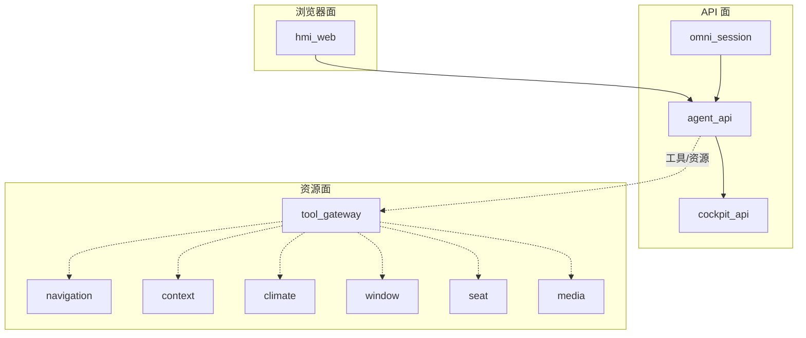
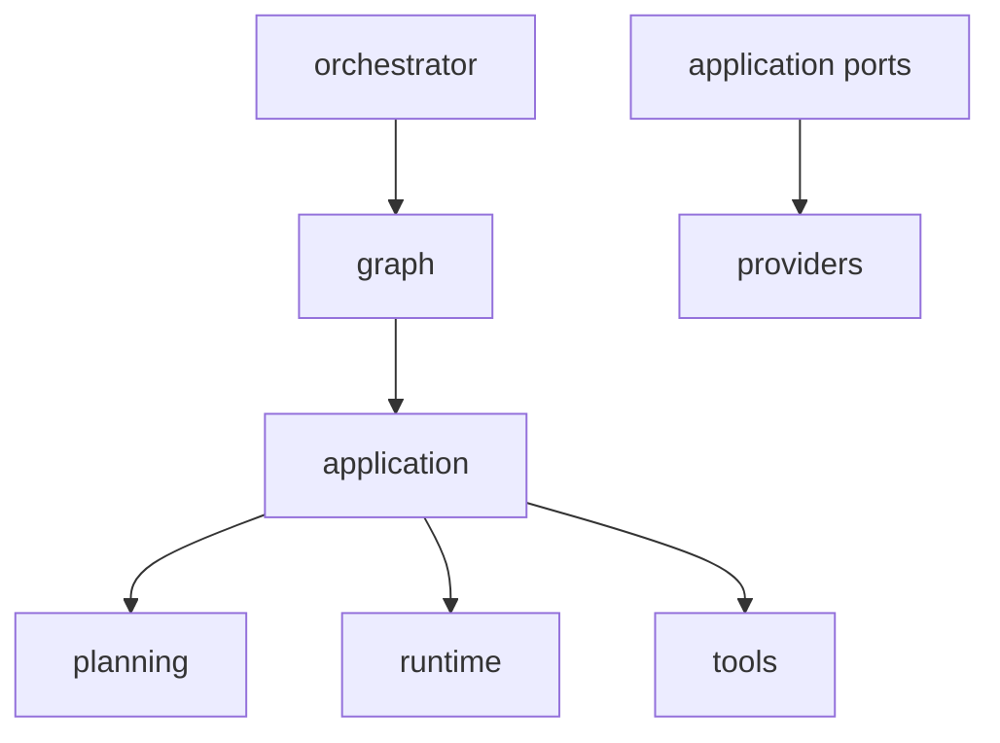
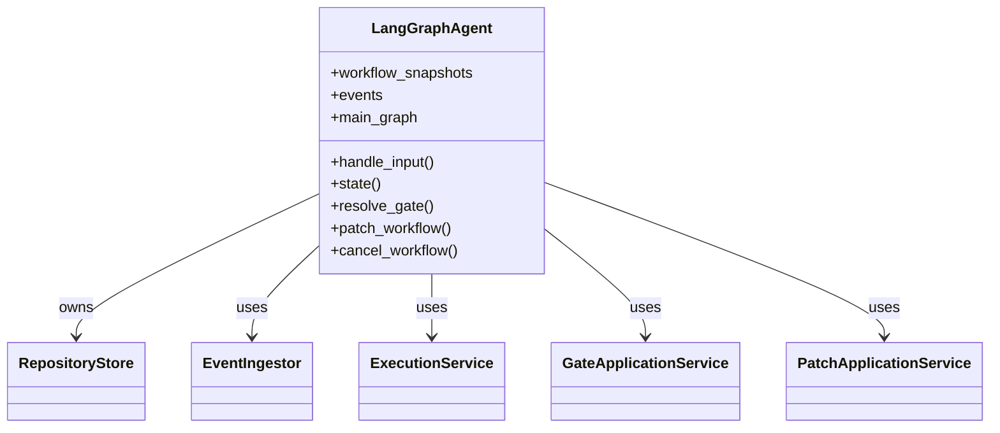
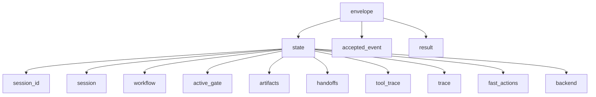
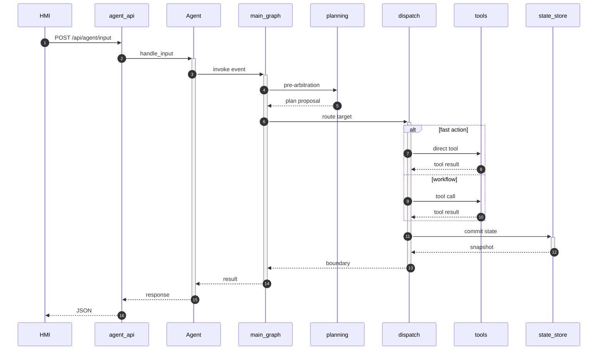
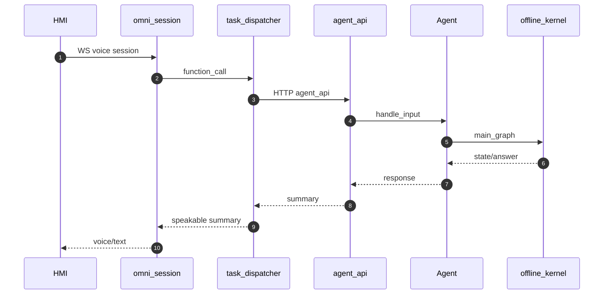

# 系统架构总览

<details>
<summary>Relevant source files</summary>

The following files were used as context for generating this wiki page:

- [README.md](README.md)
- [docs/ARCHITECTURE.md](docs/ARCHITECTURE.md)
- [src/aidv_agent/orchestrator/agent.py](src/aidv_agent/orchestrator/agent.py)
- [services/agent_api/app.py](services/agent_api/app.py)
- [compose.yaml](compose.yaml)
</details>

# 系统架构总览

AIDV Agent 是一个基于 LangGraph 编排的确定性工作流车载智能体，覆盖车控、导航和生活服务（咖啡 / 麦当劳 / 电影票）多领域任务。其核心设计目标是让 LLM 只负责“提议” Plan/Patch，而控制流、状态归约、Gate 生命周期、参数校验等关键路径全部由本地确定性代码完成，从而保证可观察、可修改、可恢复。  
Sources: [README.md:1-87](), [AGENTS.md:1-43]()

本页从服务平面、内核包依赖、API 入口、线上载荷契约、规划与执行链路、Gate/Patch、语音链路、调试观测、部署形态和契约测试等方面，对 AIDV Agent 的系统架构进行总览。  
Sources: [README.md:176-258](), [src/aidv_agent/orchestrator/__init__.py:1-34](), [services/agent_api/app.py:1-130]()

## 1. 架构目标与设计原则

AIDV Agent 的架构强调“确定性内核 + 弱规则重模型”。LLM 可以输出 Plan 或 Patch 提议，但是否应用由本地 compiler/validator/reducer 决定；非法计划或参数会被确定性拒绝，而不是静默修正。  
Sources: [README.md:1-87](), [AGENTS.md:1-43]()

| 设计原则 | 架构含义 |
|---|---|
| 确定性内核 | 控制流、状态归约、Gate 生命周期、参数校验全部本地代码 |
| 多域编排 | 导航、车控、生活服务通过 Gate / Handoff / Patch 组合 |
| 离线可验证 | 新功能必须在 `FakeToolDispatcher + ScriptedPlanningService` 下端到端跑通 |
| 弱规则重模型 | 清理复杂规则兜底，主要靠契约校验；短期特例可用简单全量字符串匹配 |
| 坏输入诚实失败 | 非法计划/参数返回结构化错误，不崩溃、不污染状态、不静默修正 |

Sources: [README.md:1-87](), [README.md:176-258](), [AGENTS.md:1-43]()

API 层通过异常处理器将内核错误转换为结构化 HTTP 响应：`ValueError` 返回 `422 invalid_request_or_plan`，`RuntimeError` 返回 `500 runtime_failure`。这体现了“坏输入诚实失败”的原则。  
Sources: [services/agent_api/app.py:23-37]()

## 2. 服务平面与端口拓扑

AIDV Agent 将服务划分为三个平面：浏览器面、API 面和资源面。浏览器面唯一对外入口是 `hmi_web`，使用 HTTPS；API 面承载 `cockpit_api`、`agent_api` 和 `omni_session`；资源面承载导航、工具网关和车辆/媒体服务。内部服务间使用明文 HTTP，TLS 只在 `hmi_web` 边缘终结。  
Sources: [README.md:73-147]()

| 服务 | 平面 | 本地端口 | Docker 宿主端口（默认） |
|---|---|---:|---:|
| `hmi_web`（HTTPS，唯一对外） | 浏览器面 | 8081 | 8181 |
| `cockpit_api` | API 面 | 18011 | 18111 |
| `agent_api`（含调试台） | API 面 | 18012 | 18112 |
| `omni_session`（语音 WS） | API 面 | 18013 | 18113 |
| `online/navigation` | 资源面 | 18101 | 18201 |
| `tool_gateway` | 资源面 | 18102 | 18202 |
| `vehicle/context` | 资源面 | 18103 | 18203 |
| `vehicle/climate` | 资源面 | 18104 | 18204 |
| `vehicle/window` | 资源面 | 18105 | 18205 |
| `vehicle/seat` | 资源面 | 18106 | 18206 |
| `online/media` | 资源面 | 18107 | 18207 |

Sources: [README.md:73-147](), [compose.yaml:48-60]()

Docker 宿主侧默认映射到 +100 号段，容器内部端口与本地一致，避免与本地开发栈和隔离验收栈抢位。宿主端口可通过 `AIDV_HOST_*` 环境变量覆盖。  
Sources: [README.md:73-147](), [compose.yaml:48-60]()



`agent_api` 会代理 `/api/cockpit/{path}` 到 `cockpit_api`，用于保留 HMI 壳页中的状态卡片、高德 JS 配置和直接车辆/媒体控制。`omni_session` 作为语音会话服务，通过 `agent_api` 执行任务。  
Sources: [services/agent_api/app.py:219-239](), [services/omni_session/__init__.py:1-7]()

## 3. 内核包依赖与组合根

`src/aidv_agent` 内部采用单向 DAG 依赖。`orchestrator` 是组合根，位于依赖链顶部，`src` 内其他包不得导入它。`graph` 保持为拓扑层，不得反向导入 `orchestrator` 或 `kernel.execution`。`providers` 只能通过应用端口模块访问，避免底层能力被上层随意耦合。  
Sources: [src/aidv_agent/orchestrator/__init__.py:1-34](), [tests/contract/test_layering.py:151-198](), [README.md:176-258]()



`orchestrator` 包内部布局包括：

| 模块 | 职责 |
|---|---|
| `agent.py` | 组合根 + 对外 facade |
| `dispatch.py` | 图外 route-target 执行点 |
| `use_cases.py` | workflow 用例：create / advance / resolve_gate / modify / cancel |
| `responses.py` | 共享响应组装 |

Sources: [src/aidv_agent/orchestrator/__init__.py:1-34]()

`LangGraphAgent` 是内核单一入口，承担组合根、facade 和事务边界职责。它组装服务、持有 store，并通过 `advance_to_boundary` 将工作流驱动到下一个相位边界，例如 Gate 激活、完成或失败。  
Sources: [src/aidv_agent/orchestrator/agent.py:1-65]()



Sources: [src/aidv_agent/orchestrator/agent.py:1-65]()

## 4. API 面与请求入口

`agent_api` 是 API 面的内核组装点和唯一 ASGI 入口，对外提供 `/api/agent/*` 能力。它基于 FastAPI 构建，并在应用启动时创建 `LangGraphAgent` 实例。  
Sources: [services/agent_api/__init__.py:1-2](), [services/agent_api/app.py:1-78]()

| 方法 | 路径 | 用途 |
|---|---|---|
| GET | `/healthz` | 健康检查，返回服务、运行时后端、端口、状态存储等信息 |
| GET | `/debug` | 重定向到 `/debug/` |
| GET | `/debug/` | 提供只读 workflow inspector 页面 |
| GET | `/api/agent/state` | 查询会话/工作流状态 |
| POST | `/api/agent/input` | 提交用户输入事件 |
| GET | `/api/agent/workflows/{workflow_id}` | 查询指定 workflow 快照 |
| POST | `/api/agent/workflows/{workflow_id}/cancel` | 取消指定 workflow |
| GET | `/api/agent/debug/state` | 返回 active 或 latest terminal workflow，用于只读 inspector |
| GET/POST/PUT/PATCH/DELETE | `/api/cockpit/{path}` | 代理到 `cockpit_api`，保留壳页直接车辆/媒体控制 |

Sources: [services/agent_api/app.py:68-130](), [services/agent_api/app.py:194-239]()

### 4.1 请求模型

| 模型 | 字段 | 约束/默认值 |
|---|---|---|
| `InputRequest` | `text` | 必填，`min_length=1` |
| `InputRequest` | `session_id` | 可选 |
| `InputRequest` | `workflow_id` | 可选 |
| `InputRequest` | `event_id` | 可选 |
| `InputRequest` | `idempotency_key` | 可选 |
| `InputRequest` | `source` | 默认 `hmi_text` |
| `GateActionRequest` | `event_id` | 可选 |
| `GateActionRequest` | `idempotency_key` | 可选 |
| `GateActionRequest` | `plan_version` | 可选 |
| `GateActionRequest` | `state_version` | 可选 |
| `GateActionRequest` | `action` | 可选 |
| `GateActionRequest` | `selected_index` | 可选 |
| `GateActionRequest` | `text` | 可选 |
| `GateActionRequest` | `source` | 默认 `touch` |
| `PatchRequest` | `text` | 必填，`min_length=1` |
| `PatchRequest` | `session_id` | 必填 |
| `PatchRequest` | `plan_version` | 必填 |
| `PatchRequest` | `state_version` | 必填 |
| `PatchRequest` | `event_id` | 可选 |
| `PatchRequest` | `idempotency_key` | 可选 |
| `PatchRequest` | `source` | 默认 `hmi_text` |

Sources: [services/agent_api/app.py:39-63]()

### 4.2 错误响应

| 异常 | HTTP 状态 | 错误类型 | 含义 |
|---|---:|---|---|
| `ValueError` | 422 | `invalid_request_or_plan` | 非法输入或被拒绝的计划 |
| `RuntimeError` | 500 | `runtime_failure` | 运行时或 provider 失败 |

Sources: [services/agent_api/app.py:23-37]()

## 5. 工作流状态与线上载荷契约

`agent.state()` 返回的 state 载荷键集被契约测试严格锁定为 10 个键。envelope 响应在 state 基础上增加 `accepted_event` 和 `result`。`result` 的键集按 route 登记，新增键必须显式扩展契约。  
Sources: [tests/contract/test_wire_payload_shape.py:1-92]()

| state 键 | 含义 |
|---|---|
| `session_id` | 会话标识 |
| `session` | 会话信息 |
| `workflow` | 工作流数据 |
| `active_gate` | 当前激活 Gate |
| `artifacts` | 任务产物 |
| `handoffs` | 跨域交接数据 |
| `tool_trace` | 工具调用轨迹 |
| `trace` | 运行轨迹 |
| `fast_actions` | 快速车控动作 |
| `backend` | 后端标识 |

Sources: [tests/contract/test_wire_payload_shape.py:28-38]()



Sources: [tests/contract/test_wire_payload_shape.py:28-39]()

| route / 场景 | result 键 |
|---|---|
| fast_action | `ok`, `type`, `fast_action_id`, `intent`, `tool_name`, `answer`, `tool_result` |
| new workflow / outcome_result | `workflow_id`, `status`, `outcome` |
| duplicate event | `duplicate_event` |
| conversation | `conversation_id`, `answer_chars`, `chat_only`, `llm_calls` |
| gate | `committed`, `selected` |
| patch（裸 payload） | `ok`, `patch`, `affected_task_ids`, `outcome`, `workflow`, `answer` |

Sources: [tests/contract/test_wire_payload_shape.py:42-71]()

状态持久化使用 SQLite。`LangGraphAgent` 默认从 `AIDV_AGENT_STATE_DB` 或项目根目录下 `.aidv/state/aidv_agent.sqlite3` 读取状态库路径，并通过 `RepositoryStore` 管理 workflow 快照和事件。  
Sources: [src/aidv_agent/orchestrator/agent.py:55-65](), [compose.yaml:35]()

## 6. 规划、仲裁与执行链路

主图由 `build_main_graph` 构建，可注入 `EventIngestor` 和 planning 子图。真实规划探针会调用主图，并检查 `pre_arbitration_route_target` 是否为 `planning`，同时要求 `validation.valid` 为真。  
Sources: [scripts/probe_real/probe_main_planning_graph_real.py:1-37](), [src/aidv_agent/orchestrator/agent.py:1-65]()

`dispatch.py` 是图外 route-target 执行的唯一点。`LangGraphAgent` 自身不再按 route target 分支，而是将执行委托给 dispatch，从而保持组合根职责清晰。  
Sources: [src/aidv_agent/orchestrator/agent.py:1-65](), [src/aidv_agent/orchestrator/__init__.py:1-34]()

系统支持 fast_nlu 旁路：高频单工具命令（如空调、车窗、座椅、媒体）可以不建工作流、不开 Gate，直接执行工具。离线语音集成测试中，“空调调到二十三度”会走 kernel fast-action 路径，不产生 workflow 和 Gate。  
Sources: [README.md:176-258](), [tests/integration/test_omni_task_pipeline.py:1-75]()



Sources: [services/agent_api/app.py:107-115](), [src/aidv_agent/orchestrator/agent.py:1-65](), [scripts/probe_real/probe_main_planning_graph_real.py:1-37]()

## 7. Gate、Patch 与状态恢复

Gate 是用户选择或确认的相位边界。`GateActionRequest` 支持触摸选择、文本输入、版本控制和幂等键。`LangGraphAgent` 暴露 `resolve_gate` 用于处理 Gate 动作。  
Sources: [services/agent_api/app.py:55-63](), [src/aidv_agent/orchestrator/agent.py:1-65]()

Patch 用于局部修改工作流，例如取消某个分支、保留未受影响状态、重算受影响后继任务。`PatchRequest` 要求 `session_id`、`plan_version` 和 `state_version`，用于版本化修改。  
Sources: [services/agent_api/app.py:61-67](), [README.md:128-199]()

| 场景 | 行为 |
|---|---|
| Gate 期间侧向车控 | 本地车控执行，原 Active Gate 保留并可继续选择 |
| 局部 Patch | 取消指定分支，保留未受影响状态，重算受影响后继任务 |
| 终点 Patch | 替换导航终点，失效旧路线 Artifact，重新预览 |

Sources: [README.md:128-199]()

Patch 是唯一裸 payload：`agent.patch_workflow` 直接返回，不经过普通 envelope 包装。由于离线不可驱动，契约测试按字面量登记其键集。  
Sources: [tests/contract/test_wire_payload_shape.py:69-71]()

## 8. 语音会话链路

`omni_session` 是 API 面语音会话服务，每个会话使用 WS pair，并通过 `agent_api` 执行任务。其目录结构包含 `app.py` 服务入口、`run.py` 会话事件循环、`providers/` 语音后端适配和 `shared/` 通用件。语音后端通过 `AIDV_VOICE_PROVIDER` 切换。  
Sources: [services/omni_session/__init__.py:1-7]()

| 变量 | 说明 |
|---|---|
| `AIDV_VOICE_PROVIDER` | `local_omni`、`dashscope_omni`、`dashscope_audio` 等 |
| `AIDV_VOICE_WS_URL` | 语音服务 WS 地址；缺失时语音入口置灰 |
| `AIDV_VOICE_API_KEY` | 云端 provider 必配；`local_omni` 可选 |
| `AIDV_VOICE_MODEL` | 模型名，各 provider 有默认值 |
| `AIDV_VOICE_TIMBRE` | 音色，仅 audio 家族生效 |
| `AIDV_VOICE_READY_S` | 语音就绪等待时间 |
| `AIDV_VOICE_TLS_VERIFY` | 是否启用 TLS 证书验证 |

Sources: [README.md:73-147](), [compose.yaml:18-25]()

离线语音到任务链路使用 `FakeOmni`、真实 dispatcher、真实 `agent_api` 和离线内核。该链路验证 dispatch pipeline、参数映射、闲聊 fallback、fast path 和 `workflow_id` fallback。  
Sources: [tests/integration/test_omni_task_pipeline.py:1-75]()



Sources: [tests/integration/test_omni_task_pipeline.py:1-75](), [services/omni_session/__init__.py:1-7]()

## 9. 调试与可观察性

`agent_api` 提供 `/debug/` 只读后台观测窗口，页面明确标注“不修改任务状态”。该页面可连接 HMI Session ID，并自动刷新或手动刷新工作流状态。  
Sources: [services/agent_api/app.py:80-95](), [services/agent_api/static/debug.html:1-49]()

| 调试面板 | 观测内容 |
|---|---|
| Pre-Arbitration / Domain | 预仲裁与领域信息 |
| Candidate Tool List | 候选工具列表 |
| Plan IR / Patch | 计划 IR 与 Patch 信息 |
| Active Gate / Fast Actions | 当前 Gate 与快速动作 |
| 真实 Tool Trace | 工具调用轨迹 |
| Runtime Timeline | 运行时时间线 |
| Token / Latency Metrics | Token 与延迟指标 |
| Artifacts / Handoffs | 产物与跨域交接 |

Sources: [services/agent_api/static/debug.html:1-49]()

`/api/agent/debug/state` 返回 active 或 latest terminal workflow，供只读 inspector 使用。debug view 支持 `plan`、`artifacts`、`handoffs`、`scheduler`、`trace` 等视图键。  
Sources: [services/agent_api/app.py:194-217]()

HMI 前端也维护轻量调试快照，包括 `route`、`trace`、`mcp`、`mcp_detail`、`skill`、`map`、`planner` 和 `elapsed`。  
Sources: [services/hmi_web/static/hmi.js:40-85]()

## 10. 部署与运行形态

AIDV Agent 支持本地 Python 栈、Docker compose 栈和隔离验收栈。本地栈要求 Python 3.12，默认使用 `uv` 管理环境，并通过 `start_stack.sh` 启动服务。Docker 栈通过 `compose.yaml` 构建 `aidv-agent` 服务，使用 `core` profile。  
Sources: [README.md:1-87](), [compose.yaml:1-73]()

| 形态 | 启动方式 | 端口特征 | 状态/日志 |
|---|---|---|---|
| 本地栈 | `./scripts/start_stack.sh` | 浏览器面 8081，API 面 1801x，资源面 1810x | 使用 `.aidv/state/` 与本地日志 |
| Docker 栈 | `docker compose --profile core up -d --build aidv-agent` | 宿主默认 +100：8181 / 1811x / 1820x | named volume：`aidv-state` / `aidv-logs` / `aidv-tls` |
| 隔离验收栈 | `AIDV_PORT_OFFSET=100 ./scripts/start_stack.sh` | 8181 / 1811x / 1820x | 必须使用独立业务状态库 |

Sources: [README.md:1-147](), [compose.yaml:1-73]()

Docker 容器使用 `aidv-cockpit-agent:latest` 镜像，构建上下文为仓库根目录，Dockerfile 为 `docker/Dockerfile.runtime`。容器健康检查访问 `https://127.0.0.1:8081/healthz`。  
Sources: [compose.yaml:40-71]()

TLS 支持本地自签证书自动生成，也支持公网真实证书。设置 `AIDV_HMI_TLS_CERT` 和 `AIDV_HMI_TLS_KEY` 后，compose 可通过 `AIDV_HOST_HMI_WEB_PORT=443` 将 `hmi_web` 映射到标准 HTTPS 端口。  
Sources: [README.md:73-147](), [compose.yaml:12-15]()

## 11. 测试与契约锁

AIDV Agent 的架构不变式由 contract test 执法。`tests/contract/test_layering.py` 锁定包分层：`graph` 必须保持拓扑层，`orchestrator` 不得被 `src` 内其他包导入，`providers` 只能通过应用端口模块访问。  
Sources: [tests/contract/test_layering.py:151-198]()

`tests/contract/test_wire_payload_shape.py` 锁定线上载荷键集，防止手工拼装 dict 导致前端消费面键漂移。  
Sources: [tests/contract/test_wire_payload_shape.py:1-92]()

| 契约锁 | 约束对象 |
|---|---|
| ports 四重锁 | 源码、`start_stack`、compose、Dockerfile EXPOSE 端口一致 |
| layering | 包依赖单向 DAG，禁止反向引用 |
| tool_registry | 工具面注册与词表派生 |
| standalone_service_modules | 服务模块归属 |
| env_example | `.env.example` 与代码同步 |
| wire_payload_shape | state / envelope / result / patch 键集 |

Sources: [README.md:176-258](), [tests/contract/test_layering.py:151-198](), [tests/contract/test_wire_payload_shape.py:1-92]()

离线回归测试不依赖 key、网络或外部服务，典型命令为：

```bash
.venv/bin/python -m pytest tests -m "not real_service" -q
```

质量门禁还包括 `pre-commit run --all-files`，与 CI lint job 保持一致。  
Sources: [README.md:176-258](), [AGENTS.md:37-42]()

真实 Provider 探针只允许查询、候选、详情和预览；禁止创建订单、取消订单、支付、调用支付链接或开始导航。  
Sources: [README.md:176-258]()

## 12. 总结

AIDV Agent 的系统架构以确定性工作流为核心，将 LLM 限制在 Plan/Patch 提议层，把控制流、Gate、状态归约和参数校验交给本地内核。服务层面通过浏览器面、API 面和资源面划分职责；内核层面通过单向 DAG 和组合根保证依赖清晰；API 层面通过结构化请求、状态载荷契约和只读 inspector 提供可观察性；部署层面支持本地、Docker 和隔离验收栈，并通过契约测试锁定端口、分层、工具面、环境配置和线上载荷形状。  
Sources: [README.md:1-87](), [src/aidv_agent/orchestrator/__init__.py:1-34](), [services/agent_api/app.py:1-130](), [tests/contract/test_layering.py:151-198](), [tests/contract/test_wire_payload_shape.py:1-92]()

---

**关联源文件:** `README.md`, `docs/ARCHITECTURE.md`, `src/aidv_agent/orchestrator/agent.py`, `services/agent_api/app.py`, `compose.yaml`
