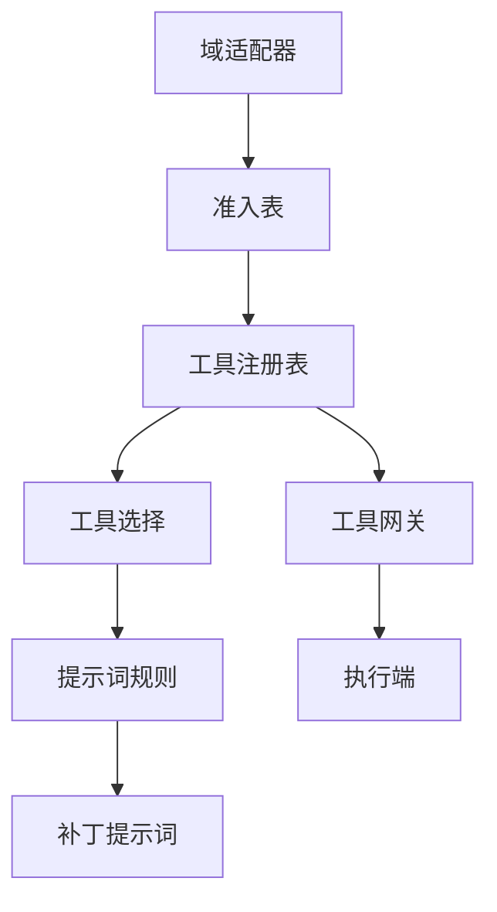
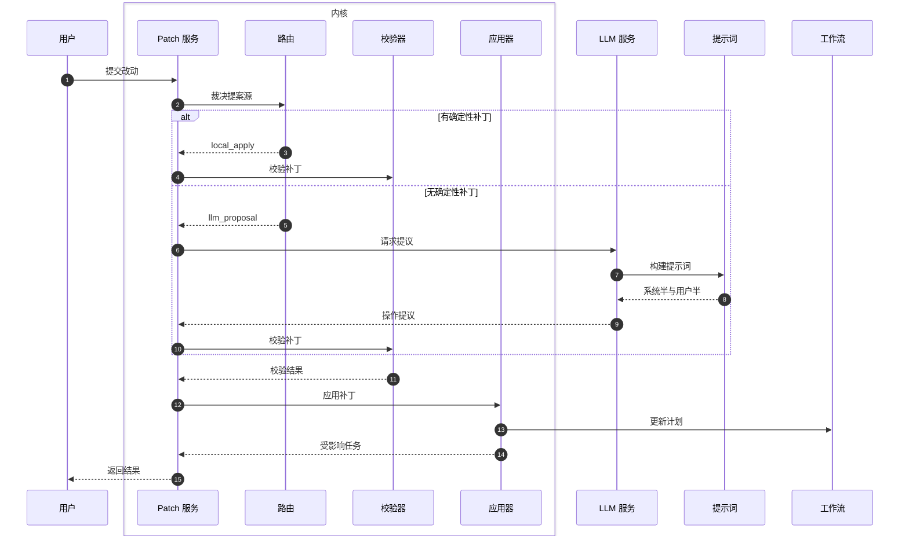
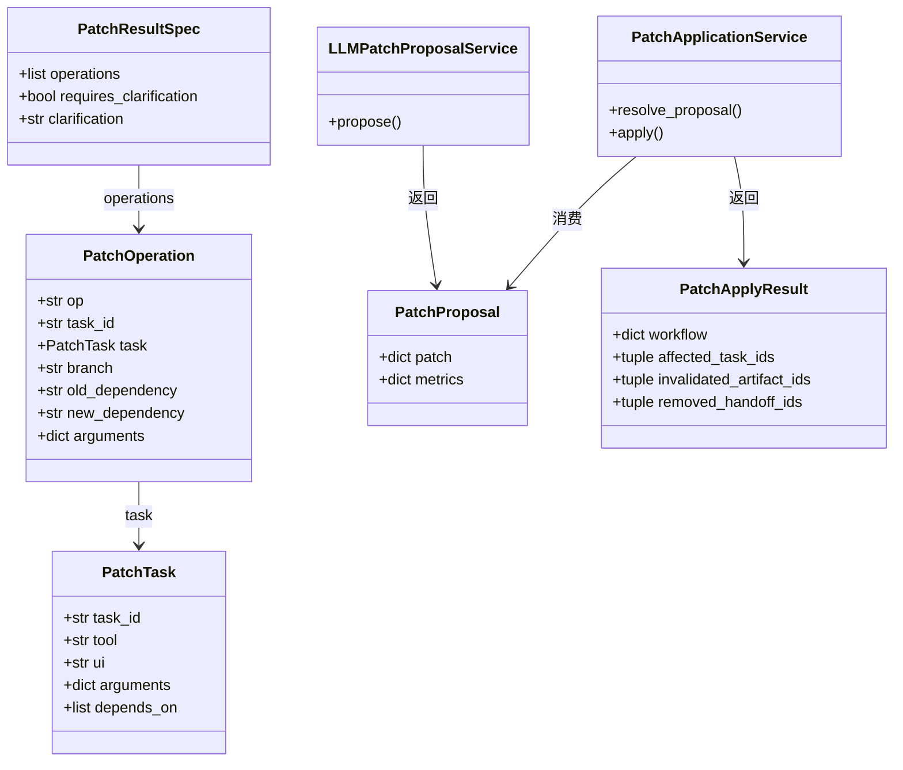

# 多域工具编排与 Patch 机制

<details>
<summary>Relevant source files</summary>

The following files were used as context for generating this wiki page:

- [src/aidv_agent/kernel/planning/prompt_rules.py](src/aidv_agent/kernel/planning/prompt_rules.py)
- [src/aidv_agent/tools/__init__.py](src/aidv_agent/tools/__init__.py)
- [src/aidv_agent/tools/admission.py](src/aidv_agent/tools/admission.py)
- [services/agent_api/app.py](services/agent_api/app.py)
- [README.md](README.md)
</details>

# 多域工具编排与 Patch 机制

## 概述

AIDV Agent 是基于 LangGraph 编排的确定性工作流车载智能体，覆盖车控、导航和生活服务（咖啡 / 麦当劳 / 电影票）多领域任务。项目强调“确定性内核”：控制流、状态归约、Gate 生命周期、参数校验全部由本地代码完成；规划 LLM 只能“提议” Plan/Patch，本地 compiler/validator/reducer 决定是否应用。多域工具编排与 Patch 机制因此承担两个职责：其一是把各域声明的工具、确认门、占位符和补丁规则统一渲染成模型可消费的工具视图；其二是把用户改动收敛为严格契约化的 Patch 操作，经校验后应用到工作流。

Sources: [README.md:1-87](), [src/aidv_agent/kernel/patching/service/__init__.py:1-76](), [src/aidv_agent/kernel/patching/applier.py:1-57]()

该机制的核心设计是“弱规则重模型、强契约兜底”：模型负责语义判断与操作提议，内核负责工具准入、参数白名单、依赖闭包、状态迁移和失败拦截。若模型输出不符合契约形状，系统会报错而不是静默修正。

Sources: [README.md:1-87](), [src/aidv_agent/contracts/patch.py:1-67](), [src/aidv_agent/kernel/patching/applier.py:1-57]()

## 多域工具编排

### 域适配器与声明式工具面

多域工具编排的基础是域适配器声明。域适配器声明哪些决策域对应哪些注册表 `target_service`、哪些阶段是必需阶段、确认门参数文档、门动作白名单、补丁提示等。工具选择模块只负责从这些声明派生视图，不硬编码域字面量。

Sources: [src/aidv_agent/kernel/planning/tool_selection.py:1-56](), [src/aidv_agent/kernel/planning/prompt_rules.py:118-162](), [src/aidv_agent/kernel/patching/patch_prompt.py:144-182]()

| 声明项 | 作用 | 主要消费方 |
|---|---|---|
| `prompt_targets` | 决策域到注册表 `target_service` 的映射，用于派生生产工具行 | `full_tools` |
| `required_stages_map` | 域到必需阶段列表的映射，门步通常取 `stages[1]` | `gate_ui_entries`、`declared_required_stages` |
| `gate_args_docs` | 确认门参数文档，用于渲染门 UI 参数表与内核白名单 | `gate_ui_section`、`ui_contracts` |
| `gate_actions` | 确认门允许动作，用于派生 `UIContract.actions` | `ui_contracts`、Patch 应用器 |
| `patch_hints` | 域声明的“只改参数不重排”补丁提示 | `_patch_hint_entries`、`_render_patch_hint_section` |
| `confirmation_exempt_tools` | 控制类工具中免确认的白名单 | `_prompt_row` 的 `requires_confirmation` |

Sources: [src/aidv_agent/kernel/planning/tool_selection.py:43-91](), [src/aidv_agent/kernel/planning/prompt_rules.py:118-162](), [src/aidv_agent/kernel/patching/patch_prompt.py:144-182]()

### 工具准入与注册表

生产工具面由统一准入表控制。默认准入表只包含 `domain` 类别，即域清单中的工具面；`native` 类别或具体工具名可以显式准入。未知准入项和空准入表会诚实失败，避免“可调度但未接线”的隐性状态。

Sources: [tests/tools/test_admission.py:1-81](), [tests/tools/test_admission.py:54-123]()

| 准入行为 | 语义 | 测试证据 |
|---|---|---|
| 默认 `ENABLED_TOOLS == frozenset({"domain"})` | 默认生产注册表等于 manifest 表面，不包含 native 工具 | `test_default_table_preserves_todays_surface` |
| 准入具体工具名 | 只准入该 native 工具，并同步接线 connector | `test_tool_name_entry_admits_one_native_end_to_end` |
| 准入 `native` 类别 | 准入所有 native 工具 | `test_native_category_admits_every_native_tool` |
| 未知准入项 | 抛出 `InvalidToolRegistry`，错误码包含 `unknown_tool_admission` | `test_unknown_entry_fails_honestly` |
| 空准入表 | 抛出 `InvalidToolRegistry`，错误码包含 `no_admitted_tools` | `test_empty_admission_fails_honestly` |
| 准入后聚合器 | fast 规则、仲裁词表等聚合器跟随准入视图 | `test_domain_knowledge_aggregates_follow_admission` |

Sources: [tests/tools/test_admission.py:1-81](), [tests/tools/test_admission.py:54-123]()

### 提示词工具视图

`tool_selection` 从 LLM 面注册表派生工具视图。`full_tools` 返回生产工具行，工具行字段包括 `name`、`domain`、`description`、`input_schema`、`side_effect`、`requires_confirmation`、`source`。其中 `side_effect` 与 `requires_confirmation` 由 `permission` 是否以 `control_` 开头派生，并受 `confirmation_exempt_tools` 影响。

Sources: [src/aidv_agent/kernel/planning/tool_selection.py:1-56](), [src/aidv_agent/kernel/planning/tool_selection.py:43-91]()

| 工具行字段 | 含义 |
|---|---|
| `name` | 工具名 |
| `domain` | 工具所属决策域 |
| `description` | 工具说明 |
| `input_schema` | 参数 schema |
| `side_effect` | 是否控制类副作用工具 |
| `requires_confirmation` | 是否需要确认门 |
| `source` | 工具来源标记 |

Sources: [src/aidv_agent/kernel/planning/tool_selection.py:1-56]()

`prompt_rules` 将工具视图渲染为静态提示词节。`tool_section` 渲染全量工具表 `T` 与首查工具表 `R`；`gate_ui_section` 渲染确认门 UI 白名单 `U`；`placeholder_section` 渲染门店占位符清单 `M`。这些节在 plan 与 patch 两个提示词面同源渲染，避免两处手抄造成漂移。

Sources: [src/aidv_agent/kernel/planning/prompt_rules.py:150-220](), [src/aidv_agent/kernel/patching/patch_prompt.py:1-94]()

| 提示词节 | 符号 | 内容 |
|---|---|---|
| 【工具清单】 | `T` / `R` | 全量工具表与首查工具子视图 |
| 【门 UI 清单】 | `U` | 确认门 UI 名单与门参数表 |
| 【门店占位符清单】 | `M` | 各域线下服务门店占位标记 |

Sources: [src/aidv_agent/kernel/planning/prompt_rules.py:150-220](), [src/aidv_agent/kernel/patching/patch_prompt.py:41-149]()

### 执行网关

`tool_gateway` 是内核工具面（mcp 传输）的统一执行入口与权限边界。它不自持工具合同，工具合同来自 `default_tool_registry()` 的 `transport == "mcp"` 切片；工具面唯一事实源位于 `src/aidv_agent/domains/*/tool_registry.json`。

Sources: [services/tool_gateway/README.md:1-31]()

| 北向接口 | 用途 |
|---|---|
| `GET /healthz` | 健康检查，含下游可达性与工具数 |
| `GET /tools` | 工具列表 |
| `GET /tools/{tool_name}` | 单个工具合同 |
| `POST /call_tool` | 工具调用入口 |
| `GET /trace/recent` | 最近工具调用 trace |

Sources: [services/tool_gateway/README.md:1-31]()

域到执行端的映射由 `tool_gateway` README 明确列出：

| src 域 | 工具数 | 执行端 |
|---|---:|---|
| `domains/vehicle` | 7 | `services/vehicle/{context,climate,window,seat}` |
| `domains/media` | 4 | `services/online/media`（ncm-cli + mpv） |
| `domains/navigation` | 1 | 哑代理 → `services/online/navigation`（AMAP） |
| `domains/luckin` | 8 | 进程内接入库 → 瑞幸外部远程 MCP |
| `domains/mcdonald` | 21 | 进程内接入库 → 麦当劳外部远程 MCP |
| `domains/maoyan` | 9 | 进程内接入库 → 猫眼 API |

Sources: [services/tool_gateway/README.md:1-31]()

## Patch 机制

### 服务与路由

Patch 应用服务位于 `src/aidv_agent/kernel/patching/service/__init__.py`。测试显示其服务级两步链为：先调用 `resolve_proposal` 得到 `patch`、`route`、`metrics`，再调用 `apply` 得到工作流结果、Patch IR 与受影响任务。

Sources: [tests/kernel/test_patch_application.py:1-44](), [tests/integration/test_use_case_pipeline.py:1-47]()

```python
patch, route, metrics = service.resolve_proposal(
    workflow, text=text, deterministic_patch=deterministic_patch
)
result = service.apply(workflow, patch, route, metrics)
```

Sources: [tests/kernel/test_patch_application.py:1-44]()

路由裁决函数 `route_patch` 实现“离线优先闸”：如果已有确定性 IR（脚本/测试直灌），则走 `local_apply`；否则走 `llm_proposal`。LLM 路线只许提议，永不携带执行权。

```python
def route_patch(*, deterministic_patch_available: bool) -> PatchRoute:
    return "local_apply" if deterministic_patch_available else "llm_proposal"
```

Sources: [src/aidv_agent/kernel/patching/service/__init__.py:1-76]()

`LLMPatchProposalService` 只允许 LLM 提议 `PlanPatchIR`，服务本身不修改 Workflow。它延迟构造 `LLMProbeClient`，避免缺少凭据阻塞启动；`propose` 会先用 `require_bounded_text` 约束输入文本。

Sources: [src/aidv_agent/kernel/patching/service/__init__.py:1-76]()

### Patch Prompt 信封

`build_patch_prompt` 返回 `CacheHeadPrompt`。系统半对每个请求字节稳定，包含角色认知、全量工具表、门 UI 清单、占位符清单、操作词表、操作规则、域补丁提示、示例和输出格式；用户半只携带每次请求的 `C`、`P`、`DONE`、`D`。

Sources: [src/aidv_agent/kernel/patching/patch_prompt.py:1-94](), [src/aidv_agent/kernel/patching/patch_prompt.py:164-210]()

| 符号 | 含义 |
|---|---|
| `C` | 用户的改动原话 |
| `P` | 当前计划任务视图 |
| `DONE` | 已完成任务的 `task_id` 列表 |
| `D` | 命中的域名单先验，约束可选工具 |
| `T` | 全量工具表 |
| `U` | 确认门 UI 清单 |
| `M` | 门店占位标记清单 |

Sources: [src/aidv_agent/kernel/patching/patch_prompt.py:41-149](), [src/aidv_agent/kernel/planning/prompt_rules.py:150-220]()

系统半的拼接顺序如下：

```python
system = (
    _PATCH_COGNITION
    + "\n"
    + tool_section(plan_tool_rows(full_tools))
    + "\n"
    + gate_ui_section()
    + placeholder_section()
    + "\n"
    + _PATCH_OPERATION_VOCAB
    + "\n"
    + _PATCH_OPERATION_RULES
    + _render_patch_hint_section()
    + "\n"
    + _PATCH_OPERATION_EXAMPLE
    + "\n"
    + _PATCH_OUTPUT_FORMAT
)
```

Sources: [src/aidv_agent/kernel/patching/patch_prompt.py:164-210]()

`_render_patch_hint_section` 从 `default_domain_adapter_registry().adapters` 收集各域 `patch_hints`，归一化为 `domain/action/tool/arguments/extra`，并渲染为“必须且只能对现有工具使用 `update_arguments`”的域补丁提示。

Sources: [src/aidv_agent/kernel/patching/patch_prompt.py:144-182]()

### 操作词表与契约

Patch 模型输出只允许 6 种操作。操作词表同时出现在提示词与契约中，模型看得见的选择面等于它能用的选择面。

Sources: [src/aidv_agent/kernel/patching/patch_prompt.py:41-149](), [src/aidv_agent/contracts/patch.py:1-67]()

| 操作 | 形状 | 语义 |
|---|---|---|
| `invalidate_task` | `{"op":"invalidate_task","task_id":str}` | 作废重做，该任务回到待执行，依赖它的任务回炉重做 |
| `cancel_task` | `{"op":"cancel_task","task_id":str}` | 取消单个任务，依赖它的任务改为“不等它” |
| `cancel_branch` | `{"op":"cancel_branch","branch":str}` | 按域取消整条腿，该域全部任务永不执行 |
| `add_task` | `{"op":"add_task","task":{...}}` | 新增一个任务，归属域与类型由内核判定 |
| `replace_dependency` | `{"op":"replace_dependency","task_id":str,"old_dependency":str,"new_dependency":str}` | 换一条依赖边，不新增或取消任务 |
| `update_arguments` | `{"op":"update_arguments","task_id":str,"arguments":{...}\|null}` | 修改现有任务参数，只覆盖写出的键 |

Sources: [src/aidv_agent/kernel/patching/patch_prompt.py:41-149](), [src/aidv_agent/contracts/patch.py:1-67]()

`PatchOperation` 使用 `StrictModel`，只保留 6 种形状实际用到的键；多余键会被拒绝。`op` 字段允许 `op` 或 `type` 别名，但提示词要求统一使用 `op`。

```python
class PatchOperation(StrictModel):
    op: Literal[
        "invalidate_task",
        "cancel_task",
        "cancel_branch",
        "add_task",
        "replace_dependency",
        "update_arguments",
    ] = Field(validation_alias=AliasChoices("op", "type"))
    task_id: str | None = None
    task: PatchTask | None = None
    branch: str | None = None
    old_dependency: str | None = None
    new_dependency: str | None = None
    arguments: dict[str, Any] | None = None
```

Sources: [src/aidv_agent/contracts/patch.py:1-67]()

`PatchTask` 是 `add_task` 新增任务的模型书写形状，与编译后任务视图 `P` 同方言，只收 `task_id`、`tool`、`ui`、`arguments`、`depends_on`；`domain`、`kind`、`allowed_actions` 由内核派生。

```python
class PatchTask(StrictModel):
    task_id: str
    tool: str | None = None
    ui: str | None = None
    arguments: dict[str, Any] | None = None
    depends_on: list[str] = Field(default_factory=list)
```

Sources: [src/aidv_agent/contracts/patch.py:1-67]()

`PatchResultSpec` 是模型输出形状，顶层只有语义决定：`operations`、`requires_clarification`、`clarification`。身份四键 `patch_id`、`base_plan_id`、`base_plan_version`、`new_plan_version` 由内核按 workflow 补全，不再要求模型书写。

Sources: [src/aidv_agent/contracts/patch.py:1-67](), [src/aidv_agent/kernel/patching/patch_prompt.py:1-94]()

### 校验与应用

`apply_patch` 先调用 `validate_patch`，校验失败则抛出 `PatchApplyError`；校验通过后深拷贝 workflow 与 plan，按 `task_id` 建立索引，并计算受影响闭包。

Sources: [src/aidv_agent/kernel/patching/applier.py:1-57](), [src/aidv_agent/kernel/patching/applier.py:47-89]()

`_compile_added_task` 对 `add_task` 做内核编译：`tool` 与 `ui` 必须恰好出现一个。若为工具步，从 `full_tools()` 查找候选工具行，派生 `domain` 与 `kind="tool_call"`，并用 `sanitize_arguments` 按 schema 清洗参数；若为门步，从 `ui_contracts()` 查找 UI 合同，派生 `domain`、`kind="ui_gate"`、`allowed_actions`，并用合同 `gate_args` 清洗参数。

```python
if bool(task.tool) == bool(task.ui):
    raise PatchApplyError(f"patch_add_task_requires_exactly_one_of_tool_or_ui:{task.task_id}")
```

Sources: [src/aidv_agent/kernel/patching/applier.py:1-57](), [src/aidv_agent/kernel/planning/prompt_rules.py:118-162]()

| `PatchApplyResult` 字段 | 含义 |
|---|---|
| `workflow` | 应用补丁后的 workflow 快照 |
| `affected_task_ids` | 受影响任务 ID 元组 |
| `invalidated_artifact_ids` | 被失效 artifact ID 元组 |
| `removed_handoff_ids` | 被移除 handoff ID 元组 |

Sources: [src/aidv_agent/kernel/patching/applier.py:1-57]()

### 测试覆盖

集成测试将 `PatchApplicationService` 放入 `ModifyWorkflowUseCase` 所在编排层，并配合 `ExecutionService`、`GateApplicationService`、`WorkflowRepository` 等组件验证工作流链路。

Sources: [tests/integration/test_use_case_pipeline.py:1-47]()

Patch 管道测试构造了包含 `t1`、`g1`、`nav` 的 workflow，覆盖 `task_states`、`artifacts`、`handoffs` 等状态面：

```python
"task_states": {"t1": "completed", "g1": "waiting_user", "nav": "pending"},
"artifacts": [{"artifact_id": "a1", "source_task_id": "t1", "status": "active"}],
"handoffs": [{"handoff_id": "h1", "source_task_id": "g1"}],
```

Sources: [tests/kernel/test_patch_pipeline.py:48-71]()

`add_task` 测试验证内核会派生 `domain` 与 `kind`，并拒绝未知工具或未知 UI：

| 测试场景 | 预期 |
|---|---|
| 新增工具任务 | `domain` 与 `kind` 由内核派生，参数白名单外键被清洗 |
| 新增门任务 | `domain`、`kind`、`allowed_actions` 由 UI 合同派生 |
| 未知工具 | 抛出 `PatchApplyError`，匹配 `patch_unknown_tool` |
| 未知 UI | 抛出 `PatchApplyError`，匹配 `patch_unknown_ui` |
| `update_arguments` | 使用一次闭包与 reducer commit |

Sources: [tests/kernel/test_patch_pipeline.py:125-166](), [src/aidv_agent/kernel/patching/applier.py:1-57]()

## 数据流

### 总体架构

下图展示多域工具编排与 Patch 机制的总体关系：域适配器声明工具与门合同，准入表决定生产注册表，工具选择与提示词规则生成模型可见视图，Patch 服务将用户改动转换为严格操作，校验器与应用器最终更新工作流。



Sources: [src/aidv_agent/kernel/planning/tool_selection.py:1-56](), [src/aidv_agent/kernel/planning/prompt_rules.py:150-220](), [tests/tools/test_admission.py:1-81](), [services/tool_gateway/README.md:1-31]()

### Patch 请求时序

下图展示一次 Patch 请求从用户改动到工作流更新的时序。路由裁决决定走本地直用还是 LLM 提议；无论哪条路线，最终都要经过校验器与应用器。



Sources: [src/aidv_agent/kernel/patching/service/__init__.py:1-76](), [src/aidv_agent/kernel/patching/patch_prompt.py:164-210](), [src/aidv_agent/kernel/patching/applier.py:1-57](), [tests/kernel/test_patch_application.py:1-44]()

### 核心契约关系

下图展示 Patch 相关契约与服务对象之间的关系。`PatchResultSpec` 是模型输出形状，`PatchOperation` 是操作项，`PatchTask` 是新增任务形状；`LLMPatchProposalService` 返回 `PatchProposal`，`PatchApplicationService` 最终返回 `PatchApplyResult`。



Sources: [src/aidv_agent/contracts/patch.py:1-67](), [src/aidv_agent/kernel/patching/service/__init__.py:1-76](), [src/aidv_agent/kernel/patching/applier.py:1-57]()

## 关键规则

### 操作选择规则

提示词明确规定不同用户意图对应的操作选择：

| 用户意图 | 推荐操作 | 禁止事项 |
|---|---|---|
| 整条服务都不要 | `cancel_branch` | 禁止用 `cancel_task` 逐步取消整腿 |
| 只撤掉其中一步 | `cancel_task` | 禁止用 `invalidate_task` 代替取消 |
| 这一步还要但要重做 | `invalidate_task` | 禁止用于“不要了”“去掉” |
| 改目的地、途经点、检索词 | `update_arguments` | 禁止为此新增任务或新增门 |
| 用户意图模糊 | `requires_clarification=true` | 禁止猜测，`operations` 必须为空 |

Sources: [src/aidv_agent/kernel/patching/patch_prompt.py:41-149]()

### 引用键来源规则

引用类键必须来自当前计划任务视图 `P` 中已存在的 `task_id`，禁止新造、禁止填域名或列表序号。`old_dependency` 必须是该任务 `depends_on` 中现有值；`new_dependency` 必须是 `P` 中已存在的 `task_id`。

Sources: [src/aidv_agent/kernel/patching/patch_prompt.py:41-149]()

`add_task` 的新 `task_id` 必须是 `P` 中没有的名字，风格跟随现有 ID：查询步通常 `t*`，确认门通常 `g*`。禁止使用中文短语或带空格。

Sources: [src/aidv_agent/kernel/patching/patch_prompt.py:41-149]()

### 取消与依赖剪除

取消任务或整腿后，其余任务 `depends_on` 中指向已取消任务的边由内核自动剪除，禁止为此再发 `replace_dependency`。这减少了模型维护依赖图的负担，也降低了非法依赖操作面。

Sources: [src/aidv_agent/kernel/patching/patch_prompt.py:41-149]()

### 门店占位标记处理

参数中的 `{{handoff.fulfillment_location.域}}` 途经标记由内核特殊处理。只有当该域在计划里已无任何存活任务时，别的任务参数里仍保留该标记才会导致整个补丁被拒；若该域还有任务存活，则不应为它额外写 `update_arguments`。

Sources: [src/aidv_agent/kernel/patching/patch_prompt.py:41-149]()

换品牌时，模型必须在同一补丁内完成：撤掉旧域标记、把新域标记写入 `waypoint_texts`、新增新域查询步与确认门，并把下游任务依赖改挂到新门。提示词中的示例明确给出“瑞幸换成麦当劳”的五步顺序。

Sources: [src/aidv_agent/kernel/patching/patch_prompt.py:41-149]()

## 工作流状态面

Patch 应用对象是 workflow 字典，测试中可见其包含 `workflow_id`、`session_id`、`trace_id`、`status`、`plan_id`、`plan_version`、`state_version`、`plan_ir`、`task_states`、`artifacts`、`handoffs` 等字段。

Sources: [tests/kernel/test_patch_pipeline.py:48-71](), [tests/kernel/test_patch_application.py:1-44]()

| 状态面 | 示例 | 含义 |
|---|---|---|
| `plan_ir.tasks` | `task_id`、`domain`、`kind`、`tool`、`ui`、`arguments`、`depends_on`、`allowed_actions` | 编译后计划任务视图 |
| `task_states` | `completed`、`waiting_user`、`pending` | 任务执行状态 |
| `artifacts` | `artifact_id`、`source_task_id`、`status` | 任务产出物 |
| `handoffs` | `handoff_id`、`source_task_id` | 跨任务交接 |

Sources: [tests/kernel/test_patch_pipeline.py:48-71](), [tests/integration/test_use_case_pipeline.py:1-47]()

## 总结

多域工具编排与 Patch 机制将“域声明、工具准入、提示词渲染、模型提议、契约校验、状态应用”串成一条可验证链路。域适配器负责声明工具、门、占位符和补丁规则；准入表决定生产工具面；`tool_selection` 与 `prompt_rules` 派生并渲染模型可见视图；`PatchApplicationService` 与 `LLMPatchProposalService` 负责提案源裁决与 LLM 提议；`PatchOperation`、`PatchTask`、`PatchResultSpec` 约束模型输出；`apply_patch` 负责编译新增任务、清洗参数、校验依赖并更新工作流。该机制的关键价值在于：LLM 只提议，内核决定；模型语义能力与确定性执行边界被清晰分离。

Sources: [README.md:1-87](), [src/aidv_agent/kernel/planning/tool_selection.py:1-56](), [src/aidv_agent/kernel/planning/prompt_rules.py:150-220](), [src/aidv_agent/kernel/patching/patch_prompt.py:164-210](), [src/aidv_agent/kernel/patching/service/__init__.py:1-76](), [src/aidv_agent/contracts/patch.py:1-67](), [src/aidv_agent/kernel/patching/applier.py:1-57]()

---

**关联源文件:** `src/aidv_agent/kernel/planning/prompt_rules.py`, `src/aidv_agent/tools/__init__.py`, `src/aidv_agent/tools/admission.py`, `services/agent_api/app.py`, `README.md`
