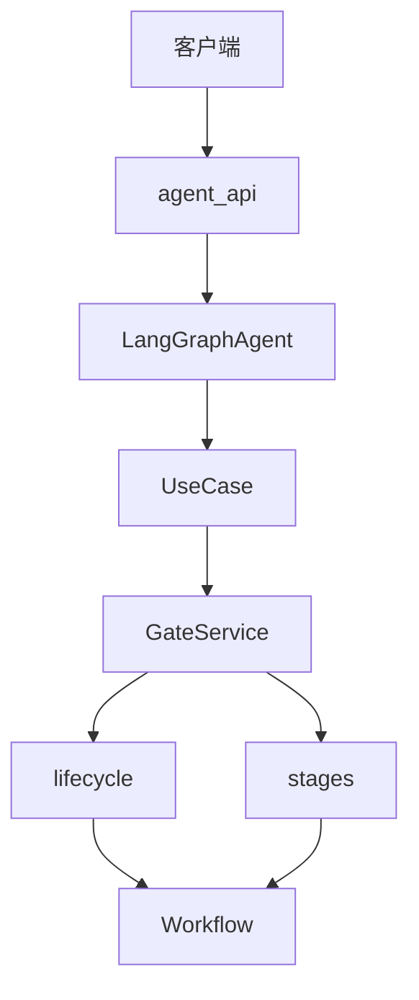
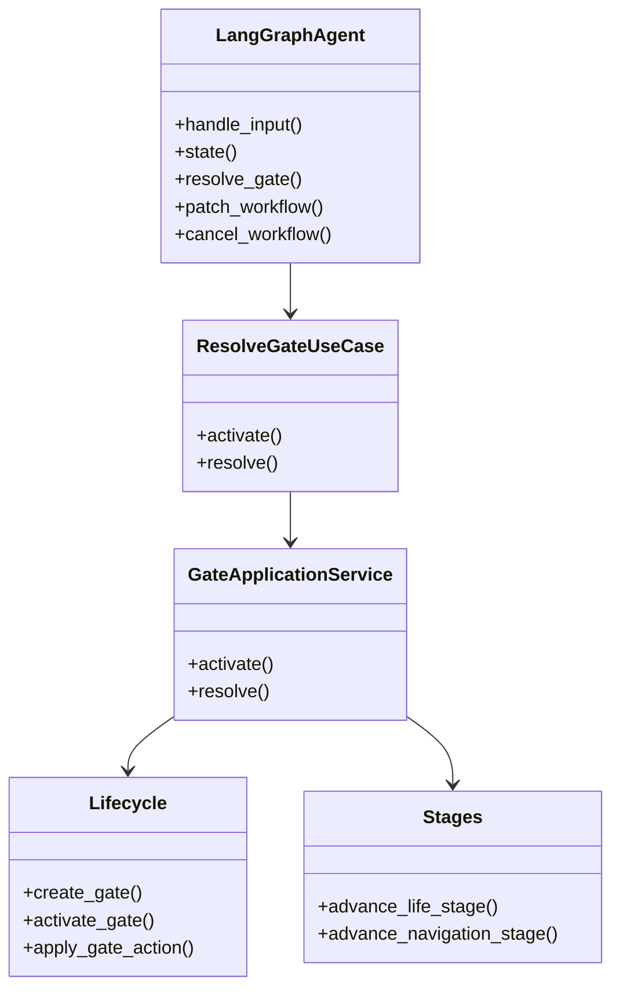
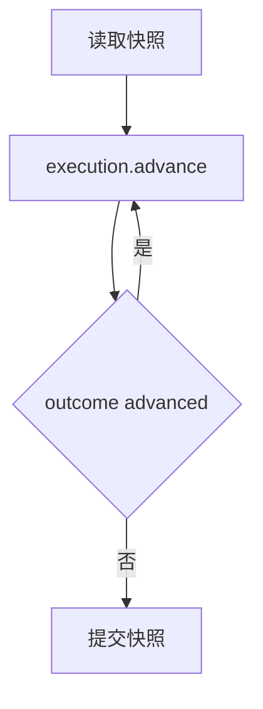
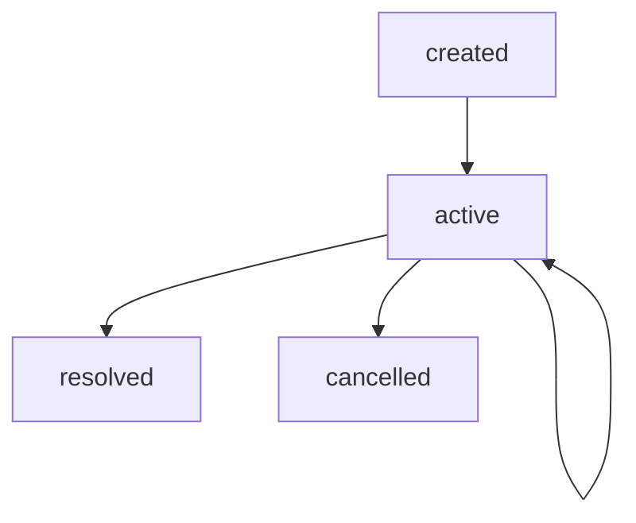
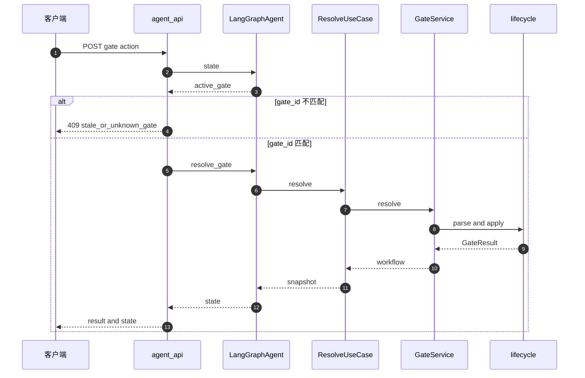
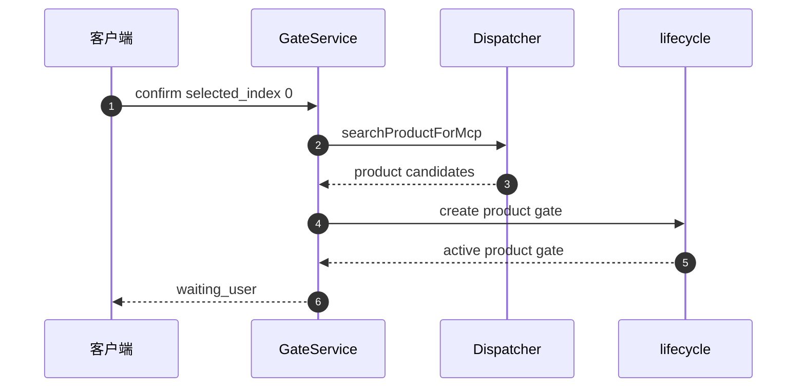

# 工作流生命周期与 Gate 机制

<details>
<summary>Relevant source files</summary>

The following files were used as context for generating this wiki page:

- [src/aidv_agent/orchestrator/agent.py](src/aidv_agent/orchestrator/agent.py)
- [services/agent_api/app.py](services/agent_api/app.py)
- [src/aidv_agent/kernel/planning/prompt_rules.py](src/aidv_agent/kernel/planning/prompt_rules.py)
- [tests/contract/test_wire_payload_shape.py](tests/contract/test_wire_payload_shape.py)
- [docs/PRD.md](docs/PRD.md)
</details>

# 工作流生命周期与 Gate 机制

AIDV Agent 是基于 LangGraph 编排的确定性车载智能体，其工作流生命周期由本地确定性内核驱动，而不是由模型直接控制。系统通过 `LangGraphAgent` 作为组合根、门面和事务边界，把工作流推进到下一个阶段边界；当需要用户确认、选择或取消时，系统会打开一个持久化 Gate，使工作流进入 `waiting_user` 状态，等待下一次请求解析。

Gate 机制是工作流生命周期中的用户交互边界。它把“系统可以自动执行”和“必须等待用户决策”的边界显式化：`GateApplicationService.activate` 负责从 `ui_gate` 任务武装一个持久化 Active Gate；`GateApplicationService.resolve` 负责校验请求、应用规范动作，并把结果路由到游标更新、多阶段域状态机、通用 handoff 完成或工作流取消等路径。多阶段域（例如瑞幸门店选择后进入商品选择）不会在一次请求内自动跑完，而是每次 `resolve` 最多推进一个 Gate，客户端根据返回的 `active_gate` 继续下一次请求。

Sources: [README.md:1-87](), [src/aidv_agent/orchestrator/agent.py:1-65](), [src/aidv_agent/kernel/gates/service/__init__.py:1-75](), [src/aidv_agent/orchestrator/use_cases.py:92-132]()

## 总体架构与职责边界

`LangGraphAgent` 是内核唯一入口，也是 `services/agent_api` 消费的门面。它承担三类职责：组合所有服务与用例、暴露公开 API 面、驱动工作流到下一个阶段边界。路由目标执行被下沉到 `dispatch.py`，Agent 本身不再按路由目标分支。



Sources: [src/aidv_agent/orchestrator/agent.py:1-65](), [services/agent_api/app.py:152-206](), [src/aidv_agent/kernel/gates/service/__init__.py:1-75]()



`ResolveGateUseCase` 把 Gate 建模为“两次请求的状态机”：第一次 `activate` 持久化 `waiting_user` 并返回；下一次请求对存储中的 `active_gate` 调用 `resolve`。如果 `resolve` 后仍留下新的 `active_gate`，客户端继续发起下一次解析请求，从而展开多阶段域。

Sources: [src/aidv_agent/orchestrator/use_cases.py:92-132](), [src/aidv_agent/orchestrator/agent.py:144-174](), [src/aidv_agent/kernel/gates/service/__init__.py:1-75]()

## 工作流快照与版本控制

`LangGraphAgent.state` 返回一个面向 API 与 HMI 的快照视图，包含工作流本体、当前 Gate、产物、handoff、工具轨迹、trace、快速动作和后端标识。

| 字段 | 类型 | 说明 |
|---|---|---|
| `workflow` | `dict` | 工作流快照本体 |
| `active_gate` | `dict \| None` | 当前活动 Gate，无 Gate 时为 `None` |
| `artifacts` | `list` | 工作流产物列表 |
| `handoffs` | `list` | 跨任务/跨域交接记录 |
| `tool_trace` | `list` | 工具调用轨迹 |
| `trace` | `list` | 通用执行轨迹 |
| `fast_actions` | `list` | 当前 session 可用的快速动作 |
| `backend` | `str` | 后端标识，示例值为 `langgraph` |

Sources: [src/aidv_agent/orchestrator/agent.py:144-174]()

工作流快照中可观察到的关键字段包括：

| 字段 | 说明 |
|---|---|
| `workflow_id` | 工作流唯一标识 |
| `session_id` | 会话标识，用于关联 HMI/语音会话 |
| `trace_id` | 追踪标识 |
| `status` | 工作流状态，如 `running`、`waiting_user` |
| `plan_id` / `plan_version` | 计划标识与版本 |
| `state_version` | 工作流状态版本，用于乐观并发控制 |
| `plan_ir` | 计划中间表示，包含 `tasks` |
| `task_states` | 各任务状态映射 |
| `active_gate` | 当前活动 Gate |
| `artifacts` / `handoffs` / `tool_trace` | 执行产物与轨迹 |

Sources: [tests/integration/test_gate_flow.py:1-38](), [tests/integration/test_gate_flow.py:88-152](), [src/aidv_agent/orchestrator/agent.py:144-174]()

版本控制是 Gate 机制正确性的核心。`AdvanceWorkflowUseCase.execute` 先读取快照并记录 `expected = int(snapshot["state_version"])`，然后循环调用 `execution.advance(snapshot)`，直到 `outcome` 不再是 `advanced`。如果最终 `state_version` 与预期不同，则使用 `expected_state_version=expected` 提交快照。



Sources: [src/aidv_agent/orchestrator/use_cases.py:92-132]()

`LangGraphAgent.resolve_gate` 在入口检查 `state_version`：如果调用方传入的 `state_version` 与当前快照不一致，抛出 `state_version_conflict`。Gate 生命周期内部也要求 Gate 的 `state_version` 与工作流 `state_version` 对齐，并在每次状态迁移时只允许版本递增一次。

Sources: [src/aidv_agent/orchestrator/agent.py:144-174](), [src/aidv_agent/kernel/gates/lifecycle.py:61-112](), [src/aidv_agent/kernel/gates/lifecycle.py:99-150]()

## Gate 数据契约

`ActiveGate` 是 Gate 的契约模型，定义了 Gate 的身份、阶段、UI 面、允许动作、选项、游标和 UI 载荷。

```python
class ActiveGate(BaseModel):
    gate_id: str
    workflow_id: str
    plan_version: int
    state_version: int
    task_id: str
    stage_id: str
    ui_surface: str
    gate_kind: str
    stage_label: str = ""
    gate_purpose: GatePurpose | None = None
    status: Literal["active", "resolved", "cancelled"] = "active"
    allowed_actions: list[str] = Field(default_factory=list)
    options: list[Any] = Field(default_factory=list)
    active_index: int | None = None
    ui_payload: dict[str, Any] = Field(default_factory=dict)
```

Sources: [src/aidv_agent/contracts/gate.py:1-29]()

| 字段 | 类型 | 说明 |
|---|---|---|
| `gate_id` | `str` | Gate 唯一标识 |
| `workflow_id` | `str` | 所属工作流 |
| `plan_version` | `int` | 关联计划版本 |
| `state_version` | `int` | Gate 创建/激活时的状态版本 |
| `task_id` | `str` | 触发 Gate 的任务 |
| `stage_id` | `str` | 域内阶段标识，例如 `luckin.select_product` |
| `ui_surface` | `str` | UI 面标识 |
| `gate_kind` | `str` | Gate 类型 |
| `stage_label` | `str` | 适配器声明的播报门名 |
| `gate_purpose` | `GatePurpose \| None` | 适配器声明的措辞族 |
| `status` | `active \| resolved \| cancelled` | Gate 状态 |
| `allowed_actions` | `list[str]` | 允许动作，如 `confirm`、`cancel_workflow` |
| `options` | `list[Any]` | 用户可选选项 |
| `active_index` | `int \| None` | 当前游标索引 |
| `ui_payload` | `dict` | HMI/语音展示载荷 |

`stage_label` 和 `gate_purpose` 由适配器声明，语音/HMI 面直接读取这些字段，而不是从 `stage_id` 推导展示语义。`options` 与 `ui_payload` 可能承载同一批候选数据，但 `options` 会额外携带域适配器归一后的 `display_name`，用于序号朗读和卡片列表共用名称。

Sources: [src/aidv_agent/contracts/gate.py:1-29](), [tests/integration/test_gate_flow.py:88-152](), [services/omni_session/shared/agent_api_tools.py:1-69]()

## Gate 生命周期

Gate 生命周期由 `src/aidv_agent/kernel/gates/lifecycle.py` 中的纯函数实现，核心包括 `create_gate`、`activate_gate`、`apply_gate_action`、`parse_resolve_request`、`transition_gate_cursor` 和 `transition_gate_resolved`。



Sources: [src/aidv_agent/kernel/gates/lifecycle.py:61-112](), [src/aidv_agent/kernel/gates/lifecycle.py:99-150](), [src/aidv_agent/kernel/gates/lifecycle.py:228-277]()

### create_gate

`create_gate` 创建 Gate 字典，并执行契约校验：

- `gate_id`、`workflow_id`、`task_id`、`stage_id` 必须存在；
- `stage_label` 必须非空；
- `gate_purpose` 必须能转换为 `GatePurpose`；
- `options` 不能为空；
- `allowed_actions` 必须属于规范动作集合；
- 返回的 Gate 初始状态为 `created`；
- `options` 会被截断到 `GATE_PAGE_SIZE`；
- `active_index` 初始为 `None`；
- `ui_payload` 默认空字典，并做深拷贝。

```python
return {
    "gate_id": gate_id,
    "workflow_id": workflow_id,
    "plan_version": plan_version,
    "state_version": state_version,
    "task_id": task_id,
    "stage_id": stage_id,
    "ui_surface": ui_surface,
    "gate_kind": gate_kind,
    "stage_label": str(stage_label).strip(),
    "gate_purpose": canonical_purpose,
    "status": "created",
    "allowed_actions": canonical,
    "options": deepcopy(options)[:GATE_PAGE_SIZE],
    "active_index": None,
    "ui_payload": deepcopy(ui_payload or {}),
}
```

Sources: [src/aidv_agent/kernel/gates/lifecycle.py:61-112](), [src/aidv_agent/kernel/gates/lifecycle.py:99-150]()

### activate_gate

`activate_gate` 将 `created` 状态 Gate 激活为 `active`。它要求：

- Gate 当前状态必须是 `created`；
- `new_state_version` 必须等于 `expected_state_version + 1`；
- 激活后 `status` 变为 `active`；
- `state_version` 更新为 `new_state_version`。

Sources: [src/aidv_agent/kernel/gates/lifecycle.py:99-150]()

### parse_resolve_request

`parse_resolve_request` 校验解析请求与工作流状态的一致性：

- Gate 必须是字典；
- Gate 的 `state_version` 必须等于工作流当前 `state_version`；
- `action` 必须非空；
- 如果动作是 `confirm`、没有显式 `selected_index`、没有 `active_index`，且选项数量只有 1，则自动把 `selected_index` 设为 `0`。

Sources: [src/aidv_agent/kernel/gates/lifecycle.py:61-112]()

### apply_gate_action

`apply_gate_action` 对 `active` Gate 应用规范动作。它要求 Gate 当前状态为 `active`，并且 `new_state_version` 必须比 `expected_state_version` 大 1。该函数返回 `GateResult`，供上层路由到游标更新、阶段推进、通用完成或取消等路径。

Sources: [src/aidv_agent/kernel/gates/lifecycle.py:99-150](), [src/aidv_agent/kernel/gates/service/__init__.py:1-75]()

### transition_gate_cursor

`transition_gate_cursor` 处理 `focus` / `select` 这类游标移动结果。Gate 保持活动，工作流状态版本递增，迁移原因记录为 `gate_{result.outcome}`。

```python
def transition_gate_cursor(
    workflow: dict[str, Any], result: GateResult, *, updated_at: str
) -> dict[str, Any]:
    """Focused/selected outcome: record the cursor move, gate stays active."""
    return apply_transition(
        workflow,
        StateTransition(
            expected_state_version=int(workflow["state_version"]),
            updated_at=updated_at,
            reason=f"gate_{result.outcome}",
            active_gate=result.gate,
        ),
    )
```

Sources: [src/aidv_agent/kernel/gates/lifecycle.py:228-277](), [src/aidv_agent/kernel/gates/lifecycle.py:193-242]()

### transition_gate_resolved

`transition_gate_resolved` 处理通用 Gate 完成路径：

- 将 Gate 对应任务标记为 `completed`；
- 工作流状态回到 `running`；
- `active_gate` 置为 `None`；
- 追加一个 `gate_selection` handoff；
- handoff 载荷为选中的选项。

```python
def transition_gate_resolved(
    workflow: dict[str, Any],
    gate: dict[str, Any],
    *,
    selected: Any,
    updated_at: str,
) -> dict[str, Any]:
    """Generic resolution: complete the gate task, release the gate, hand off."""
    task_id = str(gate["task_id"])
    expected = int(workflow["state_version"])
    transitioned = apply_transition(
        workflow,
        StateTransition(
            expected_state_version=expected,
            updated_at=updated_at,
            reason="gate_resolved",
            task_updates={task_id: "completed"},
            workflow_status="running",
            active_gate=None,
        ),
    )
    append_handoff(
        transitioned,
        task_id=task_id,
        version=expected + 1,
        handoff_type="gate_selection",
        source_domain=find_task(workflow, task_id).get("domain"),
        payload=selected,
    )
```

Sources: [src/aidv_agent/kernel/gates/lifecycle.py:228-277](), [src/aidv_agent/kernel/gates/lifecycle.py:193-242]()

## API 与请求流

`services/agent_api/app.py` 暴露了与 Gate 直接相关的 HTTP 端点。

| 方法 | 路径 | 参数 | 行为 |
|---|---|---|---|
| `GET` | `/api/agent/workflows/{workflow_id}/gates/active` | `workflow_id`, `session_id` | 返回 `agent.state(session_id, workflow_id)` |
| `POST` | `/api/agent/workflows/{workflow_id}/gates/{gate_id}/actions` | `workflow_id`, `gate_id`, `session_id`, `GateActionRequest` | 校验活动 Gate 后调用 `agent.resolve_gate` |
| `GET` | `/api/agent/debug/workflows/{workflow_id}/{kind}` | `workflow_id`, `kind`, `session_id` | 返回调试视图，支持 `plan`、`artifacts`、`handoffs`、`scheduler`、`trace` |

`GateActionRequest` 在 `gate_action` 中被使用的字段包括：

| 字段 | 说明 |
|---|---|
| `text` | 自然语言输入，会被 `parse_gate_text` 解析 |
| `action` | 结构化动作，如 `confirm`、`focus_next` |
| `selected_index` | 选中选项索引 |
| `state_version` | 乐观并发控制版本 |
| `source` | 请求来源，默认 `touch` |

`gate_action` 先读取当前状态，如果 `active_gate.gate_id` 与路径中的 `gate_id` 不一致，返回 HTTP 409，detail 为 `stale_or_unknown_gate`。匹配时调用 `agent.resolve_gate`，并返回 `result` 与最新工作流状态。

```python
@app.post("/api/agent/workflows/{workflow_id}/gates/{gate_id}/actions")
def gate_action(
    workflow_id: str, gate_id: str, request: GateActionRequest, session_id: str
) -> dict[str, Any]:
    current = agent.state(session_id, workflow_id)
    active = current.get("active_gate") or {}
    if active.get("gate_id") != gate_id:
        raise HTTPException(status_code=409, detail="stale_or_unknown_gate")
    result = agent.resolve_gate(
        workflow_id,
        text=request.text,
        action=request.action,
        selected_index=request.selected_index,
        state_version=request.state_version,
        source=request.source,
    )
    return {"result": result, **agent.state(session_id, workflow_id)}
```

Sources: [services/agent_api/app.py:152-206]()

`LangGraphAgent.resolve_gate` 负责把请求转换为 Gate 解析载荷：

- 如果传入 `state_version` 且与快照不一致，抛出 `state_version_conflict`；
- 如果存在 `action`，构造 `{"action": action, "selected_index": selected_index, "source": source}`；
- 否则如果存在 `text`，使用 `parse_gate_text(text)` 解析自然语言；
- 如果既没有 `action` 也没有 `text`，抛出 `gate_action_required`。

```python
def resolve_gate(
    self,
    workflow_id: str,
    *,
    text: str | None = None,
    action: str | None = None,
    selected_index: int | None = None,
    state_version: int | None = None,
    source: str = "touch",
) -> dict[str, Any]:
    snapshot = self._workflow_snapshot(workflow_id)
    if state_version is not None and int(snapshot["state_version"]) != int(state_version):
        raise ValueError("state_version_conflict")
    payload: dict[str, Any]
    if action:
        payload = {"action": action, "selected_index": selected_index, "source": source}
    elif text:
        payload = {**parse_gate_text(text), "source": source}
    else:
        raise ValueError("gate_action_required")
```

Sources: [src/aidv_agent/orchestrator/agent.py:144-174](), [src/aidv_agent/kernel/gates/__init__.py:1-22]()



Sources: [services/agent_api/app.py:152-206](), [src/aidv_agent/orchestrator/agent.py:144-174](), [src/aidv_agent/kernel/gates/service/__init__.py:1-75](), [src/aidv_agent/kernel/gates/lifecycle.py:61-112]()

## GateApplicationService 的结果路由

`GateApplicationService` 是 Gate 的应用服务层。它的职责是把通用 Gate 命令转换为带版本控制的工作流迁移。

| 路由结果 | 行为 |
|---|---|
| 游标更新 | 原地更新 Gate 的 `active_index`，Gate 保持活动 |
| 多阶段域 | 委托给 `stages` 中的阶段状态机，打开下一个 Gate |
| 通用完成 | 完成 Gate 任务，释放 Gate，追加 handoff |
| 放弃/取消 | 通过共享内核归约取消工作流 |

Sources: [src/aidv_agent/kernel/gates/service/__init__.py:1-75]()

`GateApplicationService` 初始化时会构建 `store_fulfillment_domains`：从适配器注册表中筛选声明了 `store_fulfillment` 标志的域。这些域在 Gate 确认后由确定性适配器状态机推进，而不是走通用 handoff + scheduler 路径。

```python
self.store_fulfillment_domains = frozenset(
    adapter.domain
    for adapter in self.adapter_registry.adapters
    if getattr(adapter, "store_fulfillment", False)
)
```

Sources: [src/aidv_agent/kernel/gates/service/__init__.py:1-75]()

## 多阶段域状态机

多阶段域 Gate 由 `src/aidv_agent/kernel/gates/service/stages.py` 中的阶段状态机处理。该模块是 `GateApplicationService.resolve` 的执行半区：适配器决定下一阶段动作，模块负责 dispatch、trace、artifact I/O，并打开下一个 Gate。

| 状态机类型 | 行为 |
|---|---|
| life-chain | `plan_selection` 根据 Gate 选择装配下游工具参数，例如 `storeCode`、`deptId`、`cinemaId`；机器以 `complete` 动作结束，可选细节跟进由 `continue_after_detail` 驱动 |
| navigation | `apply_selection` 使用目的地绑定参数重新调度规划工具，或发起下一候选搜索 |

Sources: [src/aidv_agent/kernel/gates/service/stages.py:1-74](), [src/aidv_agent/kernel/gates/service/stages.py:274-319]()

`advance_life_stage` 会从 Gate 的 `ui_payload.context` 读取上下文，并从任务参数中读取 `domain_query`。空 `domain_query` 不再整句兜底，而是走各域默认兜底；例如瑞幸默认使用「咖啡」，麦当劳不传 query 出默认菜单。随后调用 `adapter.plan_selection(stage_id, context, ...)` 装配下游工具参数。

```python
task = find_task(workflow, task_id)
domain_query = str((task.get("arguments") or {}).get("domain_query") or "").strip()
action = adapter.plan_selection(
    stage_id,
    context,
```

Sources: [src/aidv_agent/kernel/gates/service/stages.py:1-74](), [src/aidv_agent/kernel/gates/service/stages.py:274-319]()

打开下一阶段 Gate 时，系统会：

- 使用 `declared_speech(adapter, stage_id)` 获取 `stage_label` 与 `gate_purpose`；
- 使用 `declared_ui_surface(adapter, stage_id)` 获取 UI 面；
- 使用 `named_options(adapter, stage_id, list(spec.options))` 归一选项；
- 构造 `ui_payload`，包含 `context` 与 `back_disabled`；
- 调用 `create_gate` 创建 Gate；
- 调用 `activate_gate` 激活 Gate；
- 调用 `apply_transition` 将工作流置为 `waiting_user`，迁移原因为 `gate_domain_advanced`。

```python
next_gate = create_gate(
    gate_id=f"gate_{workflow['workflow_id']}_{task_id}_{expected}_{spec.stage_id}",
    workflow_id=str(workflow["workflow_id"]),
    plan_version=int(workflow.get("plan_version") or 1),
    state_version=expected,
    task_id=task_id,
    stage_id=spec.stage_id,
    ui_surface=declared_ui_surface(adapter, stage_id),
    gate_kind=spec.gate_kind,
    stage_label=stage_label,
    gate_purpose=gate_purpose,
    allowed_actions=list(task.get("allowed_actions") or []),
    options=named_options(adapter, stage_id, list(spec.options)),
    ui_payload={
        **deepcopy(spec.ui_payload),
        "context": deepcopy(spec.context),
        "back_disabled": declared_back_disabled(adapter, stage_id),
    },
)
next_gate = activate_gate(
    next_gate, expected_state_version=expected, new_state_version=expected + 1
)
return apply_transition(
    workflow,
    StateTransition(
        expected_state_version=expected,
        updated_at=updated_at,
        reason="gate_domain_advanced",
        workflow_status="waiting_user",
        active_gate=next_gate,
    ),
)
```

Sources: [src/aidv_agent/kernel/gates/service/stages.py:274-319](), [src/aidv_agent/kernel/gates/lifecycle.py:61-112](), [src/aidv_agent/kernel/gates/lifecycle.py:99-150]()

### 瑞幸门店到商品选择示例

集成测试 `test_luckin_store_gate_keeps_hmi_payload_and_advances_to_real_product_gate` 展示了多阶段 Gate 的典型行为：

1. `GateApplicationService.activate` 打开门店 Gate；
2. `active_gate.options` 与 `ui_payload.candidates.stores` 是同一批门店，顺序一致；
3. `options` 额外携带 `display_name`，而 HMI 明细 `stores` 不携带；
4. 客户端发送 `confirm` 且 `selected_index=0`；
5. 系统调用 `searchProductForMcp`；
6. 工作流仍为 `waiting_user`；
7. `active_gate.stage_id` 变为 `luckin.select_product`；
8. `tool_trace` 记录 `searchProductForMcp`；
9. `handoffs` 追加 `fulfillment_location`。

```python
advanced = service.resolve(activated, {"action": "confirm", "selected_index": 0}).workflow

assert advanced["status"] == "waiting_user"
assert advanced["task_states"]["gate"] == "waiting_user"
assert advanced["active_gate"]["stage_id"] == "luckin.select_product"
assert advanced["active_gate"]["options"][0]["productName"] == "生椰拿铁"
assert advanced["tool_trace"][-1]["tool_name"] == "searchProductForMcp"
assert advanced["handoffs"][-1]["handoff_type"] == "fulfillment_location"
```

Sources: [tests/integration/test_gate_flow.py:88-152](), [tests/integration/test_gate_flow.py:1-38]()



Sources: [tests/integration/test_gate_flow.py:88-152](), [src/aidv_agent/kernel/gates/service/stages.py:274-319]()

## Handoff 与工具执行

Gate 完成后通常会写入 handoff。`append_handoff` 是 handoff 字典形状的唯一来源，被通用 Gate 完成路径和适配器选择路径共用。

```python
def append_handoff(
    workflow: dict[str, Any],
    *,
    task_id: str,
    version: int,
    handoff_type: str,
    source_domain: Any,
    payload: Any,
) -> None:
    """Append one handoff IOU onto the workflow aggregate.

    The single dict-shape source for both writers: the generic gate_selection
    handoff (transition_gate_resolved) and adapter selection handoffs
    (service/stages); kernel.execution binding_resolver reads this shape.
    """
    workflow.setdefault("handoffs", []).append(
        {
            "handoff_id": f"handoff_{workflow['workflow_id']}_{task_id}_{version}",
            "handoff_type": handoff_type,
            "source_task_id": task_id,
            "source_domain": source_domain,
            "status": "ready",
            "payload": deepcopy(payload),
        }
    )
```

Sources: [src/aidv_agent/kernel/gates/lifecycle.py:193-242](), [src/aidv_agent/kernel/gates/lifecycle.py:228-277]()

| handoff 字段 | 说明 |
|---|---|
| `handoff_id` | 由 workflow、task、version 组成 |
| `handoff_type` | 交接类型，如 `gate_selection`、`fulfillment_location` |
| `source_task_id` | 来源任务 |
| `source_domain` | 来源域 |
| `status` | 初始为 `ready` |
| `payload` | 深拷贝后的交接载荷 |

Sources: [src/aidv_agent/kernel/gates/lifecycle.py:193-242](), [tests/integration/test_gate_flow.py:88-152]()

工具执行通过 `ToolDispatcher` 抽象。测试中的 `_LuckinDispatcher` 展示了瑞幸域的工具调用形状：

| 工具名 | 参数 | 返回 |
|---|---|---|
| `searchProductForMcp` | `deptId`, `query` | 商品候选列表 |
| `previewOrder` | `deptId`, `productList` | 订单预览，例如 `total` |

```python
class _LuckinDispatcher:
    def dispatch(self, tool_name: str, arguments: dict, trace_id: str) -> dict:
        if tool_name == "previewOrder":
            assert arguments == {
                "deptId": 101,
                "productList": [{"amount": 1, "productId": 1, "skuCode": "sku1"}],
            }
            result = {"result": {"data": {"total": 18.0}}}
        else:
            assert tool_name == "searchProductForMcp"
            assert arguments == {"deptId": 101, "query": "生椰拿铁"}
            result = {
                "result": {"data": [{"productId": 1, "productName": "生椰拿铁", "skuCode": "sku1"}]}
            }
        return {
            "result": result,
            "transport_kind": "mcp",
            "transport_total_ms": 12.5,
            "real": True,
        }
```

Sources: [tests/integration/test_gate_flow.py:1-38]()

`omni_session` 的 `AgentApiTaskToolDispatcher` 通过 HTTP 调用 `agent_api`，而不是进程内直接调用内核。它维护每个浏览器 WS 连接的 `session_id` 与 `last_workflow_id`，并把返回状态快照转成可播报的短摘要。活跃工作流状态包括 `planning`、`running`、`waiting_user`。

```python
_ACTIVE_STATUSES = {"planning", "running", "waiting_user"}
```

Sources: [services/omni_session/shared/agent_api_tools.py:1-69]()

选项名称解析优先读取 `display_name`，再回退到 `name`、`title`。该逻辑保证语音播报不会猜测 provider 语义字段，避免字段缺失时播报退化成无意义列表。

```python
def _option_name(option: dict[str, Any]) -> str | None:
    for key in ("display_name", "name", "title"):
        value = option.get(key)
        if isinstance(value, str) and value.strip():
            return value.strip()
    return None
```

Sources: [services/omni_session/shared/agent_api_tools.py:1-69]()

## 调试视图

`agent_api` 提供只读调试端点，用于检查工作流内部结构。

| `kind` | 对应快照字段 |
|---|---|
| `plan` | `plan_ir` |
| `artifacts` | `artifacts` |
| `handoffs` | `handoffs` |
| `scheduler` | `task_states` |
| `trace` | `trace` |

未知 `kind` 返回 HTTP 404，detail 为 `unknown debug view`。

```python
valid = {
    "plan": "plan_ir",
    "artifacts": "artifacts",
    "handoffs": "handoffs",
    "scheduler": "task_states",
    "trace": "trace",
}
if kind not in valid:
    raise HTTPException(status_code=404, detail="unknown debug view")
```

Sources: [services/agent_api/app.py:152-206]()

## 测试锚点

| 测试 | 验证点 |
|---|---|
| `test_gate_focus_keeps_workflow_waiting_and_versions_in_sync` | `focus_next` 后工作流保持 `waiting_user`，`active_index` 更新，Gate 与 workflow 的 `state_version` 同步 |
| `test_luckin_store_gate_keeps_hmi_payload_and_advances_to_real_product_gate` | 门店 Gate 的 `options` 与 HMI `stores` 同源同序；确认后进入商品 Gate；工具轨迹与 handoff 正确 |
| `test_gate_multistage_advances_one_gate_per_resolve_request` | 多阶段域每次 `resolve` 只推进一个 Gate |
| `tests/kernel/test_store_fulfillment_state_machine.py` 片段 | 到店履约域 Gate 的 `allowed_actions` 包含 `confirm` 与 `cancel_workflow`，`state_version` 与 `ui_payload` 形状稳定 |
| `tests/integration/test_use_case_pipeline.py` | `ExecutionService`、`GateApplicationService`、`PatchApplicationService` 与 use case 组合可离线运行 |

```python
def test_gate_focus_keeps_workflow_waiting_and_versions_in_sync() -> None:
    workflow = _workflow()
    workflow["artifacts"][0]["data"] = [{"route_id": "r1"}, {"route_id": "r2"}]
    workflow["plan_ir"]["tasks"][1]["allowed_actions"] = ["focus_next", "select_index", "confirm"]
    service = GateApplicationService(clock=lambda: "2026-08-18T00:02:00+00:00")
    activated = service.activate(workflow, "gate").workflow

    focused = service.resolve(activated, {"action": "focus_next"}).workflow

    assert focused["status"] == "waiting_user"
    assert focused["active_gate"]["active_index"] == 0
    assert focused["active_gate"]["state_version"] == focused["state_version"]
```

Sources: [tests/integration/test_gate_flow.py:88-152](), [tests/kernel/test_store_fulfillment_state_machine.py:69-98](), [tests/integration/test_use_case_pipeline.py:1-47]()

## 总结

工作流生命周期与 Gate 机制的核心是“确定性推进 + 显式用户边界”。`LangGraphAgent` 负责门面与事务边界，`AdvanceWorkflowUseCase` 负责把执行推进到下一个边界，`GateApplicationService` 负责 Gate 的激活与解析，`lifecycle` 提供版本化 Gate 状态迁移，`stages` 提供多阶段域状态机。API 层通过 `active_gate` 与 `gate_action` 端点把持久化 Gate 暴露给 HMI/语音客户端；客户端每次只解析当前 Gate，若系统返回新的 `active_gate`，则继续下一次请求。

该机制保证了工作流状态可恢复、可观察、可并发控制：`state_version` 防止陈旧请求覆盖新状态，`active_gate.gate_id` 防止操作过期 Gate，`handoffs` 与 `tool_trace` 保留跨域交接和工具执行证据，`ui_payload` 与 `options` 分离展示明细和用户选择契约。整体设计使模型只负责提议计划或解析自然语言，而控制流、状态归约、Gate 生命周期和参数校验仍由本地确定性代码完成。

Sources: [README.md:1-87](), [src/aidv_agent/orchestrator/agent.py:1-65](), [src/aidv_agent/orchestrator/use_cases.py:92-132](), [src/aidv_agent/kernel/gates/service/__init__.py:1-75](), [src/aidv_agent/kernel/gates/lifecycle.py:61-112](), [src/aidv_agent/kernel/gates/service/stages.py:1-74](), [services/agent_api/app.py:152-206]()

---

**关联源文件:** `src/aidv_agent/orchestrator/agent.py`, `services/agent_api/app.py`, `src/aidv_agent/kernel/planning/prompt_rules.py`, `tests/contract/test_wire_payload_shape.py`, `docs/PRD.md`
